# Casos de uso — Sistema-tickets

Base documental: `926fe45d27922c595c63e8f79e1e82b1594470eb`; actualización de consulta de casos: `cd953b4ea8731336669948645a55032e5f5eabba`; actualización de vistas y diagnóstico judicial: `9d497b6ff471410ea5a96ba6df5e707ccebd8e43`; actualización documental: `b77da403cba653095c8156b0e2c13035a96b606b`; actualización de catálogo: `e3f8676f5121223c9f23aaa036833260efe236f9`; reportes VIVI: `b29ea52c21307f21bb49041ba2e8f76fb8080f44`; responsables de noticias: `55827f0694bf6f736264c3c5d41622b7cc59a88a`; inventario institucional: `9daff7769ccb684b8eb5497a8b8b82b902e050e0`; navegación de personal, activos y red: `db60d821fdbc9b5e2cee31f98cc7422626a4ff22`; perfil y campañas de RRHH: `d4bd5264975a6663e3399bdc155f65141b38d7d9`; línea de integración revisada: `Dev + feat/perfil_campanas_rrhh`. Describe la base y la actualización citadas; la configuración y las autorizaciones efectivas de un servidor se comprueban por separado. Esta edición se preparó sin conectarse a Oracle, SMTP ni servidores institucionales.

Los enlaces de código fijan esa revisión para que sigan siendo consultables cuando `main` excluya herramientas de desarrollo. Al modificar un comportamiento se deben actualizar su caso de uso, configuración y referencia de código.


Guía de arquitectura, configuración y cambios: [manual-técnico.md](manual-t%C3%A9cnico.md).

## Índice

- [CU-01 · Entrar y recuperar acceso institucional](#cu-01)
- [CU-02 · Consultar inicio, perfil y rendimiento personal](#cu-02)
- [CU-03 · Navegar aplicaciones, detectar desuso y bloquear acceso previo](#cu-03)
- [CU-04 · Crear ticket y consultar listados](#cu-04)
- [CU-05 · Conversar en un ticket y abrir adjuntos Word, Excel, PDF o imagen](#cu-05)
- [CU-06 · Asignar, etiquetar y resolver tickets](#cu-06)
- [CU-07 · Administrar personas, perfiles, roles y permisos](#cu-07)
- [CU-08 · Consultar y modificar funciones corporativas autorizadas](#cu-08)
- [CU-09 · Consultar calendario semanal y actividades](#cu-09)
- [CU-10 · Consultar personal y administrar equipos de trabajo](#cu-10)
- [CU-11 · Consultar bienes, registrar atención y configurar la red](#cu-11)
- [CU-12 · Consultar servidores, contenedores y logs observados](#cu-12)
- [CU-13 · Vincular aplicaciones con GitHub y objetos Oracle](#cu-13)
- [CU-14 · Consultar métricas, reportes por etiqueta y trazabilidad](#cu-14)
- [CU-15 · Operar los espacios de plataforma, buscar y consultar ayuda](#cu-15)
- [CU-16 · Consultar vehículo SAT y manuales o reporte de anulaciones](#cu-16)
- [CU-17 · Consultar RRHH y exportar visa de nóminas](#cu-17)
- [CU-18 · Preparar PDF y enviar boletas de pago autorizadas](#cu-18)
- [CU-19 · Guardar y exportar reporte semanal (deshabilitado)](#cu-19)
- [CU-20 · Administrar noticias y notificar documentos jurídicos](#cu-20)
- [CU-21 · Buscar y tramitar casos judiciales VIVI](#cu-21)
- [CU-22 · Cambiar la vista para presentaciones y pruebas visuales](#cu-22)

- [CU-23 · Consultar usuarios y actividad de VIVI desde Informática](#cu-23)
- [CU-RH-01 · Mi ficha y campañas obligatorias de RRHH](#cu-rh-01)
- [Índice de operaciones y rutas](#operaciones)
- [Criterios de cobertura](#cobertura)

Los casos agrupan variantes de una misma finalidad (por ejemplo consultar, crear y modificar un catálogo). Las rutas y operaciones del anexo permiten encontrar el caso sin recorrer todo el código. Los diagramas describen decisiones principales; las excepciones de cada caso completan los caminos alternativos.

<a id="cu-01"></a>

## CU-01 · Entrar y recuperar acceso institucional

**Actor:** Usuario del Panel según su alcance.

**Precondiciones y entrada:** Sesión válida y capability o permiso del módulo; backend correspondiente configurado.

**Flujo y resultado**

1. Abrir acceso o recuperación.
2. Validar campos y enviar al BFF.
3. Resolver respuesta institucional.
4. Establecer sesión o mostrar instrucciones de recuperación.
5. Navegar al inicio permitido.

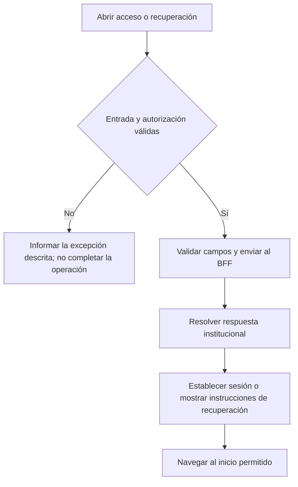

**Excepciones y alternativas**

- Fallo de perfil se distingue de credenciales inválidas.
- Recuperación no equivale a OTP vecinal de VIVI.
- No mostrar tokens ni respuesta interna completa.

**Objetos y persistencia**

Indirecto: api-autenticacion y ADMAUTEMETRA.TB_USUARIOS, TB_CLAVE_RECUPERACION y TB_CORREO_VALIDACION; el Panel no accede a Oracle.

**Archivos involucrados**

- [src/app/(auth)/forgot-password/page.tsx](https://github.com/EMETRA/Sistema-tickets/blob/926fe45d27922c595c63e8f79e1e82b1594470eb/src/app/%28auth%29/forgot-password/page.tsx)
- [src/app/(auth)/login/page.tsx](https://github.com/EMETRA/Sistema-tickets/blob/926fe45d27922c595c63e8f79e1e82b1594470eb/src/app/%28auth%29/login/page.tsx)
- [src/app/api/auth/recovery/route.ts](https://github.com/EMETRA/Sistema-tickets/blob/926fe45d27922c595c63e8f79e1e82b1594470eb/src/app/api/auth/recovery/route.ts)
- [src/app/api/graphql/route.ts](https://github.com/EMETRA/Sistema-tickets/blob/926fe45d27922c595c63e8f79e1e82b1594470eb/src/app/api/graphql/route.ts)
- [src/auth/constants.ts](https://github.com/EMETRA/Sistema-tickets/blob/926fe45d27922c595c63e8f79e1e82b1594470eb/src/auth/constants.ts)
- [src/auth/normalizeRole.ts](https://github.com/EMETRA/Sistema-tickets/blob/926fe45d27922c595c63e8f79e1e82b1594470eb/src/auth/normalizeRole.ts)
- [src/auth/recovery.server.ts](https://github.com/EMETRA/Sistema-tickets/blob/926fe45d27922c595c63e8f79e1e82b1594470eb/src/auth/recovery.server.ts)
- [src/auth/session.ts](https://github.com/EMETRA/Sistema-tickets/blob/926fe45d27922c595c63e8f79e1e82b1594470eb/src/auth/session.ts)
- [src/views/ForgotPassword/ForgotPassword.module.scss](https://github.com/EMETRA/Sistema-tickets/blob/926fe45d27922c595c63e8f79e1e82b1594470eb/src/views/ForgotPassword/ForgotPassword.module.scss)
- [src/views/ForgotPassword/ForgotPassword.tsx](https://github.com/EMETRA/Sistema-tickets/blob/926fe45d27922c595c63e8f79e1e82b1594470eb/src/views/ForgotPassword/ForgotPassword.tsx)
- [src/views/ForgotPassword/index.tsx](https://github.com/EMETRA/Sistema-tickets/blob/926fe45d27922c595c63e8f79e1e82b1594470eb/src/views/ForgotPassword/index.tsx)
- [src/views/Login/Login.module.scss](https://github.com/EMETRA/Sistema-tickets/blob/926fe45d27922c595c63e8f79e1e82b1594470eb/src/views/Login/Login.module.scss)
- [src/views/Login/Login.tsx](https://github.com/EMETRA/Sistema-tickets/blob/926fe45d27922c595c63e8f79e1e82b1594470eb/src/views/Login/Login.tsx)
- [src/views/Login/index.tsx](https://github.com/EMETRA/Sistema-tickets/blob/926fe45d27922c595c63e8f79e1e82b1594470eb/src/views/Login/index.tsx)

<a id="cu-02"></a>

## CU-02 · Consultar inicio, perfil y rendimiento personal

**Actor:** Usuario del Panel según su alcance.

**Precondiciones y entrada:** Sesión válida y capability o permiso del módulo; backend correspondiente configurado.

**Flujo y resultado**

1. Obtener sesión y bootstrap.
2. Seleccionar vista del actor y cargar indicadores.
3. Mostrar solicitudes, actividad y calendario autorizados.
4. Abrir perfil, estadísticas o detalle relacionado.

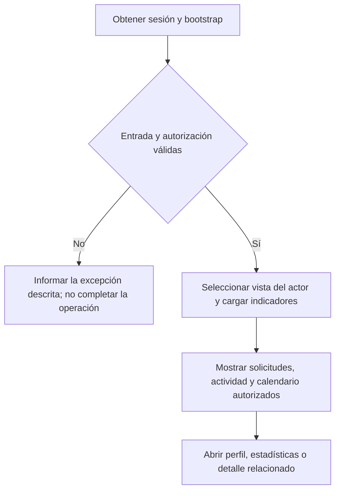

**Excepciones y alternativas**

- Indicador fallido conserva referencia y no inventa valores.
- Un nombre de perfil administrativo no cambia actor.admin.
- Listado vacío y carga fallida son estados distintos.

**Objetos y persistencia**

Indirecto: tickets e historial de ADMEMETRAIT y perfil en ADMAUTEMETRA mediante api-tickets; estadísticas son consultas remotas.

**Archivos involucrados**

- [src/app/(dashboard)/home/page.tsx](https://github.com/EMETRA/Sistema-tickets/blob/9d497b6ff471410ea5a96ba6df5e707ccebd8e43/src/app/%28dashboard%29/home/page.tsx)
- [src/app/(dashboard)/statistics/page.tsx](https://github.com/EMETRA/Sistema-tickets/blob/926fe45d27922c595c63e8f79e1e82b1594470eb/src/app/%28dashboard%29/statistics/page.tsx)
- [src/app/api/admin-dashboard/last-movements/route.ts](https://github.com/EMETRA/Sistema-tickets/blob/926fe45d27922c595c63e8f79e1e82b1594470eb/src/app/api/admin-dashboard/last-movements/route.ts)
- [src/app/api/admin-dashboard/last-ticket/route.ts](https://github.com/EMETRA/Sistema-tickets/blob/926fe45d27922c595c63e8f79e1e82b1594470eb/src/app/api/admin-dashboard/last-ticket/route.ts)
- [src/app/api/admin-dashboard/stats/route.ts](https://github.com/EMETRA/Sistema-tickets/blob/926fe45d27922c595c63e8f79e1e82b1594470eb/src/app/api/admin-dashboard/stats/route.ts)
- [src/app/api/admin-dashboard/team-members/route.ts](https://github.com/EMETRA/Sistema-tickets/blob/926fe45d27922c595c63e8f79e1e82b1594470eb/src/app/api/admin-dashboard/team-members/route.ts)
- [src/app/api/admin-dashboard/user-performance/route.ts](https://github.com/EMETRA/Sistema-tickets/blob/926fe45d27922c595c63e8f79e1e82b1594470eb/src/app/api/admin-dashboard/user-performance/route.ts)
- [src/app/api/annual-report/route.ts](https://github.com/EMETRA/Sistema-tickets/blob/926fe45d27922c595c63e8f79e1e82b1594470eb/src/app/api/annual-report/route.ts)
- [src/app/api/my-activity/route.ts](https://github.com/EMETRA/Sistema-tickets/blob/926fe45d27922c595c63e8f79e1e82b1594470eb/src/app/api/my-activity/route.ts)
- [src/app/api/my-stats/route.ts](https://github.com/EMETRA/Sistema-tickets/blob/926fe45d27922c595c63e8f79e1e82b1594470eb/src/app/api/my-stats/route.ts)
- [src/app/api/technician-events/route.ts](https://github.com/EMETRA/Sistema-tickets/blob/926fe45d27922c595c63e8f79e1e82b1594470eb/src/app/api/technician-events/route.ts)
- [src/app/api/technician-last-tickets/route.ts](https://github.com/EMETRA/Sistema-tickets/blob/926fe45d27922c595c63e8f79e1e82b1594470eb/src/app/api/technician-last-tickets/route.ts)
- [src/app/api/technician-stats/route.ts](https://github.com/EMETRA/Sistema-tickets/blob/926fe45d27922c595c63e8f79e1e82b1594470eb/src/app/api/technician-stats/route.ts)
- [src/app/api/usuario/[userId]/route.ts](https://github.com/EMETRA/Sistema-tickets/blob/926fe45d27922c595c63e8f79e1e82b1594470eb/src/app/api/usuario/%5BuserId%5D/route.ts)
- [src/app/api/usuario/route.ts](https://github.com/EMETRA/Sistema-tickets/blob/926fe45d27922c595c63e8f79e1e82b1594470eb/src/app/api/usuario/route.ts)
- [src/views/Home/Admin/AdminHome.module.scss](https://github.com/EMETRA/Sistema-tickets/blob/926fe45d27922c595c63e8f79e1e82b1594470eb/src/views/Home/Admin/AdminHome.module.scss)
- [src/views/Home/Admin/AdminHome.tsx](https://github.com/EMETRA/Sistema-tickets/blob/926fe45d27922c595c63e8f79e1e82b1594470eb/src/views/Home/Admin/AdminHome.tsx)
- [src/views/Home/Admin/index.tsx](https://github.com/EMETRA/Sistema-tickets/blob/926fe45d27922c595c63e8f79e1e82b1594470eb/src/views/Home/Admin/index.tsx)
- [src/views/Home/Admin/types.tsx](https://github.com/EMETRA/Sistema-tickets/blob/926fe45d27922c595c63e8f79e1e82b1594470eb/src/views/Home/Admin/types.tsx)
- [src/views/Home/Home.module.scss](https://github.com/EMETRA/Sistema-tickets/blob/926fe45d27922c595c63e8f79e1e82b1594470eb/src/views/Home/Home.module.scss)
- [src/views/Home/HomeHeading.tsx](https://github.com/EMETRA/Sistema-tickets/blob/926fe45d27922c595c63e8f79e1e82b1594470eb/src/views/Home/HomeHeading.tsx)
- [src/views/Home/Tech/TechHome.module.scss](https://github.com/EMETRA/Sistema-tickets/blob/926fe45d27922c595c63e8f79e1e82b1594470eb/src/views/Home/Tech/TechHome.module.scss)
- [src/views/Home/Tech/TechHome.tsx](https://github.com/EMETRA/Sistema-tickets/blob/926fe45d27922c595c63e8f79e1e82b1594470eb/src/views/Home/Tech/TechHome.tsx)
- [src/views/Home/Tech/index.tsx](https://github.com/EMETRA/Sistema-tickets/blob/926fe45d27922c595c63e8f79e1e82b1594470eb/src/views/Home/Tech/index.tsx)
- [src/views/Home/User/UserHome.module.scss](https://github.com/EMETRA/Sistema-tickets/blob/926fe45d27922c595c63e8f79e1e82b1594470eb/src/views/Home/User/UserHome.module.scss)
- [src/views/Home/User/UserHome.tsx](https://github.com/EMETRA/Sistema-tickets/blob/926fe45d27922c595c63e8f79e1e82b1594470eb/src/views/Home/User/UserHome.tsx)
- [src/views/Home/User/index.tsx](https://github.com/EMETRA/Sistema-tickets/blob/926fe45d27922c595c63e8f79e1e82b1594470eb/src/views/Home/User/index.tsx)
- [src/views/Platform/HomeWorkspace.module.scss](https://github.com/EMETRA/Sistema-tickets/blob/926fe45d27922c595c63e8f79e1e82b1594470eb/src/views/Platform/HomeWorkspace.module.scss)
- [src/views/Platform/HomeWorkspace.tsx](https://github.com/EMETRA/Sistema-tickets/blob/9d497b6ff471410ea5a96ba6df5e707ccebd8e43/src/views/Platform/HomeWorkspace.tsx)
- [src/views/Profile/Profile.module.scss](https://github.com/EMETRA/Sistema-tickets/blob/926fe45d27922c595c63e8f79e1e82b1594470eb/src/views/Profile/Profile.module.scss)
- [src/views/Profile/Profile.tsx](https://github.com/EMETRA/Sistema-tickets/blob/926fe45d27922c595c63e8f79e1e82b1594470eb/src/views/Profile/Profile.tsx)
- [src/views/Profile/index.tsx](https://github.com/EMETRA/Sistema-tickets/blob/926fe45d27922c595c63e8f79e1e82b1594470eb/src/views/Profile/index.tsx)
- [src/views/Statistics/Statistics.module.scss](https://github.com/EMETRA/Sistema-tickets/blob/926fe45d27922c595c63e8f79e1e82b1594470eb/src/views/Statistics/Statistics.module.scss)
- [src/views/Statistics/Statistics.tsx](https://github.com/EMETRA/Sistema-tickets/blob/926fe45d27922c595c63e8f79e1e82b1594470eb/src/views/Statistics/Statistics.tsx)
- [src/views/Statistics/index.tsx](https://github.com/EMETRA/Sistema-tickets/blob/926fe45d27922c595c63e8f79e1e82b1594470eb/src/views/Statistics/index.tsx)

<a id="cu-03"></a>

## CU-03 · Navegar aplicaciones, detectar desuso y bloquear acceso previo

**Actor:** Usuario del Panel según su alcance.

**Precondiciones y entrada:** Sesión válida y capability o permiso del módulo; backend correspondiente configurado.

**Flujo y resultado**

1. Cargar catálogo y capacidades.
2. Mostrar aplicaciones y módulos permitidos.
3. Comprobar acceso antes de habilitar formulario.
4. Entrar al módulo o mostrar denegación.
5. Identificar aplicaciones retiradas sin ejecutar sus procesos.

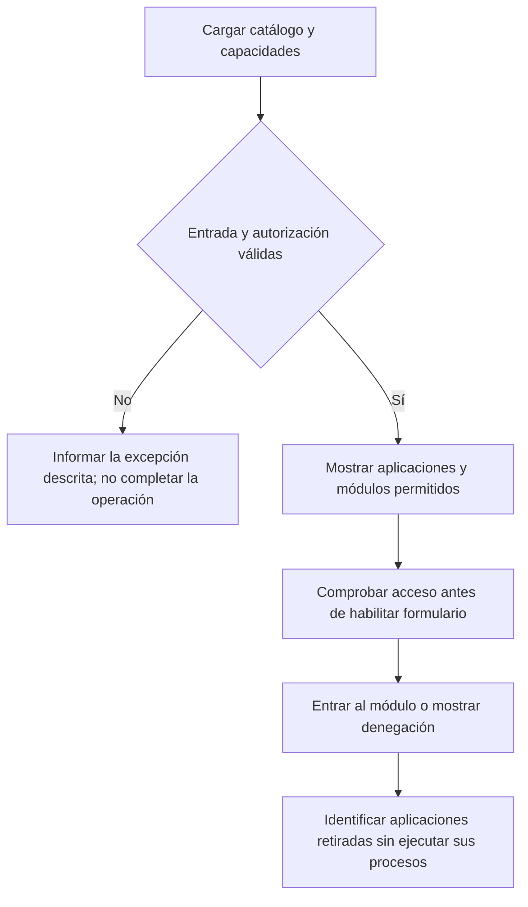

**Excepciones y alternativas**

- Catálogo no disponible no se sustituye por permisos abiertos.
- Funciones corporativas solo se accede desde Personas y accesos.
- MOD13, grabación LPR, los tres reportes semanales y los dos dashboards de Informática no se ofrecen como aplicaciones activas. Las métricas siguen en su sección.
- Consultar caso se ubica en Aplicaciones Juzgado → Consultas; solo se traslada si ya está autorizado en el catálogo. Notificar documento permanece en Jurídico.

**Objetos y persistencia**

Indirecto: catálogo y permisos de api-tickets; no consulta tablas desde el navegador.

**Archivos involucrados**

- [src/app/(dashboard)/aplicaciones/en-desuso/page.tsx](https://github.com/EMETRA/Sistema-tickets/blob/926fe45d27922c595c63e8f79e1e82b1594470eb/src/app/%28dashboard%29/aplicaciones/en-desuso/page.tsx)
- [src/app/(dashboard)/aplicaciones/page.tsx](https://github.com/EMETRA/Sistema-tickets/blob/926fe45d27922c595c63e8f79e1e82b1594470eb/src/app/%28dashboard%29/aplicaciones/page.tsx)
- [src/app/(dashboard)/home/[appId]/[sectionId]/SectionApps.module.scss](https://github.com/EMETRA/Sistema-tickets/blob/926fe45d27922c595c63e8f79e1e82b1594470eb/src/app/%28dashboard%29/home/%5BappId%5D/%5BsectionId%5D/SectionApps.module.scss)
- [src/app/(dashboard)/home/[appId]/[sectionId]/SectionAppsView.tsx](https://github.com/EMETRA/Sistema-tickets/blob/926fe45d27922c595c63e8f79e1e82b1594470eb/src/app/%28dashboard%29/home/%5BappId%5D/%5BsectionId%5D/SectionAppsView.tsx)
- [src/app/(dashboard)/home/[appId]/[sectionId]/[moduleId]/detail/page.tsx](https://github.com/EMETRA/Sistema-tickets/blob/926fe45d27922c595c63e8f79e1e82b1594470eb/src/app/%28dashboard%29/home/%5BappId%5D/%5BsectionId%5D/%5BmoduleId%5D/detail/page.tsx)
- [src/app/(dashboard)/home/[appId]/[sectionId]/[moduleId]/page.tsx](https://github.com/EMETRA/Sistema-tickets/blob/926fe45d27922c595c63e8f79e1e82b1594470eb/src/app/%28dashboard%29/home/%5BappId%5D/%5BsectionId%5D/%5BmoduleId%5D/page.tsx)
- [src/app/(dashboard)/home/[appId]/[sectionId]/page.tsx](https://github.com/EMETRA/Sistema-tickets/blob/926fe45d27922c595c63e8f79e1e82b1594470eb/src/app/%28dashboard%29/home/%5BappId%5D/%5BsectionId%5D/page.tsx)
- [src/app/(dashboard)/home/[appId]/error.tsx](https://github.com/EMETRA/Sistema-tickets/blob/926fe45d27922c595c63e8f79e1e82b1594470eb/src/app/%28dashboard%29/home/%5BappId%5D/error.tsx)
- [src/app/(dashboard)/home/[appId]/page.tsx](https://github.com/EMETRA/Sistema-tickets/blob/926fe45d27922c595c63e8f79e1e82b1594470eb/src/app/%28dashboard%29/home/%5BappId%5D/page.tsx)
- [src/app/api/apps-catalog/route.ts](https://github.com/EMETRA/Sistema-tickets/blob/926fe45d27922c595c63e8f79e1e82b1594470eb/src/app/api/apps-catalog/route.ts)
- [src/app/unauthorized/page.tsx](https://github.com/EMETRA/Sistema-tickets/blob/926fe45d27922c595c63e8f79e1e82b1594470eb/src/app/unauthorized/page.tsx)
- [src/config/app-registry.ts](https://github.com/EMETRA/Sistema-tickets/blob/b29ea52c21307f21bb49041ba2e8f76fb8080f44/src/config/app-registry.ts)
- [src/config/apps-access.ts](https://github.com/EMETRA/Sistema-tickets/blob/926fe45d27922c595c63e8f79e1e82b1594470eb/src/config/apps-access.ts)
- [src/config/apps-catalog.ts](https://github.com/EMETRA/Sistema-tickets/blob/e3f8676f5121223c9f23aaa036833260efe236f9/src/config/apps-catalog.ts)
- [src/config/constants.ts](https://github.com/EMETRA/Sistema-tickets/blob/926fe45d27922c595c63e8f79e1e82b1594470eb/src/config/constants.ts)
- [src/config/navigation.ts](https://github.com/EMETRA/Sistema-tickets/blob/926fe45d27922c595c63e8f79e1e82b1594470eb/src/config/navigation.ts)
- [src/config/protected-routes.ts](https://github.com/EMETRA/Sistema-tickets/blob/926fe45d27922c595c63e8f79e1e82b1594470eb/src/config/protected-routes.ts)
- [src/config/require-app-catalog.ts](https://github.com/EMETRA/Sistema-tickets/blob/926fe45d27922c595c63e8f79e1e82b1594470eb/src/config/require-app-catalog.ts)
- [src/config/route-access.ts](https://github.com/EMETRA/Sistema-tickets/blob/926fe45d27922c595c63e8f79e1e82b1594470eb/src/config/route-access.ts)
- [src/views/Applications/Applications.tsx](https://github.com/EMETRA/Sistema-tickets/blob/926fe45d27922c595c63e8f79e1e82b1594470eb/src/views/Applications/Applications.tsx)
- [src/views/MOD13/MOD13.module.scss](https://github.com/EMETRA/Sistema-tickets/blob/926fe45d27922c595c63e8f79e1e82b1594470eb/src/views/MOD13/MOD13.module.scss)
- [src/views/MOD13/MOD13.tsx](https://github.com/EMETRA/Sistema-tickets/blob/926fe45d27922c595c63e8f79e1e82b1594470eb/src/views/MOD13/MOD13.tsx)
- [src/views/MOD13/index.tsx](https://github.com/EMETRA/Sistema-tickets/blob/926fe45d27922c595c63e8f79e1e82b1594470eb/src/views/MOD13/index.tsx)
- [src/views/MOD13/types.tsx](https://github.com/EMETRA/Sistema-tickets/blob/926fe45d27922c595c63e8f79e1e82b1594470eb/src/views/MOD13/types.tsx)
- [src/views/PROC01/PROC01.module.scss](https://github.com/EMETRA/Sistema-tickets/blob/926fe45d27922c595c63e8f79e1e82b1594470eb/src/views/PROC01/PROC01.module.scss)
- [src/views/PROC01/PROC01.tsx](https://github.com/EMETRA/Sistema-tickets/blob/926fe45d27922c595c63e8f79e1e82b1594470eb/src/views/PROC01/PROC01.tsx)
- [src/views/PROC01/types.tsx](https://github.com/EMETRA/Sistema-tickets/blob/926fe45d27922c595c63e8f79e1e82b1594470eb/src/views/PROC01/types.tsx)
- [src/views/Platform/LegacyModuleBridge.tsx](https://github.com/EMETRA/Sistema-tickets/blob/926fe45d27922c595c63e8f79e1e82b1594470eb/src/views/Platform/LegacyModuleBridge.tsx)

<a id="cu-04"></a>

## CU-04 · Crear ticket y consultar listados

**Actor:** Usuario del Panel según su alcance.

**Precondiciones y entrada:** Sesión válida y capability o permiso del módulo; backend correspondiente configurado.

**Flujo y resultado**

1. Comprobar acceso y cargar catálogos.
2. Completar solicitud y archivos.
3. Validar y enviar creación al BFF.
4. Mostrar el registro confirmado.
5. Consultar tickets propios o cola autorizada.

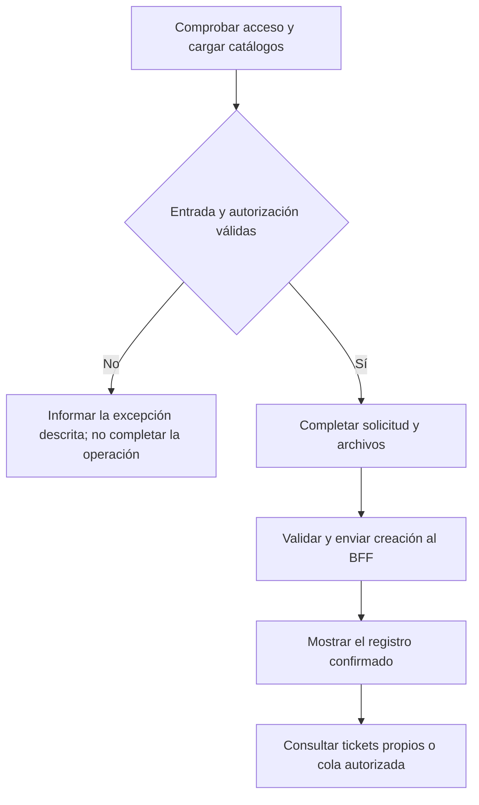

**Excepciones y alternativas**

- Catálogo vacío impide una selección válida y debe informarse.
- Error de creación conserva el formulario.
- No mostrar null como referencia ni asumir IDs fijos de estado.

**Objetos y persistencia**

Indirecto: ADMEMETRAIT.TB_TICKET, TB_TICKET_ESTADO, TB_TICKET_CATEGORIA, TB_TICKET_PRIORIDAD y adjuntos, a través de api-tickets.

**Archivos involucrados**

- [src/app/(dashboard)/mis-tickets/page.tsx](https://github.com/EMETRA/Sistema-tickets/blob/926fe45d27922c595c63e8f79e1e82b1594470eb/src/app/%28dashboard%29/mis-tickets/page.tsx)
- [src/app/(dashboard)/tickets-creation/page.tsx](https://github.com/EMETRA/Sistema-tickets/blob/926fe45d27922c595c63e8f79e1e82b1594470eb/src/app/%28dashboard%29/tickets-creation/page.tsx)
- [src/app/(dashboard)/tickets/page.tsx](https://github.com/EMETRA/Sistema-tickets/blob/926fe45d27922c595c63e8f79e1e82b1594470eb/src/app/%28dashboard%29/tickets/page.tsx)
- [src/app/api/catalogs/categories/route.ts](https://github.com/EMETRA/Sistema-tickets/blob/926fe45d27922c595c63e8f79e1e82b1594470eb/src/app/api/catalogs/categories/route.ts)
- [src/app/api/catalogs/priorities/route.ts](https://github.com/EMETRA/Sistema-tickets/blob/926fe45d27922c595c63e8f79e1e82b1594470eb/src/app/api/catalogs/priorities/route.ts)
- [src/app/api/catalogs/statuses/route.ts](https://github.com/EMETRA/Sistema-tickets/blob/926fe45d27922c595c63e8f79e1e82b1594470eb/src/app/api/catalogs/statuses/route.ts)
- [src/app/api/ticket-categories/route.ts](https://github.com/EMETRA/Sistema-tickets/blob/926fe45d27922c595c63e8f79e1e82b1594470eb/src/app/api/ticket-categories/route.ts)
- [src/app/api/ticket-priorities/route.ts](https://github.com/EMETRA/Sistema-tickets/blob/926fe45d27922c595c63e8f79e1e82b1594470eb/src/app/api/ticket-priorities/route.ts)
- [src/app/api/ticket-statuses/route.ts](https://github.com/EMETRA/Sistema-tickets/blob/926fe45d27922c595c63e8f79e1e82b1594470eb/src/app/api/ticket-statuses/route.ts)
- [src/app/api/tickets/route.ts](https://github.com/EMETRA/Sistema-tickets/blob/926fe45d27922c595c63e8f79e1e82b1594470eb/src/app/api/tickets/route.ts)
- [src/app/api/tickets/usuario/[userId]/route.ts](https://github.com/EMETRA/Sistema-tickets/blob/926fe45d27922c595c63e8f79e1e82b1594470eb/src/app/api/tickets/usuario/%5BuserId%5D/route.ts)
- [src/views/Tickets/Tickets.tsx](https://github.com/EMETRA/Sistema-tickets/blob/926fe45d27922c595c63e8f79e1e82b1594470eb/src/views/Tickets/Tickets.tsx)
- [src/views/TicketsCreation/TicketsCreation.module.scss](https://github.com/EMETRA/Sistema-tickets/blob/926fe45d27922c595c63e8f79e1e82b1594470eb/src/views/TicketsCreation/TicketsCreation.module.scss)
- [src/views/TicketsCreation/TicketsCreation.tsx](https://github.com/EMETRA/Sistema-tickets/blob/926fe45d27922c595c63e8f79e1e82b1594470eb/src/views/TicketsCreation/TicketsCreation.tsx)
- [src/views/TicketsCreation/index.tsx](https://github.com/EMETRA/Sistema-tickets/blob/926fe45d27922c595c63e8f79e1e82b1594470eb/src/views/TicketsCreation/index.tsx)

<a id="cu-05"></a>

## CU-05 · Conversar en un ticket y abrir adjuntos Word, Excel, PDF o imagen

**Actor:** Usuario del Panel según su alcance.

**Precondiciones y entrada:** Sesión válida y capability o permiso del módulo; backend correspondiente configurado.

**Flujo y resultado**

1. Abrir detalle y cargar conversación e historial.
2. Escribir comentario y adjuntar archivos.
3. Enviar mensaje conservando datos ante fallo.
4. Solicitar archivo mediante ruta protegida.
5. Mostrar visor compatible o descarga alternativa.

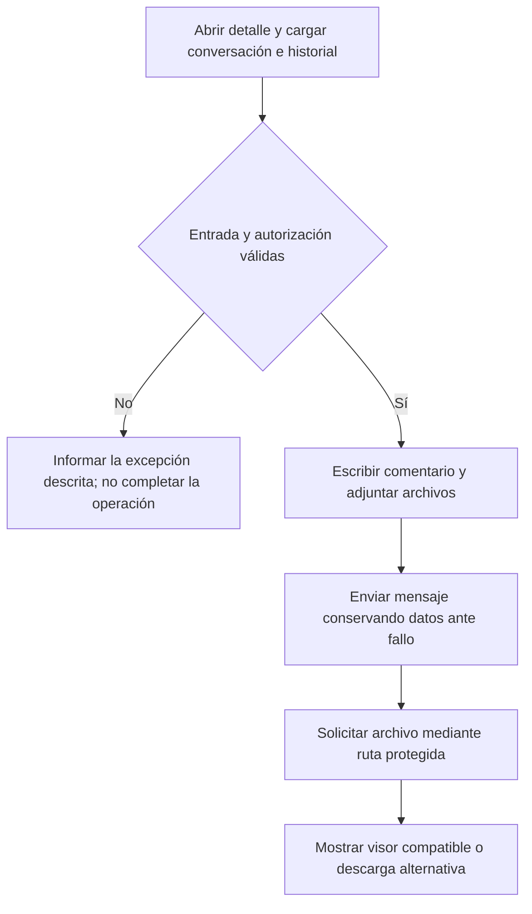

**Excepciones y alternativas**

- Comentario no debe requerir doble confirmación administrativa.
- NO_DISPONIBLE se correlaciona por referencia sin perder texto.
- Archivo sin permiso o inexistente no abre un visor vacío definitivo.
- No enviar el documento a conversores públicos.

**Objetos y persistencia**

Indirecto: TB_TICKET_MENSAJE, TB_TICKET_MENSAJE_ARCHIVO, TB_TICKET_ADJUNTO y TB_TICKET_HISTORIAL en ADMEMETRAIT; vista Office generada por backend con librerías locales.

**Archivos involucrados**

- [src/app/(dashboard)/mis-tickets/[ticketId]/page.tsx](https://github.com/EMETRA/Sistema-tickets/blob/926fe45d27922c595c63e8f79e1e82b1594470eb/src/app/%28dashboard%29/mis-tickets/%5BticketId%5D/page.tsx)
- [src/app/api/platform/[...path]/route.ts](https://github.com/EMETRA/Sistema-tickets/blob/b29ea52c21307f21bb49041ba2e8f76fb8080f44/src/app/api/platform/%5B...path%5D/route.ts)
- [src/app/api/ticket-attachments/[ticketId]/route.ts](https://github.com/EMETRA/Sistema-tickets/blob/926fe45d27922c595c63e8f79e1e82b1594470eb/src/app/api/ticket-attachments/%5BticketId%5D/route.ts)
- [src/app/api/ticket-history/[ticketId]/route.ts](https://github.com/EMETRA/Sistema-tickets/blob/926fe45d27922c595c63e8f79e1e82b1594470eb/src/app/api/ticket-history/%5BticketId%5D/route.ts)
- [src/app/api/ticket/[id]/attachments/route.ts](https://github.com/EMETRA/Sistema-tickets/blob/926fe45d27922c595c63e8f79e1e82b1594470eb/src/app/api/ticket/%5Bid%5D/attachments/route.ts)
- [src/app/api/ticket/[id]/history/route.ts](https://github.com/EMETRA/Sistema-tickets/blob/926fe45d27922c595c63e8f79e1e82b1594470eb/src/app/api/ticket/%5Bid%5D/history/route.ts)
- [src/app/api/ticket/[id]/messages/route.ts](https://github.com/EMETRA/Sistema-tickets/blob/926fe45d27922c595c63e8f79e1e82b1594470eb/src/app/api/ticket/%5Bid%5D/messages/route.ts)
- [src/app/api/ticket/[id]/route.ts](https://github.com/EMETRA/Sistema-tickets/blob/926fe45d27922c595c63e8f79e1e82b1594470eb/src/app/api/ticket/%5Bid%5D/route.ts)
- [src/views/Tickets/TicketView.tsx](https://github.com/EMETRA/Sistema-tickets/blob/926fe45d27922c595c63e8f79e1e82b1594470eb/src/views/Tickets/TicketView.tsx)

<a id="cu-06"></a>

## CU-06 · Asignar, etiquetar y resolver tickets

**Actor:** Usuario del Panel según su alcance.

**Precondiciones y entrada:** Sesión válida y capability o permiso del módulo; backend correspondiente configurado.

**Flujo y resultado**

1. Consultar cola y responsables disponibles.
2. Revisar asignación y confirmar la acción requerida.
3. Agregar etiquetas desde el input de selección.
4. Ejecutar transición permitida.
5. Exigir etiqueta antes de resolver.

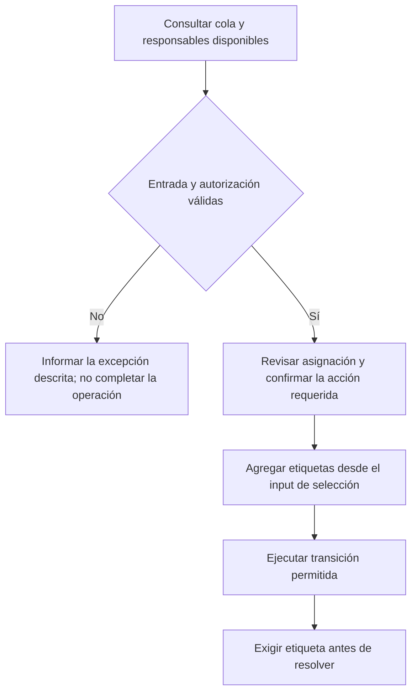

**Excepciones y alternativas**

- Ticket sin etiqueta no se resuelve.
- Confirmación para otra acción no se reutiliza.
- Responsable no autorizado no aparece como asignación válida.

**Objetos y persistencia**

Indirecto: TB_TICKET, TB_TK_TICKET_CONTROL, TB_TICKET_TAG y TB_TICKET_TAG_REL; comandos y confirmaciones de api-tickets.

**Archivos involucrados**

- [src/api/hooks/useAddTagToTicket.ts](https://github.com/EMETRA/Sistema-tickets/blob/926fe45d27922c595c63e8f79e1e82b1594470eb/src/api/hooks/useAddTagToTicket.ts)
- [src/api/hooks/useRemoveTagFromTicket.ts](https://github.com/EMETRA/Sistema-tickets/blob/926fe45d27922c595c63e8f79e1e82b1594470eb/src/api/hooks/useRemoveTagFromTicket.ts)
- [src/app/api/ticket-tag-catalog/route.ts](https://github.com/EMETRA/Sistema-tickets/blob/926fe45d27922c595c63e8f79e1e82b1594470eb/src/app/api/ticket-tag-catalog/route.ts)
- [src/app/api/ticket-tags/[ticketId]/route.ts](https://github.com/EMETRA/Sistema-tickets/blob/926fe45d27922c595c63e8f79e1e82b1594470eb/src/app/api/ticket-tags/%5BticketId%5D/route.ts)
- [src/views/Platform/AssignmentsWorkspace.tsx](https://github.com/EMETRA/Sistema-tickets/blob/926fe45d27922c595c63e8f79e1e82b1594470eb/src/views/Platform/AssignmentsWorkspace.tsx)
- [src/views/Tickets/TicketView.tsx](https://github.com/EMETRA/Sistema-tickets/blob/926fe45d27922c595c63e8f79e1e82b1594470eb/src/views/Tickets/TicketView.tsx)

<a id="cu-07"></a>

## CU-07 · Administrar personas, perfiles, roles y permisos

**Actor:** Usuario del Panel según su alcance.

**Precondiciones y entrada:** Sesión válida y capability o permiso del módulo; backend correspondiente configurado.

**Flujo y resultado**

1. Entrar con capacidades administrativas.
2. Navegar usuarios, perfiles, roles, módulos y permisos.
3. Consultar y revisar el cambio de acceso.
4. Confirmar comando y refrescar acceso efectivo.
5. Tramitar solicitud o provisión cuando corresponda.

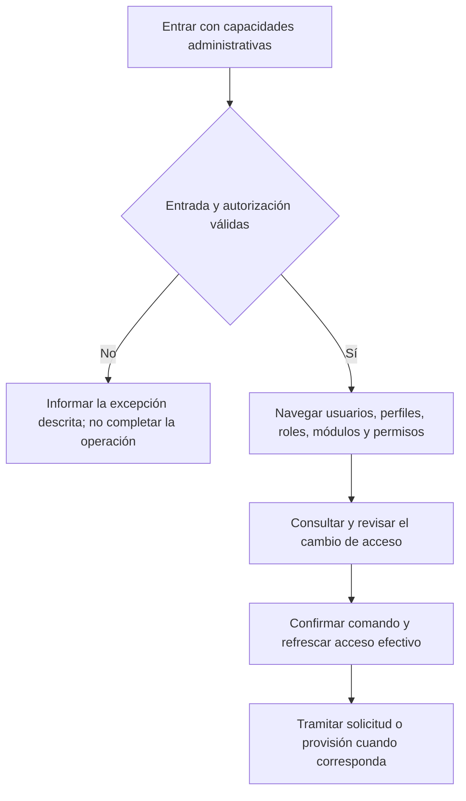

**Excepciones y alternativas**

- actor.admin falso no se corrige cambiando solo el menú.
- Error del catálogo no habilita acciones.
- Concesión de aplicación no otorga privilegios Oracle.

**Objetos y persistencia**

Indirecto: ADMAUTEMETRA, ADMEMETRAIDENTIDAD.TB_TK_USUARIO_ROL/TB_TK_USUARIO_PERM y solicitudes/confirmaciones de plataforma.

**Archivos involucrados**

- [src/app/(dashboard)/config/page.tsx](https://github.com/EMETRA/Sistema-tickets/blob/926fe45d27922c595c63e8f79e1e82b1594470eb/src/app/%28dashboard%29/config/page.tsx)
- [src/app/(dashboard)/usuarios/[id]/page.tsx](https://github.com/EMETRA/Sistema-tickets/blob/926fe45d27922c595c63e8f79e1e82b1594470eb/src/app/%28dashboard%29/usuarios/%5Bid%5D/page.tsx)
- [src/app/(dashboard)/usuarios/page.tsx](https://github.com/EMETRA/Sistema-tickets/blob/926fe45d27922c595c63e8f79e1e82b1594470eb/src/app/%28dashboard%29/usuarios/page.tsx)
- [src/app/api/configuration/pending-requests/route.ts](https://github.com/EMETRA/Sistema-tickets/blob/926fe45d27922c595c63e8f79e1e82b1594470eb/src/app/api/configuration/pending-requests/route.ts)
- [src/app/api/rbac/roles/route.ts](https://github.com/EMETRA/Sistema-tickets/blob/926fe45d27922c595c63e8f79e1e82b1594470eb/src/app/api/rbac/roles/route.ts)
- [src/app/api/users/route.ts](https://github.com/EMETRA/Sistema-tickets/blob/926fe45d27922c595c63e8f79e1e82b1594470eb/src/app/api/users/route.ts)
- [src/views/Configuration/Configuration.module.scss](https://github.com/EMETRA/Sistema-tickets/blob/926fe45d27922c595c63e8f79e1e82b1594470eb/src/views/Configuration/Configuration.module.scss)
- [src/views/Configuration/Configuration.tsx](https://github.com/EMETRA/Sistema-tickets/blob/926fe45d27922c595c63e8f79e1e82b1594470eb/src/views/Configuration/Configuration.tsx)
- [src/views/Configuration/index.tsx](https://github.com/EMETRA/Sistema-tickets/blob/926fe45d27922c595c63e8f79e1e82b1594470eb/src/views/Configuration/index.tsx)
- [src/views/Platform/AccessWorkspace.tsx](https://github.com/EMETRA/Sistema-tickets/blob/926fe45d27922c595c63e8f79e1e82b1594470eb/src/views/Platform/AccessWorkspace.tsx)
- [src/views/Users/Users.module.scss](https://github.com/EMETRA/Sistema-tickets/blob/926fe45d27922c595c63e8f79e1e82b1594470eb/src/views/Users/Users.module.scss)
- [src/views/Users/Users.tsx](https://github.com/EMETRA/Sistema-tickets/blob/926fe45d27922c595c63e8f79e1e82b1594470eb/src/views/Users/Users.tsx)
- [src/views/Users/index.tsx](https://github.com/EMETRA/Sistema-tickets/blob/926fe45d27922c595c63e8f79e1e82b1594470eb/src/views/Users/index.tsx)

<a id="cu-08"></a>

## CU-08 · Consultar y modificar funciones corporativas autorizadas

**Actor:** Usuario del Panel según su alcance.

**Precondiciones y entrada:** Sesión válida y capability o permiso del módulo; backend correspondiente configurado.

**Flujo y resultado**

1. Comprobar permiso antes del formulario.
2. Cargar empresas, usuarios y aplicaciones.
3. Consultar funciones de la selección.
4. Editar dentro de un contenedor de lista limitado.
5. Guardar o confirmar copia entre usuarios.

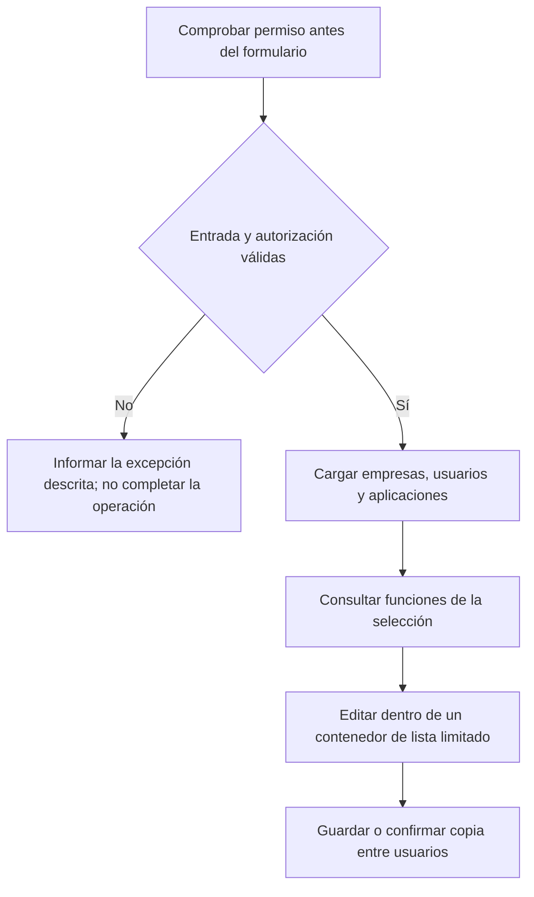

**Excepciones y alternativas**

- Catálogos fallidos ofrecen reintento sin borrar la selección.
- Lista larga no debe extender la página sin control.
- Copiar todas las aplicaciones requiere advertencia de alcance.

**Objetos y persistencia**

Indirecto: ADMINSIAF.TB_EMPRESA, TB_ASIGNA_USUARIOS, TB_APLICACIONES, TB_FUNCIONES y TB_FUNCIONES_POR_USUARIOS mediante api-tickets.

**Archivos involucrados**

- [src/app/api/MOD06/aplicaciones/route.ts](https://github.com/EMETRA/Sistema-tickets/blob/926fe45d27922c595c63e8f79e1e82b1594470eb/src/app/api/MOD06/aplicaciones/route.ts)
- [src/app/api/MOD06/empresas/route.ts](https://github.com/EMETRA/Sistema-tickets/blob/926fe45d27922c595c63e8f79e1e82b1594470eb/src/app/api/MOD06/empresas/route.ts)
- [src/app/api/MOD06/permisos/route.ts](https://github.com/EMETRA/Sistema-tickets/blob/926fe45d27922c595c63e8f79e1e82b1594470eb/src/app/api/MOD06/permisos/route.ts)
- [src/app/api/MOD06/usuarios/route.ts](https://github.com/EMETRA/Sistema-tickets/blob/926fe45d27922c595c63e8f79e1e82b1594470eb/src/app/api/MOD06/usuarios/route.ts)
- [src/views/MOD06/MOD06.module.scss](https://github.com/EMETRA/Sistema-tickets/blob/926fe45d27922c595c63e8f79e1e82b1594470eb/src/views/MOD06/MOD06.module.scss)
- [src/views/MOD06/MOD06.tsx](https://github.com/EMETRA/Sistema-tickets/blob/926fe45d27922c595c63e8f79e1e82b1594470eb/src/views/MOD06/MOD06.tsx)
- [src/views/MOD06/index.tsx](https://github.com/EMETRA/Sistema-tickets/blob/926fe45d27922c595c63e8f79e1e82b1594470eb/src/views/MOD06/index.tsx)

<a id="cu-09"></a>

## CU-09 · Consultar calendario semanal y actividades

**Actor:** Usuario del Panel según su alcance.

**Precondiciones y entrada:** Sesión válida y capability o permiso del módulo; backend correspondiente configurado.

**Flujo y resultado**

1. Obtener actividades dentro del alcance.
2. Elegir equipo, general y periodo.
3. Ubicar eventos por día y hora institucional.
4. Consultar detalle o cambiar semana.
5. Refrescar conservando filtros.

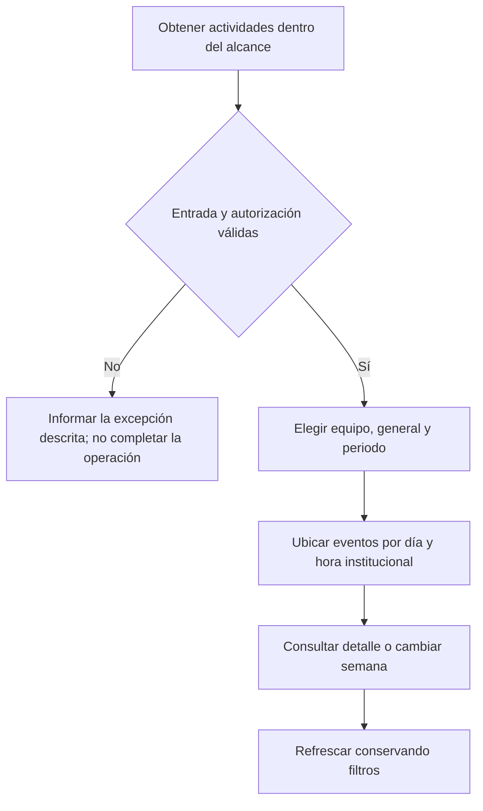

**Excepciones y alternativas**

- No mostrar eventos de otro equipo sin autorización.
- Lista vacía no es fallo de carga.
- Evitar duplicar encabezados y mantener alternativa accesible.

**Objetos y persistencia**

Indirecto: ADMEMETRAIT.TB_TK_ACTIVIDADES y equipos de plataforma.

**Archivos involucrados**

- [src/platform/calendar.ts](https://github.com/EMETRA/Sistema-tickets/blob/926fe45d27922c595c63e8f79e1e82b1594470eb/src/platform/calendar.ts)
- [src/platform/dates.ts](https://github.com/EMETRA/Sistema-tickets/blob/926fe45d27922c595c63e8f79e1e82b1594470eb/src/platform/dates.ts)
- [src/views/Platform/CalendarWorkspace.module.scss](https://github.com/EMETRA/Sistema-tickets/blob/926fe45d27922c595c63e8f79e1e82b1594470eb/src/views/Platform/CalendarWorkspace.module.scss)
- [src/views/Platform/CalendarWorkspace.tsx](https://github.com/EMETRA/Sistema-tickets/blob/926fe45d27922c595c63e8f79e1e82b1594470eb/src/views/Platform/CalendarWorkspace.tsx)

<a id="cu-10"></a>

## CU-10 · Consultar personal y administrar equipos de trabajo

**Actores:** Administración para el directorio institucional y sincronización; usuarios con permisos de organización para sus equipos y responsabilidades.

**Flujo y resultado**

1. Abrir Personal y equipos. Administración ve automáticamente Personal de RRHH, incluidos empleados activos sin cuenta o con nombre de unidad pendiente.
2. Buscar por persona, código, puesto o unidad; filtrar y paginar. Abrir el perfil cuando existe una cuenta habilitada inequívoca o Ver bienes para ir al inventario filtrado por empleado.
3. Equipos de trabajo consulta grupos de personas; el nombre abre su ficha y desde allí se puede ir al inventario del equipo.
4. Responsabilidades permite filtrar el equipo y gestionar funciones de miembros con cuenta. El formulario comienza con el equipo elegido.
5. Sincronizar equipos desde RRHH se despliega dentro de Equipos de trabajo. Consultar cambios presenta unidades y diferencias; confirmar conserva las dos confirmaciones administrativas. Un conflicto mantiene la vista previa y requiere actualizarla.
6. El acceso antiguo Equipo redirige a este espacio cuando está autorizado. No aparece una segunda entrada para el mismo directorio; los usuarios sin el módulo conservan su directorio heredado permitido.

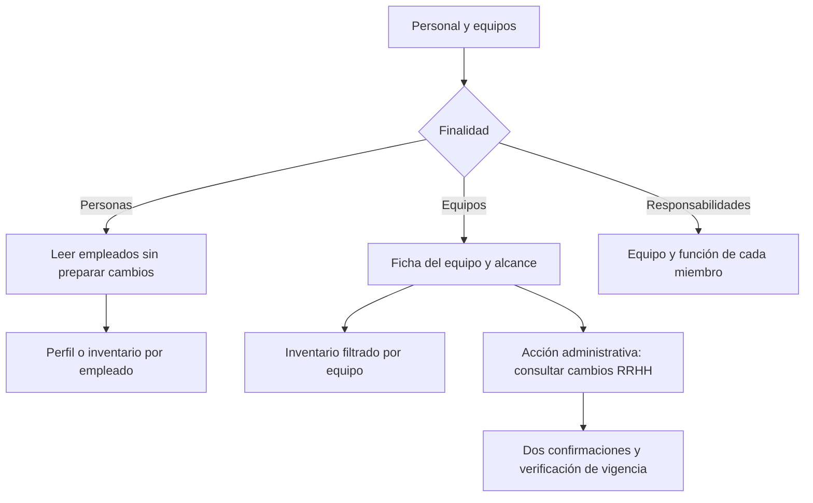

**Excepciones y alternativas**

- Sin cuenta en Tickets no se ofrece un perfil ni se concede acceso, pero los bienes se consultan por código de empleado si el actor está autorizado.
- Unidades sin catálogo vigente muestran código/nombre pendiente; no usan nombres antiguos ni generan jefaturas automáticamente.
- Cuenta con varios vínculos no abre un perfil elegido arbitrariamente.
- Accesos al sistema se gestionan en Personas y accesos; una responsabilidad de equipo no reemplaza esos permisos.
- Lectura del personal, vista previa y aplicación son operaciones distintas; abrir la pantalla no ejecuta cambios.

Implementación: [directorio y tareas](https://github.com/EMETRA/Sistema-tickets/blob/db60d821fdbc9b5e2cee31f98cc7422626a4ff22/src/views/Platform/OrganizationWorkspace.tsx), [sincronización](https://github.com/EMETRA/Sistema-tickets/blob/db60d821fdbc9b5e2cee31f98cc7422626a4ff22/src/views/Platform/OrganizationSync.tsx), [personal](https://github.com/EMETRA/Sistema-tickets/blob/db60d821fdbc9b5e2cee31f98cc7422626a4ff22/src/components/client/organisms/OrganizationPeople/OrganizationPeople.tsx), [compatibilidad Equipo](https://github.com/EMETRA/Sistema-tickets/blob/db60d821fdbc9b5e2cee31f98cc7422626a4ff22/src/views/Team/Team.tsx), [perfil y bienes asignados](https://github.com/EMETRA/Sistema-tickets/blob/db60d821fdbc9b5e2cee31f98cc7422626a4ff22/src/views/Profile/Profile.tsx).

**Objetos y persistencia**

Indirecto: ADMINSIAF.TB_EMPLEADOS, TB_ASIGNACION_PROGRAMATICA y TB_UNIDADES_P; equipos y miembros de ADMEMETRAIT.

**Archivos involucrados**

- [src/app/(dashboard)/equipo/[id]/page.tsx](https://github.com/EMETRA/Sistema-tickets/blob/db60d821fdbc9b5e2cee31f98cc7422626a4ff22/src/app/%28dashboard%29/equipo/%5Bid%5D/page.tsx)
- [src/app/(dashboard)/equipo/page.tsx](https://github.com/EMETRA/Sistema-tickets/blob/db60d821fdbc9b5e2cee31f98cc7422626a4ff22/src/app/%28dashboard%29/equipo/page.tsx)
- [src/app/api/departments/route.ts](https://github.com/EMETRA/Sistema-tickets/blob/db60d821fdbc9b5e2cee31f98cc7422626a4ff22/src/app/api/departments/route.ts)
- [src/app/api/perfil-equipo/route.ts](https://github.com/EMETRA/Sistema-tickets/blob/db60d821fdbc9b5e2cee31f98cc7422626a4ff22/src/app/api/perfil-equipo/route.ts)
- [src/views/Platform/OrganizationWorkspace.tsx](https://github.com/EMETRA/Sistema-tickets/blob/db60d821fdbc9b5e2cee31f98cc7422626a4ff22/src/views/Platform/OrganizationWorkspace.tsx)
- [src/views/Team/Team.module.scss](https://github.com/EMETRA/Sistema-tickets/blob/db60d821fdbc9b5e2cee31f98cc7422626a4ff22/src/views/Team/Team.module.scss)
- [src/views/Team/Team.tsx](https://github.com/EMETRA/Sistema-tickets/blob/db60d821fdbc9b5e2cee31f98cc7422626a4ff22/src/views/Team/Team.tsx)
- [src/views/Team/index.tsx](https://github.com/EMETRA/Sistema-tickets/blob/db60d821fdbc9b5e2cee31f98cc7422626a4ff22/src/views/Team/index.tsx)

<a id="cu-11"></a>

## CU-11 · Consultar bienes, registrar atención y configurar la red

**Actor:** Usuario con permiso de lectura y, para cambios, la acción correspondiente sobre el registro.

**Flujo y resultado**

1. Activos y mantenimiento abre Inventario de bienes automáticamente, con `offset=0`. Buscar por empleado, tarjeta, número, descripción o serie; distinguir ausencia de bienes, metadatos incompletos y error/reintento.
2. Ver ficha abre una ficha técnica existente y autorizada; Crear ficha técnica prepara datos de origen, para completar responsable y características en Tickets. Fichas técnicas consulta únicamente los registros locales, con columnas de inventario, tipo, serie, ubicación y técnico.
3. Mantenimientos y visitas registra trabajos y próximas revisiones. Ubicaciones mantiene el catálogo compartido por bienes y red. Movimientos es la bitácora de una operación autorizada, sin modificar la tarjeta oficial.
4. Red y cableado abre Dispositivos, mostrando inventario, ubicación y puertos. Vincular bien de Activos Fijos abre una búsqueda; seleccionar el bien y completar ubicación/puertos prepara el dispositivo. Las confirmaciones existentes se conservan; después de guardar se cierra la búsqueda y recarga el listado.
5. Conexiones gestiona los puertos de origen/destino y el medio del enlace. Mapa de red visualiza esos mismos dispositivos y conexiones por ubicación; mantiene los controles y autorización de edición del plano.
6. Administrar ubicaciones lleva al único catálogo en Activos y mantenimiento. El parámetro `view` identifica la tarea y el historial permite volver a la pestaña anterior.

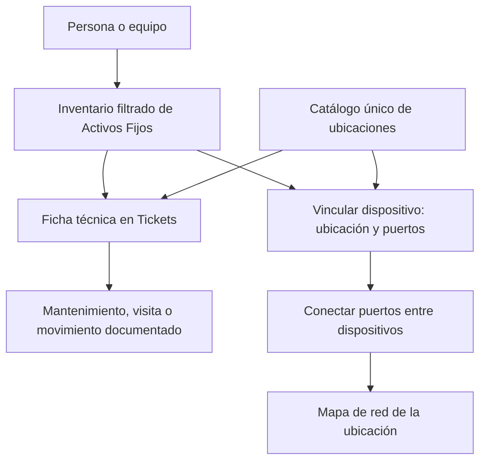

**Excepciones y alternativas**

- Una versión antigua del API que exige empleado rechaza la carga inicial; comprobar el código compilado y reconstruir desde QA. No cambiar datos ni retirar validaciones para ocultar ese problema.
- Un bien sin detalle de origen se muestra como consulta; no se ofrece crear una ficha incompleta. Se distingue inventario de número de tarjeta.
- Las lecturas cancelan solicitudes obsoletas. Errores y listas vacías no muestran bienes de un alcance anterior.
- No se crean ubicaciones, fichas, puertos, conexiones ni movimientos al consultar. La clase sugerida por descripción se revisa antes de guardar.
- Las referencias privadas no revelan sus nombres en las tablas; el API resuelve etiquetas por lote y aplica el alcance de cada recurso.
- Buscar dentro de un formulario no lo guarda. Crear o modificar mantiene permisos, versiones, idempotencia y confirmaciones del contrato existente.

Implementación: [tareas de activos](https://github.com/EMETRA/Sistema-tickets/blob/db60d821fdbc9b5e2cee31f98cc7422626a4ff22/src/views/Platform/AssetsWorkspace.tsx), [red](https://github.com/EMETRA/Sistema-tickets/blob/db60d821fdbc9b5e2cee31f98cc7422626a4ff22/src/views/Platform/NetworkWorkspace.tsx), [vinculación](https://github.com/EMETRA/Sistema-tickets/blob/db60d821fdbc9b5e2cee31f98cc7422626a4ff22/src/views/Platform/InventoryLinkDialog.tsx), [columnas y nombres](https://github.com/EMETRA/Sistema-tickets/blob/db60d821fdbc9b5e2cee31f98cc7422626a4ff22/src/platform/resources.ts), [listados](https://github.com/EMETRA/Sistema-tickets/blob/db60d821fdbc9b5e2cee31f98cc7422626a4ff22/src/components/client/organisms/ResourceWorkspace/ResourceWorkspace.tsx), [búsqueda de inventario](https://github.com/EMETRA/Sistema-tickets/blob/db60d821fdbc9b5e2cee31f98cc7422626a4ff22/src/components/client/organisms/ResourceWorkspace/InventoryPicker.tsx). [Actualización del API y comprobación de versión](https://github.com/EMETRA/api-tickets/blob/e077b221b4efdd01c60b7051331bea6b5392a13d/docs/guia-inventario-activos-fijos.md).

**Objetos y persistencia**

Indirecto: ADMEMETRAIT.TB_TK_ACTIVOS, TB_TK_INTERVENCIONES, TB_TK_MOV_ACTIVOS, TB_TK_RED_DISPOSITIVOS y TB_TK_RED_ENLACES; inventario fuente retenido en ADMEMETRA.

**Contrato y verificación**

[Fuente, permisos y diagnóstico del API](https://github.com/EMETRA/api-tickets/blob/e077b221b4efdd01c60b7051331bea6b5392a13d/docs/guia-inventario-activos-fijos.md). [Prueba de navegador](https://github.com/EMETRA/Sistema-tickets/blob/db60d821fdbc9b5e2cee31f98cc7422626a4ff22/test/integracion/inventario-browser.cjs): carga automática, filtros, paginación, error/reintento, preparación, ausencia de formularios anidados, red, perfil, permisos y móvil con datos ficticios. No se comprobó Oracle institucional desde este entorno.

**Archivos involucrados**

- [InventoryPicker / InventoryCatalog](https://github.com/EMETRA/Sistema-tickets/blob/db60d821fdbc9b5e2cee31f98cc7422626a4ff22/src/components/client/organisms/ResourceWorkspace/InventoryPicker.tsx)
- [InventoryWorkspace](https://github.com/EMETRA/Sistema-tickets/blob/db60d821fdbc9b5e2cee31f98cc7422626a4ff22/src/components/client/organisms/ResourceWorkspace/InventoryWorkspace.tsx)
- [ResourceWorkspace](https://github.com/EMETRA/Sistema-tickets/blob/db60d821fdbc9b5e2cee31f98cc7422626a4ff22/src/components/client/organisms/ResourceWorkspace/ResourceWorkspace.tsx)
- [RecordEditor](https://github.com/EMETRA/Sistema-tickets/blob/db60d821fdbc9b5e2cee31f98cc7422626a4ff22/src/components/client/organisms/ResourceWorkspace/RecordEditor.tsx)

- [src/app/(dashboard)/espacio/registro/[type]/[id]/page.tsx](https://github.com/EMETRA/Sistema-tickets/blob/db60d821fdbc9b5e2cee31f98cc7422626a4ff22/src/app/%28dashboard%29/espacio/registro/%5Btype%5D/%5Bid%5D/page.tsx)
- [src/views/Platform/NetworkWorkspace.tsx](https://github.com/EMETRA/Sistema-tickets/blob/db60d821fdbc9b5e2cee31f98cc7422626a4ff22/src/views/Platform/NetworkWorkspace.tsx)
- [src/views/Platform/RecordPage.tsx](https://github.com/EMETRA/Sistema-tickets/blob/db60d821fdbc9b5e2cee31f98cc7422626a4ff22/src/views/Platform/RecordPage.tsx)

<a id="cu-12"></a>

## CU-12 · Consultar servidores, contenedores y logs observados

**Actor:** Usuario del Panel según su alcance.

**Precondiciones y entrada:** Sesión válida y capability o permiso del módulo; backend correspondiente configurado.

**Flujo y resultado**

1. Abrir Estado observado y elegir servidor.
2. Leer snapshot y fecha de actualización.
3. Seleccionar contenedor y métricas.
4. Mostrar líneas de log autorizadas si fueron enviadas.
5. Actualizar sin ejecutar comandos en el servidor.

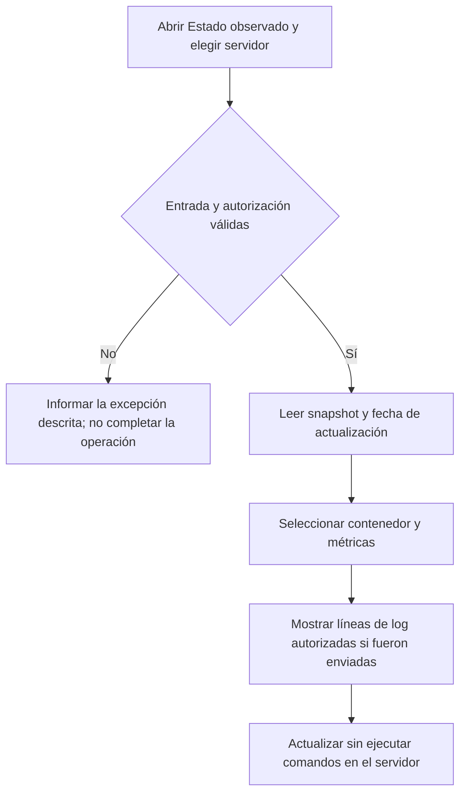

**Excepciones y alternativas**

- Sin líneas de log se informa ausencia de captura.
- Snapshot antiguo no se muestra como lectura en tiempo real.
- El Panel no obtiene por sí mismo acceso al socket Docker.

**Objetos y persistencia**

Indirecto: ADMEMETRAIT.TB_TK_SERVIDORES, TB_TK_CONTENEDORES y TB_TK_OBSERVACIONES; observador Python instalado en cada servidor.

**Archivos involucrados**

- [src/platform/monitoring.ts](https://github.com/EMETRA/Sistema-tickets/blob/926fe45d27922c595c63e8f79e1e82b1594470eb/src/platform/monitoring.ts)
- [src/views/Platform/MonitoringWorkspace.tsx](https://github.com/EMETRA/Sistema-tickets/blob/926fe45d27922c595c63e8f79e1e82b1594470eb/src/views/Platform/MonitoringWorkspace.tsx)

<a id="cu-13"></a>

## CU-13 · Vincular aplicaciones con GitHub y objetos Oracle

**Actor:** Usuario del Panel según su alcance.

**Precondiciones y entrada:** Sesión válida y capability o permiso del módulo; backend correspondiente configurado.

**Flujo y resultado**

1. Entrar en Aplicaciones y sistemas con permiso.
2. Consultar fuentes y filtrar owner o esquema.
3. Elegir repositorio, rama u objeto real.
4. Revisar y confirmar vinculación.
5. Recargar la ficha con las referencias guardadas.

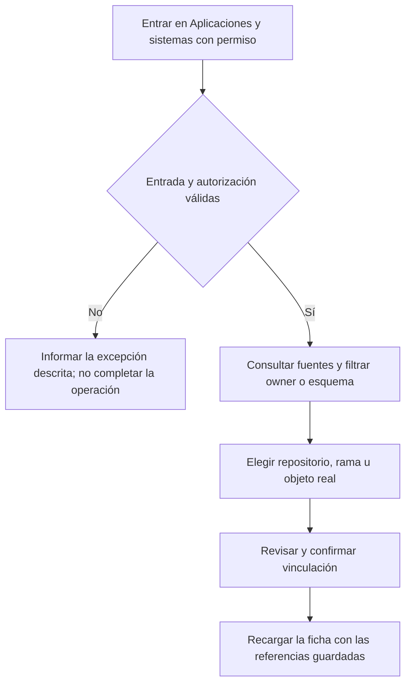

**Excepciones y alternativas**

- GitHub sin credencial muestra configuración pendiente.
- No aceptar identificadores libres como si se hubieran descubierto.
- La operación no crea objetos Oracle ni otorga permisos.

**Objetos y persistencia**

Indirecto: metadatos consultados por api-tickets, GitHub REST y registros TB_TK_APLICACIONES/TB_TK_REPOSITORIOS/TB_TK_ESQUEMAS.

**Archivos involucrados**

- [src/components/client/organisms/SourceCatalog/SourceCatalog.module.scss](https://github.com/EMETRA/Sistema-tickets/blob/926fe45d27922c595c63e8f79e1e82b1594470eb/src/components/client/organisms/SourceCatalog/SourceCatalog.module.scss)
- [src/components/client/organisms/SourceCatalog/SourceCatalog.tsx](https://github.com/EMETRA/Sistema-tickets/blob/926fe45d27922c595c63e8f79e1e82b1594470eb/src/components/client/organisms/SourceCatalog/SourceCatalog.tsx)
- [src/platform/client.ts](https://github.com/EMETRA/Sistema-tickets/blob/926fe45d27922c595c63e8f79e1e82b1594470eb/src/platform/client.ts)
- [src/views/Platform/SystemsWorkspace.tsx](https://github.com/EMETRA/Sistema-tickets/blob/926fe45d27922c595c63e8f79e1e82b1594470eb/src/views/Platform/SystemsWorkspace.tsx)

<a id="cu-14"></a>

## CU-14 · Consultar métricas, reportes por etiqueta y trazabilidad

**Actor:** Usuario del Panel según su alcance.

**Precondiciones y entrada:** Sesión válida y capability o permiso del módulo; backend correspondiente configurado.

**Flujo y resultado**

1. Seleccionar periodo y alcance.
2. Consultar indicadores confirmados.
3. Diferenciar tickets de operaciones de aplicaciones.
4. Abrir registros que forman el indicador.
5. Consultar reporte por técnico y etiqueta o auditoría.

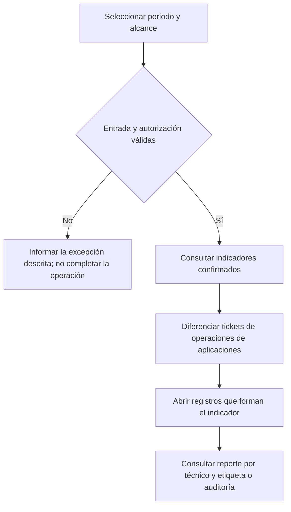

**Excepciones y alternativas**

- Cero eventos no se reemplaza por visitas.
- Indicadores fallidos no se muestran como cero confirmado.
- Actor sin alcance no consulta métricas globales.

**Objetos y persistencia**

Indirecto: ADMEMETRAAUDITORIA.TB_TK_METRICA_EVENTO/TB_TK_AUDITORIA y tickets/etiquetas en ADMEMETRAIT.

**Archivos involucrados**

- [src/platform/metrics.ts](https://github.com/EMETRA/Sistema-tickets/blob/926fe45d27922c595c63e8f79e1e82b1594470eb/src/platform/metrics.ts)
- [src/platform/ticket-reports.ts](https://github.com/EMETRA/Sistema-tickets/blob/926fe45d27922c595c63e8f79e1e82b1594470eb/src/platform/ticket-reports.ts)
- [src/views/Platform/AuditWorkspace.tsx](https://github.com/EMETRA/Sistema-tickets/blob/926fe45d27922c595c63e8f79e1e82b1594470eb/src/views/Platform/AuditWorkspace.tsx)
- [src/views/Platform/MetricsWorkspace.tsx](https://github.com/EMETRA/Sistema-tickets/blob/926fe45d27922c595c63e8f79e1e82b1594470eb/src/views/Platform/MetricsWorkspace.tsx)
- [src/views/Platform/TicketTagReport.module.scss](https://github.com/EMETRA/Sistema-tickets/blob/926fe45d27922c595c63e8f79e1e82b1594470eb/src/views/Platform/TicketTagReport.module.scss)
- [src/views/Platform/TicketTagReport.tsx](https://github.com/EMETRA/Sistema-tickets/blob/926fe45d27922c595c63e8f79e1e82b1594470eb/src/views/Platform/TicketTagReport.tsx)

<a id="cu-15"></a>

## CU-15 · Operar los espacios de plataforma, buscar y consultar ayuda

**Actor:** Usuario del Panel según su alcance.

**Precondiciones y entrada:** Sesión válida y capability o permiso del módulo; backend correspondiente configurado.

**Flujo y resultado**

1. Resolver sección y capacidades.
2. Cargar workspace o ficha autorizada.
3. Buscar registros dentro del alcance.
4. Mostrar estados de carga, ausencia y error.
5. Navegar a ficha o ayuda sin perder contexto.

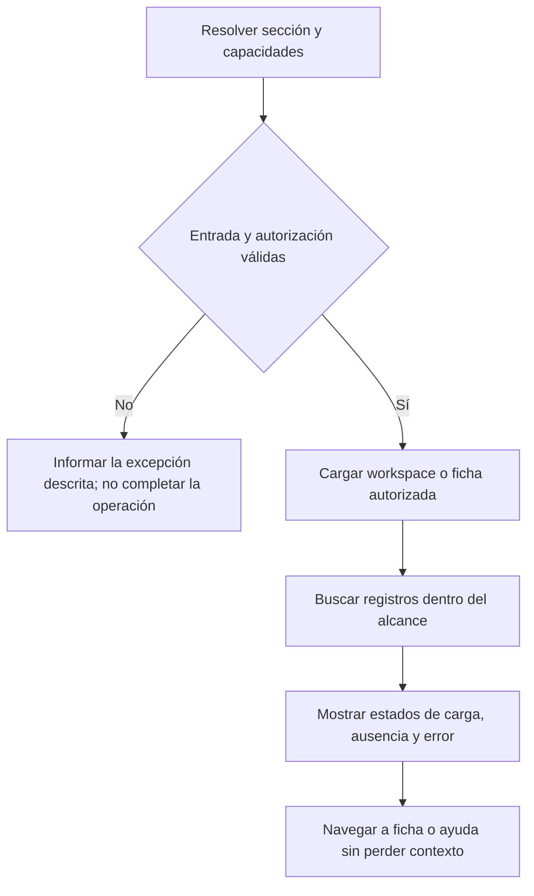

**Excepciones y alternativas**

- Sección desconocida o no permitida no expone un workspace.
- Registro eliminado no se representa como activo.
- Errores saneados se capturan sin datos sensibles.

**Objetos y persistencia**

Indirecto: registros de ADMEMETRAIT; captura de incidencias mediante api-tickets. No hay consulta Oracle desde el frontend.

**Archivos involucrados**

- [src/app/(dashboard)/ayuda/page.tsx](https://github.com/EMETRA/Sistema-tickets/blob/926fe45d27922c595c63e8f79e1e82b1594470eb/src/app/%28dashboard%29/ayuda/page.tsx)
- [src/app/(dashboard)/espacio/[section]/page.tsx](https://github.com/EMETRA/Sistema-tickets/blob/926fe45d27922c595c63e8f79e1e82b1594470eb/src/app/%28dashboard%29/espacio/%5Bsection%5D/page.tsx)
- [src/observability/server-incidents.ts](https://github.com/EMETRA/Sistema-tickets/blob/926fe45d27922c595c63e8f79e1e82b1594470eb/src/observability/server-incidents.ts)
- [src/views/Platform/PlatformRoute.tsx](https://github.com/EMETRA/Sistema-tickets/blob/926fe45d27922c595c63e8f79e1e82b1594470eb/src/views/Platform/PlatformRoute.tsx)
- [src/views/Platform/SearchWorkspace.tsx](https://github.com/EMETRA/Sistema-tickets/blob/926fe45d27922c595c63e8f79e1e82b1594470eb/src/views/Platform/SearchWorkspace.tsx)

<a id="cu-16"></a>

## CU-16 · Consultar vehículo SAT y manuales o reporte de anulaciones

**Actor:** Usuario del Panel según su alcance.

**Precondiciones y entrada:** Sesión válida y capability o permiso del módulo; backend correspondiente configurado.

**Flujo y resultado**

1. Comprobar acceso antes del formulario.
2. Elegir uso y placa o filtros de documento.
3. Enviar consulta y esperar respuesta controlada.
4. Mostrar ficha legible o archivo exportado.

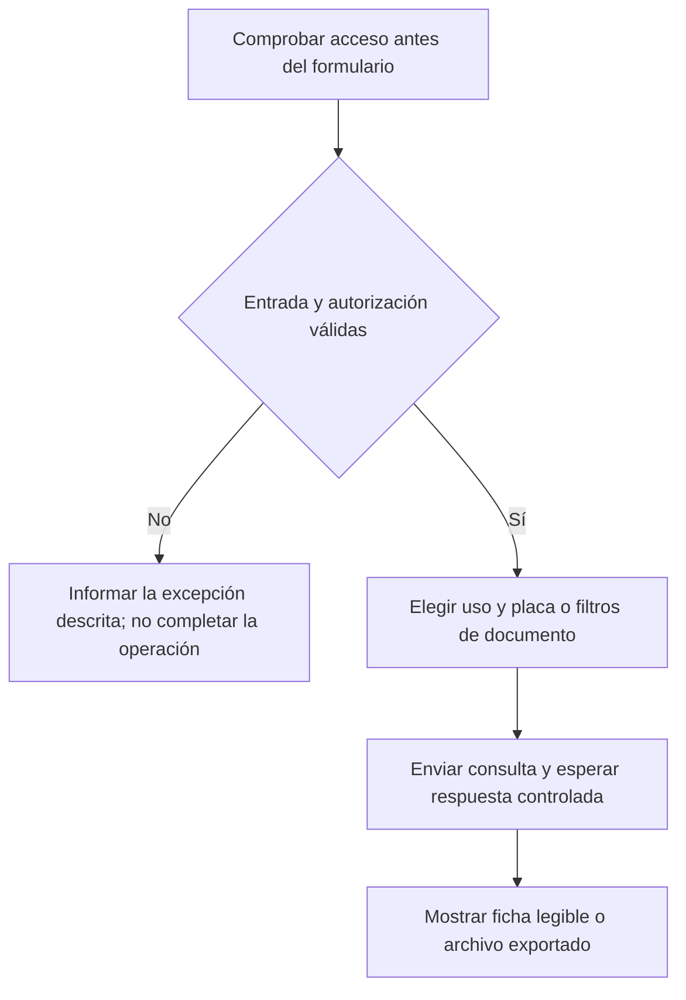

**Excepciones y alternativas**

- Error TLS/WSDL no se presenta como vehículo inexistente.
- Decodificar contenido textual sin inyectar HTML.
- Documento no encontrado no debe abrir un visor aparentemente vacío.

**Objetos y persistencia**

Indirecto: SAT vía api-tickets; manuales y bitácoras en sus fuentes configuradas. No SQL directo.

**Archivos involucrados**

- [src/app/api/MOD07/manual/route.ts](https://github.com/EMETRA/Sistema-tickets/blob/926fe45d27922c595c63e8f79e1e82b1594470eb/src/app/api/MOD07/manual/route.ts)
- [src/app/api/MOD07/manualesAgrupados/route.ts](https://github.com/EMETRA/Sistema-tickets/blob/926fe45d27922c595c63e8f79e1e82b1594470eb/src/app/api/MOD07/manualesAgrupados/route.ts)
- [src/app/api/MOD07/manualesCategorias/route.ts](https://github.com/EMETRA/Sistema-tickets/blob/926fe45d27922c595c63e8f79e1e82b1594470eb/src/app/api/MOD07/manualesCategorias/route.ts)
- [src/app/api/MOD07/manualesDisponibles/route.ts](https://github.com/EMETRA/Sistema-tickets/blob/926fe45d27922c595c63e8f79e1e82b1594470eb/src/app/api/MOD07/manualesDisponibles/route.ts)
- [src/app/api/MOD08/reporteAnuladosExcel/route.ts](https://github.com/EMETRA/Sistema-tickets/blob/926fe45d27922c595c63e8f79e1e82b1594470eb/src/app/api/MOD08/reporteAnuladosExcel/route.ts)
- [src/app/api/MOD08/reporteAnuladosResultados/route.ts](https://github.com/EMETRA/Sistema-tickets/blob/926fe45d27922c595c63e8f79e1e82b1594470eb/src/app/api/MOD08/reporteAnuladosResultados/route.ts)
- [src/app/api/MOD08/reporteAnuladosTipos/route.ts](https://github.com/EMETRA/Sistema-tickets/blob/926fe45d27922c595c63e8f79e1e82b1594470eb/src/app/api/MOD08/reporteAnuladosTipos/route.ts)
- [src/views/ConsultaVehiculos/ConsultaVehiculos.module.scss](https://github.com/EMETRA/Sistema-tickets/blob/926fe45d27922c595c63e8f79e1e82b1594470eb/src/views/ConsultaVehiculos/ConsultaVehiculos.module.scss)
- [src/views/ConsultaVehiculos/ConsultaVehiculos.tsx](https://github.com/EMETRA/Sistema-tickets/blob/926fe45d27922c595c63e8f79e1e82b1594470eb/src/views/ConsultaVehiculos/ConsultaVehiculos.tsx)
- [src/views/ConsultaVehiculos/index.tsx](https://github.com/EMETRA/Sistema-tickets/blob/926fe45d27922c595c63e8f79e1e82b1594470eb/src/views/ConsultaVehiculos/index.tsx)
- [src/views/ConsultaVehiculos/types.tsx](https://github.com/EMETRA/Sistema-tickets/blob/926fe45d27922c595c63e8f79e1e82b1594470eb/src/views/ConsultaVehiculos/types.tsx)
- [src/views/MOD07/MOD07.module.scss](https://github.com/EMETRA/Sistema-tickets/blob/926fe45d27922c595c63e8f79e1e82b1594470eb/src/views/MOD07/MOD07.module.scss)
- [src/views/MOD07/MOD07.tsx](https://github.com/EMETRA/Sistema-tickets/blob/926fe45d27922c595c63e8f79e1e82b1594470eb/src/views/MOD07/MOD07.tsx)
- [src/views/MOD07/index.tsx](https://github.com/EMETRA/Sistema-tickets/blob/926fe45d27922c595c63e8f79e1e82b1594470eb/src/views/MOD07/index.tsx)
- [src/views/MOD08/MOD08.module.scss](https://github.com/EMETRA/Sistema-tickets/blob/926fe45d27922c595c63e8f79e1e82b1594470eb/src/views/MOD08/MOD08.module.scss)
- [src/views/MOD08/MOD08.tsx](https://github.com/EMETRA/Sistema-tickets/blob/926fe45d27922c595c63e8f79e1e82b1594470eb/src/views/MOD08/MOD08.tsx)
- [src/views/MOD08/index.tsx](https://github.com/EMETRA/Sistema-tickets/blob/926fe45d27922c595c63e8f79e1e82b1594470eb/src/views/MOD08/index.tsx)

<a id="cu-17"></a>

## CU-17 · Consultar RRHH y exportar visa de nóminas

**Actor:** Usuario del Panel según su alcance.

**Precondiciones y entrada:** Sesión válida y capability o permiso del módulo; backend correspondiente configurado.

**Flujo y resultado**

1. Comprobar permiso del módulo antes de seleccionar.
2. Cargar filtros y campos.
3. Consultar datos o exportación.
4. Informar resultado vacío o descargar Excel con datos.

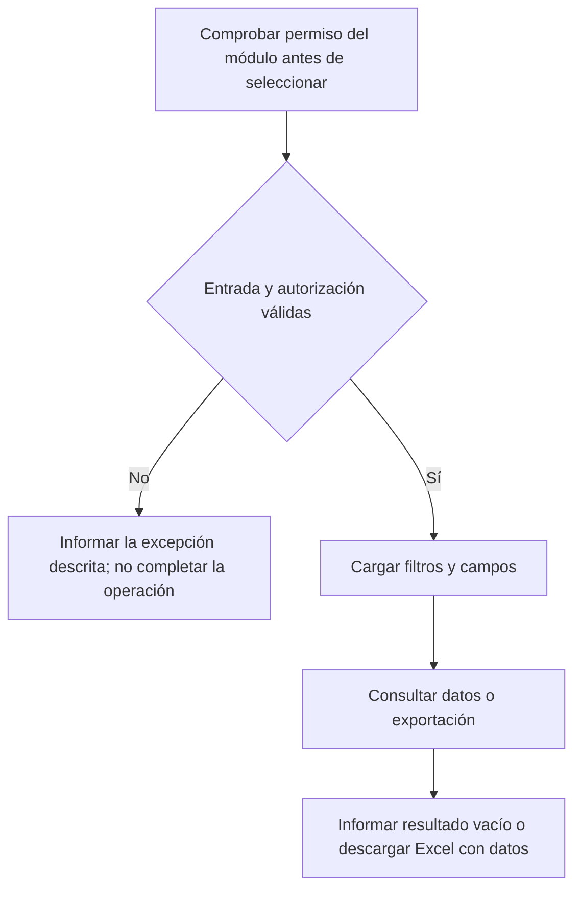

**Excepciones y alternativas**

- Permiso denegado se muestra antes de completar el proceso.
- Archivo de solo encabezados no se confunde con consulta exitosa con filas.
- Los datos de empleados no se migran.

**Objetos y persistencia**

Indirecto: ADMINSIAF y fuentes de ReporteRh/VisaNomina de api-tickets.

**Archivos involucrados**

- [src/app/api/MOD04/visaNominaExportExcel/route.ts](https://github.com/EMETRA/Sistema-tickets/blob/926fe45d27922c595c63e8f79e1e82b1594470eb/src/app/api/MOD04/visaNominaExportExcel/route.ts)
- [src/app/api/MOD05/reporteRhCamposDisponibles/route.ts](https://github.com/EMETRA/Sistema-tickets/blob/926fe45d27922c595c63e8f79e1e82b1594470eb/src/app/api/MOD05/reporteRhCamposDisponibles/route.ts)
- [src/app/api/MOD05/reporteRhEstatusOpciones/route.ts](https://github.com/EMETRA/Sistema-tickets/blob/926fe45d27922c595c63e8f79e1e82b1594470eb/src/app/api/MOD05/reporteRhEstatusOpciones/route.ts)
- [src/app/api/MOD05/reporteRhExportExcel/route.ts](https://github.com/EMETRA/Sistema-tickets/blob/926fe45d27922c595c63e8f79e1e82b1594470eb/src/app/api/MOD05/reporteRhExportExcel/route.ts)
- [src/app/api/MOD05/reporteRhResultados/route.ts](https://github.com/EMETRA/Sistema-tickets/blob/926fe45d27922c595c63e8f79e1e82b1594470eb/src/app/api/MOD05/reporteRhResultados/route.ts)
- [src/views/MOD04/MOD04.module.scss](https://github.com/EMETRA/Sistema-tickets/blob/926fe45d27922c595c63e8f79e1e82b1594470eb/src/views/MOD04/MOD04.module.scss)
- [src/views/MOD04/MOD04.tsx](https://github.com/EMETRA/Sistema-tickets/blob/926fe45d27922c595c63e8f79e1e82b1594470eb/src/views/MOD04/MOD04.tsx)
- [src/views/MOD04/index.tsx](https://github.com/EMETRA/Sistema-tickets/blob/926fe45d27922c595c63e8f79e1e82b1594470eb/src/views/MOD04/index.tsx)
- [src/views/MOD05/MOD05.module.scss](https://github.com/EMETRA/Sistema-tickets/blob/926fe45d27922c595c63e8f79e1e82b1594470eb/src/views/MOD05/MOD05.module.scss)
- [src/views/MOD05/MOD05.tsx](https://github.com/EMETRA/Sistema-tickets/blob/926fe45d27922c595c63e8f79e1e82b1594470eb/src/views/MOD05/MOD05.tsx)
- [src/views/MOD05/index.tsx](https://github.com/EMETRA/Sistema-tickets/blob/926fe45d27922c595c63e8f79e1e82b1594470eb/src/views/MOD05/index.tsx)

<a id="cu-18"></a>

## CU-18 · Preparar PDF y enviar boletas de pago autorizadas

**Actor:** Usuario del Panel según su alcance.

**Precondiciones y entrada:** Sesión válida y capability o permiso del módulo; backend correspondiente configurado.

**Flujo y resultado**

1. Elegir tipo y maestro de nómina.
2. Consultar previa y abrir el PDF.
3. Autorizar lote y revisar destinatario de prueba.
4. Enviar boletas autorizadas.
5. Actualizar resultados y conciliar si son inciertos.

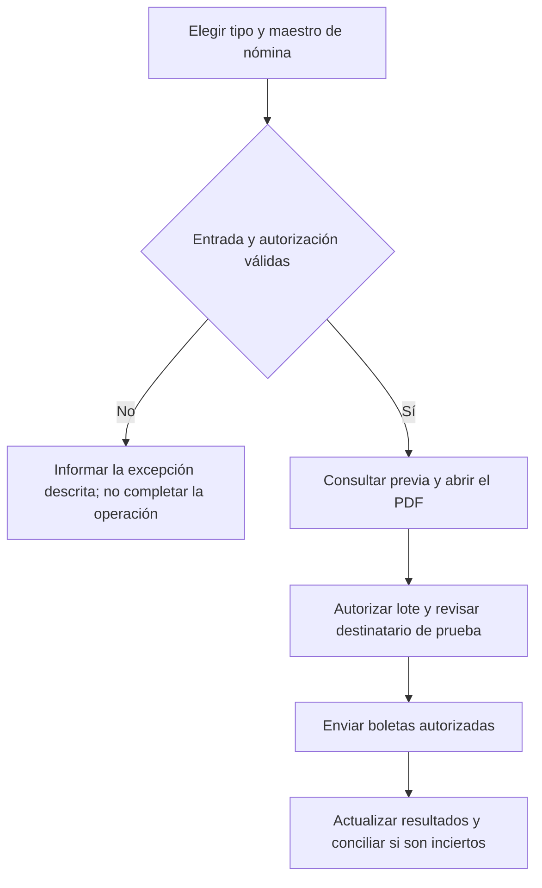

**Excepciones y alternativas**

- PENDIENTE no significa enviado.
- Aceptado por SMTP no acredita entrega al buzón.
- Error en send-next conserva lote y referencia.
- Un reenvío requiere revisar resultado anterior.

**Objetos y persistencia**

Indirecto: nómina ADMINSIAF; ADMEMETRANOTIFICACIONES.TB_TK_BOLETA_LOTES y TB_TK_BOLETA_ENVIOS vía api-tickets.

**Archivos involucrados**

- [src/views/Platform/PayrollWorkspace.module.scss](https://github.com/EMETRA/Sistema-tickets/blob/926fe45d27922c595c63e8f79e1e82b1594470eb/src/views/Platform/PayrollWorkspace.module.scss)
- [src/views/Platform/PayrollWorkspace.tsx](https://github.com/EMETRA/Sistema-tickets/blob/926fe45d27922c595c63e8f79e1e82b1594470eb/src/views/Platform/PayrollWorkspace.tsx)

<a id="cu-19"></a>

## CU-19 · Guardar y exportar reporte semanal (deshabilitado)

**Estado:** Deshabilitado. Se documenta para mantener la trazabilidad del código y de los datos históricos.

**Actor:** Usuario autenticado, incluido administrador.

**Flujo y resultado**

1. El catálogo no ofrece Reporte semanal informática, Exportar reporte semanal informática ni Reporte Guardado.
2. Un marcador antiguo muestra la pantalla de desuso del Panel.
3. Una llamada directa al resolver semanal es rechazada por el interceptor del API antes de consultar o modificar datos.
4. Los indicadores y reportes vigentes se consultan desde Métricas.

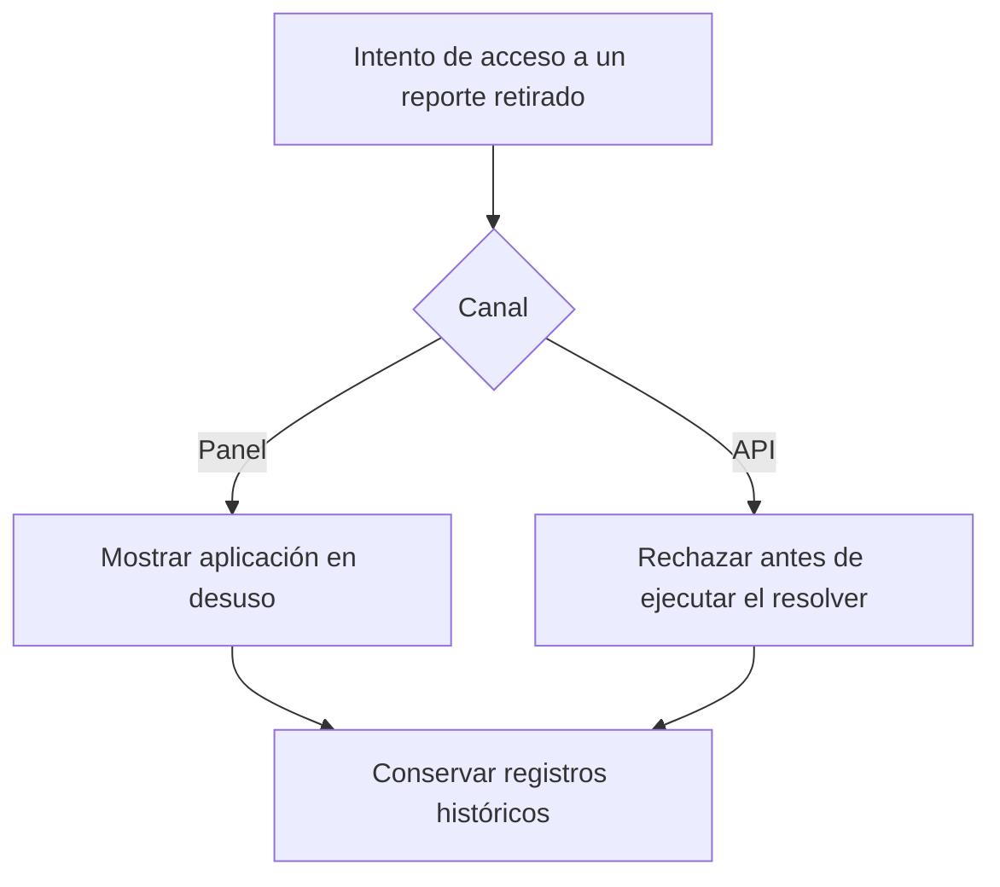

**Excepciones y alternativas**

- Un permiso antiguo o la administración no reactiva el proceso.
- Desactivar la plataforma general no elude el bloqueo del resolver.
- Los dashboards de Informática se retiran como aplicaciones; sus marcadores dirigen a Métricas. El resolver compartido de indicadores permanece disponible.

**Objetos y persistencia**

Referencias históricas conservadas; este caso no ejecuta nuevas lecturas, escrituras ni exportaciones.

Indirecto: reportes semanales y detalles en ADMEMETRAIT mediante api-tickets.

**Archivos involucrados**

- [src/app/api/MOD01/reporteSemanal/route.ts](https://github.com/EMETRA/Sistema-tickets/blob/926fe45d27922c595c63e8f79e1e82b1594470eb/src/app/api/MOD01/reporteSemanal/route.ts)
- [src/app/api/MOD01/reporteSemanalColaboradores/route.ts](https://github.com/EMETRA/Sistema-tickets/blob/926fe45d27922c595c63e8f79e1e82b1594470eb/src/app/api/MOD01/reporteSemanalColaboradores/route.ts)
- [src/app/api/MOD01/reporteSemanalExcel/route.ts](https://github.com/EMETRA/Sistema-tickets/blob/926fe45d27922c595c63e8f79e1e82b1594470eb/src/app/api/MOD01/reporteSemanalExcel/route.ts)
- [src/app/api/MOD01/reporteSemanalSeguimiento/route.ts](https://github.com/EMETRA/Sistema-tickets/blob/926fe45d27922c595c63e8f79e1e82b1594470eb/src/app/api/MOD01/reporteSemanalSeguimiento/route.ts)
- [src/app/api/MOD01/reportesSemanales/route.ts](https://github.com/EMETRA/Sistema-tickets/blob/926fe45d27922c595c63e8f79e1e82b1594470eb/src/app/api/MOD01/reportesSemanales/route.ts)
- [src/views/DashboardCollaborators/DashboardCollaborators.module.scss](https://github.com/EMETRA/Sistema-tickets/blob/926fe45d27922c595c63e8f79e1e82b1594470eb/src/views/DashboardCollaborators/DashboardCollaborators.module.scss)
- [src/views/DashboardCollaborators/DashboardCollaborators.tsx](https://github.com/EMETRA/Sistema-tickets/blob/926fe45d27922c595c63e8f79e1e82b1594470eb/src/views/DashboardCollaborators/DashboardCollaborators.tsx)
- [src/views/DashboardCollaborators/index.tsx](https://github.com/EMETRA/Sistema-tickets/blob/926fe45d27922c595c63e8f79e1e82b1594470eb/src/views/DashboardCollaborators/index.tsx)
- [src/views/DashboardProjects/DashboardProjects.module.scss](https://github.com/EMETRA/Sistema-tickets/blob/926fe45d27922c595c63e8f79e1e82b1594470eb/src/views/DashboardProjects/DashboardProjects.module.scss)
- [src/views/DashboardProjects/DashboardProjects.tsx](https://github.com/EMETRA/Sistema-tickets/blob/926fe45d27922c595c63e8f79e1e82b1594470eb/src/views/DashboardProjects/DashboardProjects.tsx)
- [src/views/DashboardProjects/index.tsx](https://github.com/EMETRA/Sistema-tickets/blob/926fe45d27922c595c63e8f79e1e82b1594470eb/src/views/DashboardProjects/index.tsx)
- [src/views/ExportMOD01/ExportMOD01.module.scss](https://github.com/EMETRA/Sistema-tickets/blob/926fe45d27922c595c63e8f79e1e82b1594470eb/src/views/ExportMOD01/ExportMOD01.module.scss)
- [src/views/ExportMOD01/ExportMOD01.tsx](https://github.com/EMETRA/Sistema-tickets/blob/926fe45d27922c595c63e8f79e1e82b1594470eb/src/views/ExportMOD01/ExportMOD01.tsx)
- [src/views/ExportMOD01/index.tsx](https://github.com/EMETRA/Sistema-tickets/blob/926fe45d27922c595c63e8f79e1e82b1594470eb/src/views/ExportMOD01/index.tsx)
- [src/views/MOD01/MOD01.module.scss](https://github.com/EMETRA/Sistema-tickets/blob/926fe45d27922c595c63e8f79e1e82b1594470eb/src/views/MOD01/MOD01.module.scss)
- [src/views/MOD01/MOD01.tsx](https://github.com/EMETRA/Sistema-tickets/blob/926fe45d27922c595c63e8f79e1e82b1594470eb/src/views/MOD01/MOD01.tsx)
- [src/views/MOD01/index.tsx](https://github.com/EMETRA/Sistema-tickets/blob/926fe45d27922c595c63e8f79e1e82b1594470eb/src/views/MOD01/index.tsx)
- [src/views/SaveMOD01/ExportMOD01/SaveMOD01.module.scss](https://github.com/EMETRA/Sistema-tickets/blob/926fe45d27922c595c63e8f79e1e82b1594470eb/src/views/SaveMOD01/ExportMOD01/SaveMOD01.module.scss)
- [src/views/SaveMOD01/ExportMOD01/SaveMOD01.tsx](https://github.com/EMETRA/Sistema-tickets/blob/926fe45d27922c595c63e8f79e1e82b1594470eb/src/views/SaveMOD01/ExportMOD01/SaveMOD01.tsx)
- [src/views/SaveMOD01/ExportMOD01/index.tsx](https://github.com/EMETRA/Sistema-tickets/blob/926fe45d27922c595c63e8f79e1e82b1594470eb/src/views/SaveMOD01/ExportMOD01/index.tsx)

<a id="cu-20"></a>

## CU-20 · Administrar noticias y notificar documentos jurídicos

**Actor:** Usuario del Panel según su alcance.

**Precondiciones y entrada:** Sesión válida y capability o permiso del módulo; backend correspondiente configurado.

**Flujo y resultado**

1. Comprobar permisos y cargar catálogos.
2. Preparar contenido o documento.
3. Revisar destinatario o publicación.
4. Confirmar y enviar comando.
5. Mostrar resultado y referencia sin duplicar la acción.

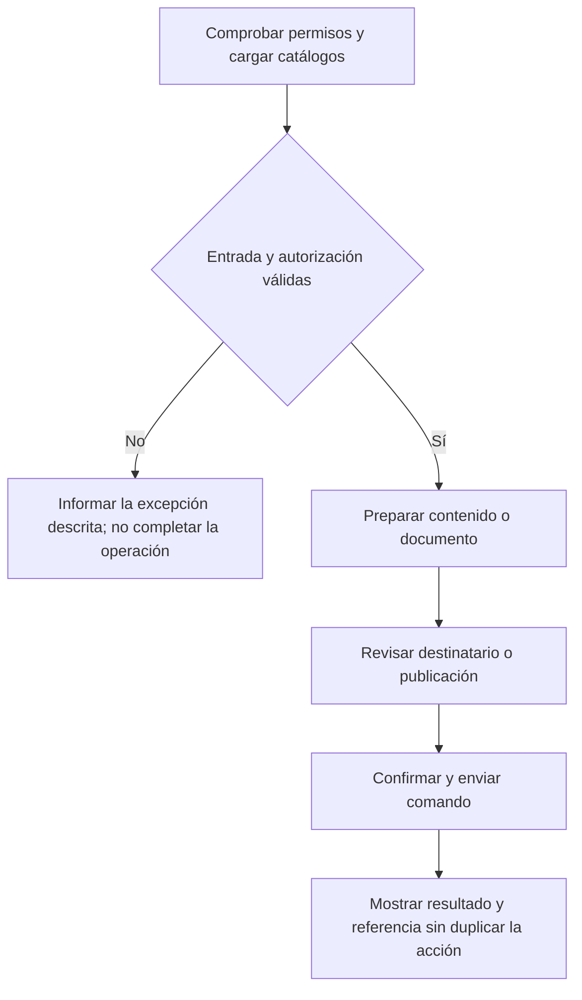

**Identificar creación y última actualización de una noticia**

El listado incluye «Autor editorial» y «Registro y edición» como datos distintos. Al abrir una noticia para editar, una ficha de solo lectura muestra quién la creó y quién la actualizó por última vez, junto a las fechas del CMS en hora de Guatemala. Estos valores no se envían como campos editables ni aparecen en la vista previa editorial. No se trata de un historial completo de cambios.

```mermaid
flowchart LR
  lectura["Listado o detalle privado COM03"] --> bff["BFF conserva actividadEditorial"]
  bff --> mapa["Adaptar responsables y fechas"]
  mapa --> tabla["Columna Registro y edición"]
  mapa --> ficha["Ficha de responsables al editar"]
```

Si falta responsable histórico, mostrar «Sin registro»; con ID conocido y nombre no disponible, «Usuario #ID». No asignar el nombre del autor editorial como sustituto. Objetos indirectos: `ADMEMETRANOTIFICACIONES.TB_NOTICIA` y `ADMAUTEMETRA.TB_USUARIOS` mediante api-tickets/api-portal; el Panel no consulta Oracle. Implementación: [src/components/client/organisms/NewsActivity/NewsActivity.tsx](https://github.com/EMETRA/Sistema-tickets/blob/55827f0694bf6f736264c3c5d41622b7cc59a88a/src/components/client/organisms/NewsActivity/NewsActivity.tsx), [src/components/client/organisms/NewsTablePanel/NewsTablePanel.tsx](https://github.com/EMETRA/Sistema-tickets/blob/55827f0694bf6f736264c3c5d41622b7cc59a88a/src/components/client/organisms/NewsTablePanel/NewsTablePanel.tsx), [src/views/COM03/NewsFormView/NewsFormView.tsx](https://github.com/EMETRA/Sistema-tickets/blob/55827f0694bf6f736264c3c5d41622b7cc59a88a/src/views/COM03/NewsFormView/NewsFormView.tsx).

**Excepciones y alternativas**

- Prueba jurídica debe mantener destinatario institucional de prueba configurado.
- Error de carga no habilita publicar contenido incompleto.
- Envío SMTP y entrega son estados distintos.

**Objetos y persistencia**

Indirecto: CMS api-portal y registro de notificaciones de api-tickets; no escribe directamente en tablas editoriales.

Referencias de implementación relacionadas (incluye dependencias compartidas; el propietario dinámico se resuelve según el manual):

| Objeto citado | Archivo |
| --- | --- |
| `TB_CATEGORIA` | [src/views/COM03/NewsFormView/NewsFormView.tsx](https://github.com/EMETRA/Sistema-tickets/blob/926fe45d27922c595c63e8f79e1e82b1594470eb/src/views/COM03/NewsFormView/NewsFormView.tsx) |
| `TB_NOTICIA` | [src/views/COM03/constants.ts](https://github.com/EMETRA/Sistema-tickets/blob/926fe45d27922c595c63e8f79e1e82b1594470eb/src/views/COM03/constants.ts) |
| `TB_RECURSO` | [src/views/COM03/hooks/useNewsForm.ts](https://github.com/EMETRA/Sistema-tickets/blob/926fe45d27922c595c63e8f79e1e82b1594470eb/src/views/COM03/hooks/useNewsForm.ts) |

**Archivos involucrados**

- [src/app/api/COM03/autores/route.ts](https://github.com/EMETRA/Sistema-tickets/blob/926fe45d27922c595c63e8f79e1e82b1594470eb/src/app/api/COM03/autores/route.ts)
- [src/app/api/COM03/categorias/route.ts](https://github.com/EMETRA/Sistema-tickets/blob/926fe45d27922c595c63e8f79e1e82b1594470eb/src/app/api/COM03/categorias/route.ts)
- [src/app/api/COM03/etiquetas/route.ts](https://github.com/EMETRA/Sistema-tickets/blob/926fe45d27922c595c63e8f79e1e82b1594470eb/src/app/api/COM03/etiquetas/route.ts)
- [src/app/api/COM03/media/[...path]/route.ts](https://github.com/EMETRA/Sistema-tickets/blob/926fe45d27922c595c63e8f79e1e82b1594470eb/src/app/api/COM03/media/%5B...path%5D/route.ts)
- [src/app/api/COM03/noticia/[id]/route.ts](https://github.com/EMETRA/Sistema-tickets/blob/926fe45d27922c595c63e8f79e1e82b1594470eb/src/app/api/COM03/noticia/%5Bid%5D/route.ts)
- [src/app/api/COM03/noticias/route.ts](https://github.com/EMETRA/Sistema-tickets/blob/926fe45d27922c595c63e8f79e1e82b1594470eb/src/app/api/COM03/noticias/route.ts)
- [src/app/api/COM03/notificaciones/route.ts](https://github.com/EMETRA/Sistema-tickets/blob/926fe45d27922c595c63e8f79e1e82b1594470eb/src/app/api/COM03/notificaciones/route.ts)
- [src/app/api/COM03/permisos/route.ts](https://github.com/EMETRA/Sistema-tickets/blob/926fe45d27922c595c63e8f79e1e82b1594470eb/src/app/api/COM03/permisos/route.ts)
- [src/app/api/COM03/recursos/externos/route.ts](https://github.com/EMETRA/Sistema-tickets/blob/926fe45d27922c595c63e8f79e1e82b1594470eb/src/app/api/COM03/recursos/externos/route.ts)
- [src/app/api/COM03/recursos/route.ts](https://github.com/EMETRA/Sistema-tickets/blob/926fe45d27922c595c63e8f79e1e82b1594470eb/src/app/api/COM03/recursos/route.ts)
- [src/views/COM03/COM03.module.scss](https://github.com/EMETRA/Sistema-tickets/blob/926fe45d27922c595c63e8f79e1e82b1594470eb/src/views/COM03/COM03.module.scss)
- [src/views/COM03/COM03.tsx](https://github.com/EMETRA/Sistema-tickets/blob/926fe45d27922c595c63e8f79e1e82b1594470eb/src/views/COM03/COM03.tsx)
- [src/views/COM03/NewsFormView/NewsFormView.module.scss](https://github.com/EMETRA/Sistema-tickets/blob/926fe45d27922c595c63e8f79e1e82b1594470eb/src/views/COM03/NewsFormView/NewsFormView.module.scss)
- [src/views/COM03/NewsFormView/NewsFormView.tsx](https://github.com/EMETRA/Sistema-tickets/blob/926fe45d27922c595c63e8f79e1e82b1594470eb/src/views/COM03/NewsFormView/NewsFormView.tsx)
- [src/views/COM03/NewsFormView/flowTexts.ts](https://github.com/EMETRA/Sistema-tickets/blob/926fe45d27922c595c63e8f79e1e82b1594470eb/src/views/COM03/NewsFormView/flowTexts.ts)
- [src/views/COM03/NewsListView/NewsListView.module.scss](https://github.com/EMETRA/Sistema-tickets/blob/926fe45d27922c595c63e8f79e1e82b1594470eb/src/views/COM03/NewsListView/NewsListView.module.scss)
- [src/views/COM03/NewsListView/NewsListView.tsx](https://github.com/EMETRA/Sistema-tickets/blob/926fe45d27922c595c63e8f79e1e82b1594470eb/src/views/COM03/NewsListView/NewsListView.tsx)
- [src/views/COM03/constants.ts](https://github.com/EMETRA/Sistema-tickets/blob/926fe45d27922c595c63e8f79e1e82b1594470eb/src/views/COM03/constants.ts)
- [src/views/COM03/hooks/useNewsForm.ts](https://github.com/EMETRA/Sistema-tickets/blob/926fe45d27922c595c63e8f79e1e82b1594470eb/src/views/COM03/hooks/useNewsForm.ts)
- [src/views/COM03/index.tsx](https://github.com/EMETRA/Sistema-tickets/blob/926fe45d27922c595c63e8f79e1e82b1594470eb/src/views/COM03/index.tsx)
- [src/views/COM03/schemas/newsForm.schema.ts](https://github.com/EMETRA/Sistema-tickets/blob/926fe45d27922c595c63e8f79e1e82b1594470eb/src/views/COM03/schemas/newsForm.schema.ts)
- [src/views/COM03/types.tsx](https://github.com/EMETRA/Sistema-tickets/blob/926fe45d27922c595c63e8f79e1e82b1594470eb/src/views/COM03/types.tsx)
- [src/views/COM03/utils/buildGuardarNoticiaPayload.ts](https://github.com/EMETRA/Sistema-tickets/blob/926fe45d27922c595c63e8f79e1e82b1594470eb/src/views/COM03/utils/buildGuardarNoticiaPayload.ts)
- [src/views/COM03/utils/claveIdempotente.ts](https://github.com/EMETRA/Sistema-tickets/blob/926fe45d27922c595c63e8f79e1e82b1594470eb/src/views/COM03/utils/claveIdempotente.ts)
- [src/views/COM03/utils/permisos.ts](https://github.com/EMETRA/Sistema-tickets/blob/926fe45d27922c595c63e8f79e1e82b1594470eb/src/views/COM03/utils/permisos.ts)
- [src/views/COM03/utils/prepareGuardarNoticiaPayload.ts](https://github.com/EMETRA/Sistema-tickets/blob/926fe45d27922c595c63e8f79e1e82b1594470eb/src/views/COM03/utils/prepareGuardarNoticiaPayload.ts)
- [src/views/MOD10/MOD10.module.scss](https://github.com/EMETRA/Sistema-tickets/blob/926fe45d27922c595c63e8f79e1e82b1594470eb/src/views/MOD10/MOD10.module.scss)
- [src/views/MOD10/MOD10.tsx](https://github.com/EMETRA/Sistema-tickets/blob/926fe45d27922c595c63e8f79e1e82b1594470eb/src/views/MOD10/MOD10.tsx)
- [src/views/MOD10/index.tsx](https://github.com/EMETRA/Sistema-tickets/blob/926fe45d27922c595c63e8f79e1e82b1594470eb/src/views/MOD10/index.tsx)
- [src/views/MOD10/types.tsx](https://github.com/EMETRA/Sistema-tickets/blob/926fe45d27922c595c63e8f79e1e82b1594470eb/src/views/MOD10/types.tsx)

<a id="cu-21"></a>

## CU-21 · Buscar y tramitar casos judiciales VIVI

**Actor:** Usuario del Panel según su alcance.

**Precondiciones y entrada:** Sesión válida y capability o permiso del módulo; backend correspondiente configurado.

**Entrada del catálogo:** Aplicaciones Juzgado → Consultas → Consultar caso, `/home/juzgado/consultas/juz01`. Los marcadores anteriores de Jurídico redirigen conservando el caso; los permisos judiciales se mantienen.

**Flujo y resultado**

1. Escribir al menos tres caracteres (incluidos seis o el código completo).
2. Mostrar resultados con placa y datos de identificación permitidos.
3. Abrir caso dentro de la sede autorizada.
4. Consultar evidencia y registrar gestión o resolución.
5. Mostrar documento y resultado persistido.

```mermaid
flowchart TD
  inicio["Escribir al menos tres caracteres (incluidos seis o el código completo)"]
  control{"Entrada y autorización válidas"}
  inicio --> control
  control -->|No| rechazo["Informar la excepción descrita; no completar la operación"]
  paso1["Mostrar resultados con placa y datos de identificación permitidos"]
  control -->|Sí| paso1
  paso2["Abrir caso dentro de la sede autorizada"]
  paso1 --> paso2
  paso3["Consultar evidencia y registrar gestión o resolución"]
  paso2 --> paso3
  paso4["Mostrar documento y resultado persistido"]
  paso3 --> paso4
```

**Excepciones y alternativas**

- Búsqueda menor de tres caracteres no llama al API; con tres, seis o el código completo se consulta por el inicio.
- Tabla y tarjetas móviles conservan identificación equivalente.
- Si hay más de 20 coincidencias, `BUSQUEDA_DEMASIADO_AMPLIA` pide precisar con seis caracteres o el código completo.
- Acción no permitida por estado se bloquea.
- Reintentos no duplican resolución.
- Una decisión confirmada puede tener PDF pendiente. El fallo de generación conserva la referencia HTTP del API y el aviso indica reintentar únicamente el documento. Cada clic documental obtiene un comando y confirmaciones nuevos, conservando el mismo ID de resolución; no modifica la identidad de la decisión.
- El proxy solo acepta JSON para generar metadata y tipos de archivo permitidos para descargar. Registra los fallos técnicos que no tengan una referencia del API y no devuelve mensajes internos.

**Objetos y persistencia**

Indirecto: dominio judicial ADMEMETRAVEHICULAR mediante api-tickets; archivos privados por rutas autorizadas.

**Archivos involucrados**

- [src/api/graphql/juzgado.ts](https://github.com/EMETRA/Sistema-tickets/blob/b77da403cba653095c8156b0e2c13035a96b606b/src/api/graphql/juzgado.ts)
- [src/api/graphql/juzgado-vista.ts](https://github.com/EMETRA/Sistema-tickets/blob/cd953b4ea8731336669948645a55032e5f5eabba/src/api/graphql/juzgado-vista.ts)
- [src/app/api/JUZ01/[...path]/route.ts](https://github.com/EMETRA/Sistema-tickets/blob/b77da403cba653095c8156b0e2c13035a96b606b/src/app/api/JUZ01/%5B...path%5D/route.ts)
- [src/views/JUZ01/JUZ01.module.scss](https://github.com/EMETRA/Sistema-tickets/blob/cd953b4ea8731336669948645a55032e5f5eabba/src/views/JUZ01/JUZ01.module.scss)
- [src/views/JUZ01/JUZ01.schema.ts](https://github.com/EMETRA/Sistema-tickets/blob/cd953b4ea8731336669948645a55032e5f5eabba/src/views/JUZ01/JUZ01.schema.ts)
- [src/views/JUZ01/JUZ01.tsx](https://github.com/EMETRA/Sistema-tickets/blob/cd953b4ea8731336669948645a55032e5f5eabba/src/views/JUZ01/JUZ01.tsx)
- [src/views/JUZ01/index.tsx](https://github.com/EMETRA/Sistema-tickets/blob/926fe45d27922c595c63e8f79e1e82b1594470eb/src/views/JUZ01/index.tsx)
- [src/views/JUZ01Detail/AnalisisEvidencias.tsx](https://github.com/EMETRA/Sistema-tickets/blob/926fe45d27922c595c63e8f79e1e82b1594470eb/src/views/JUZ01Detail/AnalisisEvidencias.tsx)
- [src/views/JUZ01Detail/EvidenciasCaso.tsx](https://github.com/EMETRA/Sistema-tickets/blob/926fe45d27922c595c63e8f79e1e82b1594470eb/src/views/JUZ01Detail/EvidenciasCaso.tsx)
- [src/views/JUZ01Detail/JUZ01Detail.module.scss](https://github.com/EMETRA/Sistema-tickets/blob/cd953b4ea8731336669948645a55032e5f5eabba/src/views/JUZ01Detail/JUZ01Detail.module.scss)
- [src/views/JUZ01Detail/JUZ01Detail.tsx](https://github.com/EMETRA/Sistema-tickets/blob/b77da403cba653095c8156b0e2c13035a96b606b/src/views/JUZ01Detail/JUZ01Detail.tsx)
- [src/views/JUZ01Detail/types.tsx](https://github.com/EMETRA/Sistema-tickets/blob/926fe45d27922c595c63e8f79e1e82b1594470eb/src/views/JUZ01Detail/types.tsx)

<a id="cu-22"></a>

## CU-22 · Cambiar la vista para presentaciones y pruebas visuales

**Actor:** Cuenta con administración efectiva de Tickets, confirmada por el bootstrap.

**Precondiciones:** Sesión válida y `actor.admin=true`; no basta un perfil llamado USER_ADMIN.

**Flujo y resultado**

1. Abrir Menú de usuario → Cambiar vista.
2. Elegir Usuario, Técnico, Desarrollador, DevOps, Asignación o Jefatura y aplicar.
3. Consultar la portada y navegación de esa vista. Si estaba en un formulario, se conserva la pantalla y el aviso ofrece Ver inicio de esta vista.
4. Navegar entre pantallas; la selección continúa mientras permanezca esa sesión y el layout.
5. Pulsar Volver a mi vista o seleccionar Mi vista actual para restaurar la presentación habitual.

```mermaid
flowchart TD
  inicio["Abrir menú de usuario"] --> admin{"Administración efectiva"}
  admin -->|No| sinSelector["Conservar vista habitual sin selector"]
  admin -->|Sí| elegir["Elegir y aplicar vista"]
  elegir --> mostrar["Proyectar portada y navegación; mostrar aviso"]
  mostrar --> navegar["Consultar datos autorizados de la misma cuenta"]
  navegar --> volver["Volver a la vista habitual"]
```

**Excepciones y alternativas**

- Cancelar o Escape conserva la selección anterior y devuelve el foco al menú.
- Recargar, cerrar sesión, cambiar de cuenta/sesión o perder administración desactiva la presentación temporal.
- El aviso aclara que datos y permisos pertenecen a la cuenta real. Las pruebas de autorización de otra persona necesitan una sesión de esa persona.
- Una selección desconocida no proyecta privilegios ni habilita el selector.

**Objetos y archivos involucrados**

No escribe en Oracle ni cambia perfiles, roles, cookies o token. Reutiliza el bootstrap y consultas existentes de métricas, tickets y calendario, autorizadas por api-tickets. El runtime original de permisos se conserva.

- [Proyección y navegación](https://github.com/EMETRA/Sistema-tickets/blob/9d497b6ff471410ea5a96ba6df5e707ccebd8e43/src/platform/presentation.ts).
- [Contexto temporal por cuenta y sesión](https://github.com/EMETRA/Sistema-tickets/blob/9d497b6ff471410ea5a96ba6df5e707ccebd8e43/src/platform/presentation-context.tsx).
- [Selector accesible](https://github.com/EMETRA/Sistema-tickets/blob/9d497b6ff471410ea5a96ba6df5e707ccebd8e43/src/components/client/organisms/WorkspaceViewSwitcher/WorkspaceViewSwitcher.tsx).
- [Shell y aviso de presentación](https://github.com/EMETRA/Sistema-tickets/blob/9d497b6ff471410ea5a96ba6df5e707ccebd8e43/src/components/client/templates/SystemLayout/SystemLayout.tsx).
- [Portada según vista](https://github.com/EMETRA/Sistema-tickets/blob/9d497b6ff471410ea5a96ba6df5e707ccebd8e43/src/views/Platform/HomeWorkspace.tsx).

<a id="cu-23"></a>

## CU-23 · Consultar usuarios y actividad de VIVI desde Informática

**Actor:** Administración efectiva de Tickets o cuenta con TICKETS_VIVI_REPORTES_LEER. El nombre USER_ADMIN por sí solo no concede acceso.

**Precondiciones y entrada:** Plataforma activa, módulo `vivi-reportes` registrado y activo, sesión Bearer y SELECT de la cuenta técnica sobre las fuentes. El complemento SQL solo prepara catálogo y permiso funcional. La ruta es `/home/informatica/reportes/vivi-reportes`.

**Flujo y resultado**

1. Entrar a Aplicaciones de Informática → Reportes → Reportes de VIVI; comprobar permiso antes de mostrar el formulario.
2. Consultar usuarios por nombre, correo, teléfono o ID, cuenta activa/inactiva, con/sin actividad y fecha de inscripción.
3. Mostrar total del filtro completo, distribución de cuentas, usuarios con/sin publicaciones y página de hasta 50 usuarios. Los contadores por usuario incluyen su historial completo.
4. Abrir la ficha: nombres, apellidos, correo, teléfono, fecha/estado de registro, DPI, NIT, nacimiento, códigos de sexo/etnia/residencia, zona, dirección y placa declarada. Distinguir nulos de cero y datos declarados de identidad o propiedad acreditada.
5. Consultar su actividad, o abrir Avisos y reportes para una consulta global. Filtrar por ID VIVI, origen, estado y fecha en que se guardó el registro; agrupar los totales por origen/estado.
6. Mostrar avisos con caso, placa y motivo, y reportes de incidentes con estado de publicación. No confundir IDs iguales de orígenes distintos; vincular siempre NOUSUARIO con ID_USUARIO_VIVI.
7. Cambiar de página conservando los filtros aplicados o descargar el CSV de la página confirmada. No modificar cuentas, casos ni publicaciones.

```mermaid
flowchart TD
  entrada["Abrir Reportes de VIVI"] --> permiso{"Sesión, módulo y permiso vigentes"}
  permiso -->|No| denegar["No mostrar formulario ni consultar fuentes"]
  permiso -->|Sí| usuarios["Filtrar y contar usuarios inscritos"]
  usuarios --> ficha["Consultar ficha de registro declarada"]
  ficha --> actividad["Consultar avisos y reportes del usuario"]
  permiso -->|Sí| actividad
  actividad --> resultado["Agrupar por origen y estado y paginar"]
  usuarios --> pagina["Exportar solo la página confirmada"]
  resultado --> pagina
```

**Excepciones y alternativas**

- Un módulo inactivo o un permiso ausente se deniega incluso mediante acceso directo. No se infiere acceso por nombre de perfil.
- Fechas inválidas o invertidas, filtros desconocidos/repetidos, ID no positivo, estado incompatible con el origen o página inválida se rechazan antes de leer las fuentes VIVI.
- Las fechas incluyen los días completos de Guatemala. Sin fechas, el historial no se limita a los últimos 30 días.
- Un usuario inexistente devuelve 404; una consulta sin coincidencias devuelve totales cero y lista vacía.
- No publicado no se presenta como publicado ni como un fallo de correo; una cuenta activa no acredita identidad del titular.
- Una caída o un ORA conserva el diagnóstico saneado por referencia e incidencia. La pantalla conserva resultados confirmados y permite reintentar; no fabrica un total cero ante un fallo.
- No se consultan HASH_CLAVE, CREDENCIAL_VERSION, PUSH_TOKEN, OTP, sesiones, documentos ni evidencias.
- El CSV contiene solo las filas de la página actual; no se anuncia como una exportación de todo el universo filtrado.

**Objetos y persistencia**

| Objeto | Uso |
| --- | --- |
| ADMEMETRAIDENTIDAD.TB_VIVI_USUARIOS | Registro y ficha declarada; clave NOUSUARIO. |
| ADMEMETRAVEHICULAR.TB_VIVI_DENUNCIAS | Avisos, caso, placa, estado y fecha de registro. |
| ADMEMETRAVEHICULAR.TB_VIVI_REPORTES | Incidentes, usuario VIVI, fecha y publicación. |
| ADMEMETRAVEHICULAR.TB_VIVI_REGLAMENTO | Descripción del motivo del aviso. |
| ADMEMETRANOTIFICACIONES.TB_VIVI_TIPOS_INCIDENTE | Nombre del incidente. |
| ADMEMETRAIDENTIDAD.TB_TK_MODULOS | Entrada activa y permiso estable del formulario. |
| ADMAUTEMETRA.TB_PERMISOS | Permiso funcional TICKETS_VIVI_REPORTES_LEER. |

Persistencia remota mediante api-tickets. El Panel no conecta a Oracle ni replica estos perfiles en almacenamiento local. Los datos de la ficha y los resultados permanecen en el estado de la pantalla.

**Archivos involucrados**

- [src/views/Platform/ViviReportsWorkspace.tsx](https://github.com/EMETRA/Sistema-tickets/blob/b29ea52c21307f21bb49041ba2e8f76fb8080f44/src/views/Platform/ViviReportsWorkspace.tsx)
- [src/views/Platform/ViviReportsWorkspace.module.scss](https://github.com/EMETRA/Sistema-tickets/blob/b29ea52c21307f21bb49041ba2e8f76fb8080f44/src/views/Platform/ViviReportsWorkspace.module.scss)
- [src/platform/vivi-reports.ts](https://github.com/EMETRA/Sistema-tickets/blob/b29ea52c21307f21bb49041ba2e8f76fb8080f44/src/platform/vivi-reports.ts)
- [src/config/app-registry.ts](https://github.com/EMETRA/Sistema-tickets/blob/b29ea52c21307f21bb49041ba2e8f76fb8080f44/src/config/app-registry.ts)
- [src/app/api/platform/[...path]/route.ts](https://github.com/EMETRA/Sistema-tickets/blob/b29ea52c21307f21bb49041ba2e8f76fb8080f44/src/app/api/platform/%5B...path%5D/route.ts)

<a id="cu-rh-01"></a>

## CU-RH-01 · Ver mi ficha de RRHH y gestionar actualizaciones obligatorias

**Actores:** Usuario autenticado para su propio perfil; personal de RRHH con permisos específicos para convocar y revisar; administración efectiva de Tickets.

**Entradas:** `/mi-perfil`, `/notificaciones`, `/mi-perfil?campana=...` y `/home/rrhh/formularios/rh-datos`. Campañas requieren preparación y bandera en el API. El perfil no usa el nombre del usuario para resolver al empleado.

**Recorrido personal**

1. Abrir Mi perfil desde el menú de usuario. Presentar la ficha oficial agrupada, su código vinculado y las campañas; explicar un vínculo pendiente sin mostrar otra ficha.
2. Consultar el recordatorio obligatorio en la campana, el aviso y Notificaciones; acceder desde ahí a la campaña.
3. Revisar campos, modo de aplicación y cierre. Antes de apertura/después del cierre, mostrar estado sin habilitar envío.
4. Editar únicamente los campos permitidos o confirmar los solicitados. Para corregir un dato de solo confirmación, exigir observación y enviarla a RRHH sin modificar ese dato.
5. Enviar con idempotencia; mantener lo escrito ante errores y mostrar referencia. Informar si se aplicaron los editables o quedaron pendientes de aprobación.
6. Actualizar perfil/avisos y consultar observaciones del revisor. Una devolución durante el plazo vuelve a habilitar el formulario y el recordatorio.

**Recorrido de RRHH**

1. Validar acceso antes de mostrar configuración y datos. Elegir nombre, instrucciones, campos, modo y periodo en hora de Guatemala.
2. Publicar para el grupo de cuentas habilitadas de empresa 97; conservar el grupo, campos y modo publicados.
3. Abrir avance y consultar porcentaje de enviados, pendientes, aplicados/confirmados, contacto y revisados. Paginar o filtrar sin cambiar el total convocado.
4. Abrir cada envío, comparar anterior/propuesta y consultar observaciones, contacto y versiones anteriores.
5. Aprobar/aplicar, devolver solo durante plazo y sin aplicar, o solicitar atención sin aplicar incluso después del cierre. Registrar nota visible.
6. Contactar al empleado para los datos observados y finalizar la atención, conservando la trazabilidad. Cerrar anticipadamente si corresponde.

```mermaid
flowchart TD
  usuario["Usuario abre Mi perfil o Notificaciones"] --> vinculo{"Vínculo y campaña disponibles"}
  vinculo -->|No| estado["Explicar vínculo pendiente, programación o cierre"]
  vinculo -->|Sí| campos["Editar o confirmar campos solicitados"]
  campos --> corregir{"Solicita corrección"}
  corregir -->|Sí| nota["Observación obligatoria para RRHH"]
  corregir -->|No| enviar["Enviar actualización propia"]
  nota --> enviar
  enviar --> resultado{"Aplicar al enviar"}
  resultado -->|Sí| aplicado["Mostrar resultado de aplicación"]
  resultado -->|No| pendiente["Mostrar pendiente de aprobación"]
  aplicado --> reporte["RRHH consulta avance y cada envío"]
  pendiente --> reporte
  reporte --> revision["Aprobar, devolver o atender por contacto"]
  revision --> final["Registrar decisión y actualizar estado e indicadores"]
```

**Excepciones:** 401/403 → bloquear acceso; 400 → indicar campo inválido sin perder el formulario; 409 → consultar estado/recargar datos oficiales y revisar confirmaciones; fallo técnico → referencia y reintento. No aceptar un PDF/archivo como dato editable ni escribir sueldos o claves laborales. Una cuenta sin vínculo no puede actualizar un empleado supuesto. Una campaña cerrada no habilita proceso de envío. Un envío automático no se presenta como revisión humana. Los fallos temporales de bandeja conservan el aviso conocido y usan espera creciente; 401/403 detienen repetición automática.

**Objetos DB indirectos:** ADMINSIAF.TB_EMPLEADOS; ADMAUTEMETRA.TB_USUARIOS; ADMEMETRAIT.TB_TK_RH_CAMPANAS, TB_TK_RH_DESTINOS y TB_TK_RH_ENTREGAS; catálogo, permisos, confirmaciones, comandos y auditoría de la plataforma. Solo el API consulta/aplica datos corporativos.

**Archivos:** [src/views/Platform/HrProfileWorkspace.tsx](https://github.com/EMETRA/Sistema-tickets/blob/d4bd5264975a6663e3399bdc155f65141b38d7d9/src/views/Platform/HrProfileWorkspace.tsx), [src/views/Platform/HrCampaignsWorkspace.tsx](https://github.com/EMETRA/Sistema-tickets/blob/d4bd5264975a6663e3399bdc155f65141b38d7d9/src/views/Platform/HrCampaignsWorkspace.tsx), [src/views/Platform/HrDeliveryHistory.tsx](https://github.com/EMETRA/Sistema-tickets/blob/d4bd5264975a6663e3399bdc155f65141b38d7d9/src/views/Platform/HrDeliveryHistory.tsx), [src/platform/hr-notifications.tsx](https://github.com/EMETRA/Sistema-tickets/blob/d4bd5264975a6663e3399bdc155f65141b38d7d9/src/platform/hr-notifications.tsx), [src/platform/hr.ts](https://github.com/EMETRA/Sistema-tickets/blob/d4bd5264975a6663e3399bdc155f65141b38d7d9/src/platform/hr.ts), [src/app/api/platform/[...path]/route.ts](https://github.com/EMETRA/Sistema-tickets/blob/d4bd5264975a6663e3399bdc155f65141b38d7d9/src/app/api/platform/[...path]/route.ts). Preparación QA: [sql/rrhh/README.md](https://github.com/EMETRA/api-tickets/blob/68f2223df8324c0ec39dac4e0e521c4ff29a240e/sql/rrhh/README.md); arquitectura y contratos: [manual técnico](manual-t%C3%A9cnico.md#rrhh-personal).

**Datos complementarios de este mismo caso**

- RRHH selecciona por separado familiares, formación académica y alergias a medicamentos, con edición o solo confirmación.
- El usuario agrega varias filas o declara que no tiene registros; no responder queda distinto de una declaración negativa. Carrera/nivel y su estado se registran por separado, incluyendo cierre de pénsum.
- El servidor valida los registros y conserva anterior/propuesta. AL_ENVIAR o APROBAR aplica solo las secciones solicitadas a `ADMEMETRAIDENTIDAD.TB_RH_FICHAS_EXT`, `TB_RH_FAMILIARES`, `TB_RH_ESTUDIOS` y `TB_RH_ALERGIAS`; un campo de confirmación conserva su observación sin modificar filas.
- Las sustituciones retiran lógicamente filas con autor/fecha; las versiones de entrega conservan historial. Un fallo revierte la aplicación en la transacción y no marca el envío como aplicado.
- Sin la bandera de ampliación no se consultan esas tablas. La preparación adicional es `sql/rrhh/05–07`; el registro oficial del empleado permanece en ADMINSIAF y su cuenta en ADMAUTEMETRA.

<a id="operaciones"></a>

## Índice de operaciones y rutas

Las carpetas entre paréntesis agrupan rutas App Router sin añadirse a la URL; `[id]` y segmentos equivalentes son parámetros. Los BFF son intermediarios del mismo origen y no acceden por sí mismos a Oracle.

| Tipo | Archivo / ruta | Caso |
| --- | --- | --- |
| Pantalla | [src/app/(auth)/forgot-password/page.tsx](https://github.com/EMETRA/Sistema-tickets/blob/926fe45d27922c595c63e8f79e1e82b1594470eb/src/app/%28auth%29/forgot-password/page.tsx) | [CU-01](#cu-01) |
| Pantalla | [src/app/(auth)/login/page.tsx](https://github.com/EMETRA/Sistema-tickets/blob/926fe45d27922c595c63e8f79e1e82b1594470eb/src/app/%28auth%29/login/page.tsx) | [CU-01](#cu-01) |
| Pantalla | [src/app/(dashboard)/aplicaciones/en-desuso/page.tsx](https://github.com/EMETRA/Sistema-tickets/blob/926fe45d27922c595c63e8f79e1e82b1594470eb/src/app/%28dashboard%29/aplicaciones/en-desuso/page.tsx) | [CU-03](#cu-03) |
| Pantalla | [src/app/(dashboard)/aplicaciones/page.tsx](https://github.com/EMETRA/Sistema-tickets/blob/926fe45d27922c595c63e8f79e1e82b1594470eb/src/app/%28dashboard%29/aplicaciones/page.tsx) | [CU-03](#cu-03) |
| Pantalla | [src/app/(dashboard)/ayuda/page.tsx](https://github.com/EMETRA/Sistema-tickets/blob/926fe45d27922c595c63e8f79e1e82b1594470eb/src/app/%28dashboard%29/ayuda/page.tsx) | [CU-15](#cu-15) |
| Pantalla | [src/app/(dashboard)/config/page.tsx](https://github.com/EMETRA/Sistema-tickets/blob/926fe45d27922c595c63e8f79e1e82b1594470eb/src/app/%28dashboard%29/config/page.tsx) | [CU-07](#cu-07) |
| Pantalla | [src/app/(dashboard)/equipo/[id]/page.tsx](https://github.com/EMETRA/Sistema-tickets/blob/926fe45d27922c595c63e8f79e1e82b1594470eb/src/app/%28dashboard%29/equipo/%5Bid%5D/page.tsx) | [CU-10](#cu-10) |
| Pantalla | [src/app/(dashboard)/equipo/page.tsx](https://github.com/EMETRA/Sistema-tickets/blob/926fe45d27922c595c63e8f79e1e82b1594470eb/src/app/%28dashboard%29/equipo/page.tsx) | [CU-10](#cu-10) |
| Pantalla | [src/app/(dashboard)/espacio/[section]/page.tsx](https://github.com/EMETRA/Sistema-tickets/blob/926fe45d27922c595c63e8f79e1e82b1594470eb/src/app/%28dashboard%29/espacio/%5Bsection%5D/page.tsx) | [CU-15](#cu-15) |
| Pantalla | [src/app/(dashboard)/espacio/registro/[type]/[id]/page.tsx](https://github.com/EMETRA/Sistema-tickets/blob/926fe45d27922c595c63e8f79e1e82b1594470eb/src/app/%28dashboard%29/espacio/registro/%5Btype%5D/%5Bid%5D/page.tsx) | [CU-11](#cu-11) |
| Pantalla | [src/app/(dashboard)/home/[appId]/[sectionId]/[moduleId]/detail/page.tsx](https://github.com/EMETRA/Sistema-tickets/blob/926fe45d27922c595c63e8f79e1e82b1594470eb/src/app/%28dashboard%29/home/%5BappId%5D/%5BsectionId%5D/%5BmoduleId%5D/detail/page.tsx) | [CU-03](#cu-03) |
| Pantalla | [src/app/(dashboard)/home/[appId]/[sectionId]/[moduleId]/page.tsx](https://github.com/EMETRA/Sistema-tickets/blob/926fe45d27922c595c63e8f79e1e82b1594470eb/src/app/%28dashboard%29/home/%5BappId%5D/%5BsectionId%5D/%5BmoduleId%5D/page.tsx) | [CU-03](#cu-03) |
| Pantalla | [src/app/(dashboard)/home/[appId]/[sectionId]/page.tsx](https://github.com/EMETRA/Sistema-tickets/blob/926fe45d27922c595c63e8f79e1e82b1594470eb/src/app/%28dashboard%29/home/%5BappId%5D/%5BsectionId%5D/page.tsx) | [CU-03](#cu-03) |
| Pantalla | [src/app/(dashboard)/home/[appId]/page.tsx](https://github.com/EMETRA/Sistema-tickets/blob/926fe45d27922c595c63e8f79e1e82b1594470eb/src/app/%28dashboard%29/home/%5BappId%5D/page.tsx) | [CU-03](#cu-03) |
| Pantalla | [src/app/(dashboard)/home/page.tsx](https://github.com/EMETRA/Sistema-tickets/blob/9d497b6ff471410ea5a96ba6df5e707ccebd8e43/src/app/%28dashboard%29/home/page.tsx) | [CU-02](#cu-02) |
| Pantalla | [src/app/(dashboard)/mis-tickets/[ticketId]/page.tsx](https://github.com/EMETRA/Sistema-tickets/blob/926fe45d27922c595c63e8f79e1e82b1594470eb/src/app/%28dashboard%29/mis-tickets/%5BticketId%5D/page.tsx) | [CU-05](#cu-05) |
| Pantalla | [src/app/(dashboard)/mis-tickets/page.tsx](https://github.com/EMETRA/Sistema-tickets/blob/926fe45d27922c595c63e8f79e1e82b1594470eb/src/app/%28dashboard%29/mis-tickets/page.tsx) | [CU-04](#cu-04) |
| Pantalla | [src/app/(dashboard)/statistics/page.tsx](https://github.com/EMETRA/Sistema-tickets/blob/926fe45d27922c595c63e8f79e1e82b1594470eb/src/app/%28dashboard%29/statistics/page.tsx) | [CU-02](#cu-02) |
| Pantalla | [src/app/(dashboard)/tickets-creation/page.tsx](https://github.com/EMETRA/Sistema-tickets/blob/926fe45d27922c595c63e8f79e1e82b1594470eb/src/app/%28dashboard%29/tickets-creation/page.tsx) | [CU-04](#cu-04) |
| Pantalla | [src/app/(dashboard)/tickets/page.tsx](https://github.com/EMETRA/Sistema-tickets/blob/926fe45d27922c595c63e8f79e1e82b1594470eb/src/app/%28dashboard%29/tickets/page.tsx) | [CU-04](#cu-04) |
| Pantalla | [src/app/(dashboard)/usuarios/[id]/page.tsx](https://github.com/EMETRA/Sistema-tickets/blob/926fe45d27922c595c63e8f79e1e82b1594470eb/src/app/%28dashboard%29/usuarios/%5Bid%5D/page.tsx) | [CU-07](#cu-07) |
| Pantalla | [src/app/(dashboard)/usuarios/page.tsx](https://github.com/EMETRA/Sistema-tickets/blob/926fe45d27922c595c63e8f79e1e82b1594470eb/src/app/%28dashboard%29/usuarios/page.tsx) | [CU-07](#cu-07) |
| Pantalla | [src/app/unauthorized/page.tsx](https://github.com/EMETRA/Sistema-tickets/blob/926fe45d27922c595c63e8f79e1e82b1594470eb/src/app/unauthorized/page.tsx) | [CU-03](#cu-03) |
| BFF | [src/app/api/COM03/autores/route.ts](https://github.com/EMETRA/Sistema-tickets/blob/926fe45d27922c595c63e8f79e1e82b1594470eb/src/app/api/COM03/autores/route.ts) | [CU-20](#cu-20) |
| BFF | [src/app/api/COM03/categorias/route.ts](https://github.com/EMETRA/Sistema-tickets/blob/926fe45d27922c595c63e8f79e1e82b1594470eb/src/app/api/COM03/categorias/route.ts) | [CU-20](#cu-20) |
| BFF | [src/app/api/COM03/etiquetas/route.ts](https://github.com/EMETRA/Sistema-tickets/blob/926fe45d27922c595c63e8f79e1e82b1594470eb/src/app/api/COM03/etiquetas/route.ts) | [CU-20](#cu-20) |
| BFF | [src/app/api/COM03/media/[...path]/route.ts](https://github.com/EMETRA/Sistema-tickets/blob/926fe45d27922c595c63e8f79e1e82b1594470eb/src/app/api/COM03/media/%5B...path%5D/route.ts) | [CU-20](#cu-20) |
| BFF | [src/app/api/COM03/noticia/[id]/route.ts](https://github.com/EMETRA/Sistema-tickets/blob/926fe45d27922c595c63e8f79e1e82b1594470eb/src/app/api/COM03/noticia/%5Bid%5D/route.ts) | [CU-20](#cu-20) |
| BFF | [src/app/api/COM03/noticias/route.ts](https://github.com/EMETRA/Sistema-tickets/blob/926fe45d27922c595c63e8f79e1e82b1594470eb/src/app/api/COM03/noticias/route.ts) | [CU-20](#cu-20) |
| BFF | [src/app/api/COM03/notificaciones/route.ts](https://github.com/EMETRA/Sistema-tickets/blob/926fe45d27922c595c63e8f79e1e82b1594470eb/src/app/api/COM03/notificaciones/route.ts) | [CU-20](#cu-20) |
| BFF | [src/app/api/COM03/permisos/route.ts](https://github.com/EMETRA/Sistema-tickets/blob/926fe45d27922c595c63e8f79e1e82b1594470eb/src/app/api/COM03/permisos/route.ts) | [CU-20](#cu-20) |
| BFF | [src/app/api/COM03/recursos/externos/route.ts](https://github.com/EMETRA/Sistema-tickets/blob/926fe45d27922c595c63e8f79e1e82b1594470eb/src/app/api/COM03/recursos/externos/route.ts) | [CU-20](#cu-20) |
| BFF | [src/app/api/COM03/recursos/route.ts](https://github.com/EMETRA/Sistema-tickets/blob/926fe45d27922c595c63e8f79e1e82b1594470eb/src/app/api/COM03/recursos/route.ts) | [CU-20](#cu-20) |
| BFF | [src/app/api/JUZ01/[...path]/route.ts](https://github.com/EMETRA/Sistema-tickets/blob/b77da403cba653095c8156b0e2c13035a96b606b/src/app/api/JUZ01/%5B...path%5D/route.ts) | [CU-21](#cu-21) |
| BFF | [src/app/api/MOD01/reporteSemanal/route.ts](https://github.com/EMETRA/Sistema-tickets/blob/926fe45d27922c595c63e8f79e1e82b1594470eb/src/app/api/MOD01/reporteSemanal/route.ts) | [CU-19](#cu-19) |
| BFF | [src/app/api/MOD01/reporteSemanalColaboradores/route.ts](https://github.com/EMETRA/Sistema-tickets/blob/926fe45d27922c595c63e8f79e1e82b1594470eb/src/app/api/MOD01/reporteSemanalColaboradores/route.ts) | [CU-19](#cu-19) |
| BFF | [src/app/api/MOD01/reporteSemanalExcel/route.ts](https://github.com/EMETRA/Sistema-tickets/blob/926fe45d27922c595c63e8f79e1e82b1594470eb/src/app/api/MOD01/reporteSemanalExcel/route.ts) | [CU-19](#cu-19) |
| BFF | [src/app/api/MOD01/reporteSemanalSeguimiento/route.ts](https://github.com/EMETRA/Sistema-tickets/blob/926fe45d27922c595c63e8f79e1e82b1594470eb/src/app/api/MOD01/reporteSemanalSeguimiento/route.ts) | [CU-19](#cu-19) |
| BFF | [src/app/api/MOD01/reportesSemanales/route.ts](https://github.com/EMETRA/Sistema-tickets/blob/926fe45d27922c595c63e8f79e1e82b1594470eb/src/app/api/MOD01/reportesSemanales/route.ts) | [CU-19](#cu-19) |
| BFF | [src/app/api/MOD04/visaNominaExportExcel/route.ts](https://github.com/EMETRA/Sistema-tickets/blob/926fe45d27922c595c63e8f79e1e82b1594470eb/src/app/api/MOD04/visaNominaExportExcel/route.ts) | [CU-17](#cu-17) |
| BFF | [src/app/api/MOD05/reporteRhCamposDisponibles/route.ts](https://github.com/EMETRA/Sistema-tickets/blob/926fe45d27922c595c63e8f79e1e82b1594470eb/src/app/api/MOD05/reporteRhCamposDisponibles/route.ts) | [CU-17](#cu-17) |
| BFF | [src/app/api/MOD05/reporteRhEstatusOpciones/route.ts](https://github.com/EMETRA/Sistema-tickets/blob/926fe45d27922c595c63e8f79e1e82b1594470eb/src/app/api/MOD05/reporteRhEstatusOpciones/route.ts) | [CU-17](#cu-17) |
| BFF | [src/app/api/MOD05/reporteRhExportExcel/route.ts](https://github.com/EMETRA/Sistema-tickets/blob/926fe45d27922c595c63e8f79e1e82b1594470eb/src/app/api/MOD05/reporteRhExportExcel/route.ts) | [CU-17](#cu-17) |
| BFF | [src/app/api/MOD05/reporteRhResultados/route.ts](https://github.com/EMETRA/Sistema-tickets/blob/926fe45d27922c595c63e8f79e1e82b1594470eb/src/app/api/MOD05/reporteRhResultados/route.ts) | [CU-17](#cu-17) |
| BFF | [src/app/api/MOD06/aplicaciones/route.ts](https://github.com/EMETRA/Sistema-tickets/blob/926fe45d27922c595c63e8f79e1e82b1594470eb/src/app/api/MOD06/aplicaciones/route.ts) | [CU-08](#cu-08) |
| BFF | [src/app/api/MOD06/empresas/route.ts](https://github.com/EMETRA/Sistema-tickets/blob/926fe45d27922c595c63e8f79e1e82b1594470eb/src/app/api/MOD06/empresas/route.ts) | [CU-08](#cu-08) |
| BFF | [src/app/api/MOD06/permisos/route.ts](https://github.com/EMETRA/Sistema-tickets/blob/926fe45d27922c595c63e8f79e1e82b1594470eb/src/app/api/MOD06/permisos/route.ts) | [CU-08](#cu-08) |
| BFF | [src/app/api/MOD06/usuarios/route.ts](https://github.com/EMETRA/Sistema-tickets/blob/926fe45d27922c595c63e8f79e1e82b1594470eb/src/app/api/MOD06/usuarios/route.ts) | [CU-08](#cu-08) |
| BFF | [src/app/api/MOD07/manual/route.ts](https://github.com/EMETRA/Sistema-tickets/blob/926fe45d27922c595c63e8f79e1e82b1594470eb/src/app/api/MOD07/manual/route.ts) | [CU-16](#cu-16) |
| BFF | [src/app/api/MOD07/manualesAgrupados/route.ts](https://github.com/EMETRA/Sistema-tickets/blob/926fe45d27922c595c63e8f79e1e82b1594470eb/src/app/api/MOD07/manualesAgrupados/route.ts) | [CU-16](#cu-16) |
| BFF | [src/app/api/MOD07/manualesCategorias/route.ts](https://github.com/EMETRA/Sistema-tickets/blob/926fe45d27922c595c63e8f79e1e82b1594470eb/src/app/api/MOD07/manualesCategorias/route.ts) | [CU-16](#cu-16) |
| BFF | [src/app/api/MOD07/manualesDisponibles/route.ts](https://github.com/EMETRA/Sistema-tickets/blob/926fe45d27922c595c63e8f79e1e82b1594470eb/src/app/api/MOD07/manualesDisponibles/route.ts) | [CU-16](#cu-16) |
| BFF | [src/app/api/MOD08/reporteAnuladosExcel/route.ts](https://github.com/EMETRA/Sistema-tickets/blob/926fe45d27922c595c63e8f79e1e82b1594470eb/src/app/api/MOD08/reporteAnuladosExcel/route.ts) | [CU-16](#cu-16) |
| BFF | [src/app/api/MOD08/reporteAnuladosResultados/route.ts](https://github.com/EMETRA/Sistema-tickets/blob/926fe45d27922c595c63e8f79e1e82b1594470eb/src/app/api/MOD08/reporteAnuladosResultados/route.ts) | [CU-16](#cu-16) |
| BFF | [src/app/api/MOD08/reporteAnuladosTipos/route.ts](https://github.com/EMETRA/Sistema-tickets/blob/926fe45d27922c595c63e8f79e1e82b1594470eb/src/app/api/MOD08/reporteAnuladosTipos/route.ts) | [CU-16](#cu-16) |
| BFF | [src/app/api/admin-dashboard/last-movements/route.ts](https://github.com/EMETRA/Sistema-tickets/blob/926fe45d27922c595c63e8f79e1e82b1594470eb/src/app/api/admin-dashboard/last-movements/route.ts) | [CU-02](#cu-02) |
| BFF | [src/app/api/admin-dashboard/last-ticket/route.ts](https://github.com/EMETRA/Sistema-tickets/blob/926fe45d27922c595c63e8f79e1e82b1594470eb/src/app/api/admin-dashboard/last-ticket/route.ts) | [CU-02](#cu-02) |
| BFF | [src/app/api/admin-dashboard/stats/route.ts](https://github.com/EMETRA/Sistema-tickets/blob/926fe45d27922c595c63e8f79e1e82b1594470eb/src/app/api/admin-dashboard/stats/route.ts) | [CU-02](#cu-02) |
| BFF | [src/app/api/admin-dashboard/team-members/route.ts](https://github.com/EMETRA/Sistema-tickets/blob/926fe45d27922c595c63e8f79e1e82b1594470eb/src/app/api/admin-dashboard/team-members/route.ts) | [CU-02](#cu-02) |
| BFF | [src/app/api/admin-dashboard/user-performance/route.ts](https://github.com/EMETRA/Sistema-tickets/blob/926fe45d27922c595c63e8f79e1e82b1594470eb/src/app/api/admin-dashboard/user-performance/route.ts) | [CU-02](#cu-02) |
| BFF | [src/app/api/annual-report/route.ts](https://github.com/EMETRA/Sistema-tickets/blob/926fe45d27922c595c63e8f79e1e82b1594470eb/src/app/api/annual-report/route.ts) | [CU-02](#cu-02) |
| BFF | [src/app/api/apps-catalog/route.ts](https://github.com/EMETRA/Sistema-tickets/blob/926fe45d27922c595c63e8f79e1e82b1594470eb/src/app/api/apps-catalog/route.ts) | [CU-03](#cu-03) |
| BFF | [src/app/api/auth/recovery/route.ts](https://github.com/EMETRA/Sistema-tickets/blob/926fe45d27922c595c63e8f79e1e82b1594470eb/src/app/api/auth/recovery/route.ts) | [CU-01](#cu-01) |
| BFF | [src/app/api/catalogs/categories/route.ts](https://github.com/EMETRA/Sistema-tickets/blob/926fe45d27922c595c63e8f79e1e82b1594470eb/src/app/api/catalogs/categories/route.ts) | [CU-04](#cu-04) |
| BFF | [src/app/api/catalogs/priorities/route.ts](https://github.com/EMETRA/Sistema-tickets/blob/926fe45d27922c595c63e8f79e1e82b1594470eb/src/app/api/catalogs/priorities/route.ts) | [CU-04](#cu-04) |
| BFF | [src/app/api/catalogs/statuses/route.ts](https://github.com/EMETRA/Sistema-tickets/blob/926fe45d27922c595c63e8f79e1e82b1594470eb/src/app/api/catalogs/statuses/route.ts) | [CU-04](#cu-04) |
| BFF | [src/app/api/configuration/pending-requests/route.ts](https://github.com/EMETRA/Sistema-tickets/blob/926fe45d27922c595c63e8f79e1e82b1594470eb/src/app/api/configuration/pending-requests/route.ts) | [CU-07](#cu-07) |
| BFF | [src/app/api/departments/route.ts](https://github.com/EMETRA/Sistema-tickets/blob/926fe45d27922c595c63e8f79e1e82b1594470eb/src/app/api/departments/route.ts) | [CU-10](#cu-10) |
| BFF | [src/app/api/graphql/route.ts](https://github.com/EMETRA/Sistema-tickets/blob/926fe45d27922c595c63e8f79e1e82b1594470eb/src/app/api/graphql/route.ts) | [CU-01](#cu-01) |
| BFF | [src/app/api/my-activity/route.ts](https://github.com/EMETRA/Sistema-tickets/blob/926fe45d27922c595c63e8f79e1e82b1594470eb/src/app/api/my-activity/route.ts) | [CU-02](#cu-02) |
| BFF | [src/app/api/my-stats/route.ts](https://github.com/EMETRA/Sistema-tickets/blob/926fe45d27922c595c63e8f79e1e82b1594470eb/src/app/api/my-stats/route.ts) | [CU-02](#cu-02) |
| BFF | [src/app/api/perfil-equipo/route.ts](https://github.com/EMETRA/Sistema-tickets/blob/926fe45d27922c595c63e8f79e1e82b1594470eb/src/app/api/perfil-equipo/route.ts) | [CU-10](#cu-10) |
| BFF | [src/app/api/platform/[...path]/route.ts](https://github.com/EMETRA/Sistema-tickets/blob/b29ea52c21307f21bb49041ba2e8f76fb8080f44/src/app/api/platform/%5B...path%5D/route.ts) | [CU-05](#cu-05) |
| BFF | [src/app/api/rbac/roles/route.ts](https://github.com/EMETRA/Sistema-tickets/blob/926fe45d27922c595c63e8f79e1e82b1594470eb/src/app/api/rbac/roles/route.ts) | [CU-07](#cu-07) |
| BFF | [src/app/api/technician-events/route.ts](https://github.com/EMETRA/Sistema-tickets/blob/926fe45d27922c595c63e8f79e1e82b1594470eb/src/app/api/technician-events/route.ts) | [CU-02](#cu-02) |
| BFF | [src/app/api/technician-last-tickets/route.ts](https://github.com/EMETRA/Sistema-tickets/blob/926fe45d27922c595c63e8f79e1e82b1594470eb/src/app/api/technician-last-tickets/route.ts) | [CU-02](#cu-02) |
| BFF | [src/app/api/technician-stats/route.ts](https://github.com/EMETRA/Sistema-tickets/blob/926fe45d27922c595c63e8f79e1e82b1594470eb/src/app/api/technician-stats/route.ts) | [CU-02](#cu-02) |
| BFF | [src/app/api/ticket-attachments/[ticketId]/route.ts](https://github.com/EMETRA/Sistema-tickets/blob/926fe45d27922c595c63e8f79e1e82b1594470eb/src/app/api/ticket-attachments/%5BticketId%5D/route.ts) | [CU-05](#cu-05) |
| BFF | [src/app/api/ticket-categories/route.ts](https://github.com/EMETRA/Sistema-tickets/blob/926fe45d27922c595c63e8f79e1e82b1594470eb/src/app/api/ticket-categories/route.ts) | [CU-04](#cu-04) |
| BFF | [src/app/api/ticket-history/[ticketId]/route.ts](https://github.com/EMETRA/Sistema-tickets/blob/926fe45d27922c595c63e8f79e1e82b1594470eb/src/app/api/ticket-history/%5BticketId%5D/route.ts) | [CU-05](#cu-05) |
| BFF | [src/app/api/ticket-priorities/route.ts](https://github.com/EMETRA/Sistema-tickets/blob/926fe45d27922c595c63e8f79e1e82b1594470eb/src/app/api/ticket-priorities/route.ts) | [CU-04](#cu-04) |
| BFF | [src/app/api/ticket-statuses/route.ts](https://github.com/EMETRA/Sistema-tickets/blob/926fe45d27922c595c63e8f79e1e82b1594470eb/src/app/api/ticket-statuses/route.ts) | [CU-04](#cu-04) |
| BFF | [src/app/api/ticket-tag-catalog/route.ts](https://github.com/EMETRA/Sistema-tickets/blob/926fe45d27922c595c63e8f79e1e82b1594470eb/src/app/api/ticket-tag-catalog/route.ts) | [CU-06](#cu-06) |
| BFF | [src/app/api/ticket-tags/[ticketId]/route.ts](https://github.com/EMETRA/Sistema-tickets/blob/926fe45d27922c595c63e8f79e1e82b1594470eb/src/app/api/ticket-tags/%5BticketId%5D/route.ts) | [CU-06](#cu-06) |
| BFF | [src/app/api/ticket/[id]/attachments/route.ts](https://github.com/EMETRA/Sistema-tickets/blob/926fe45d27922c595c63e8f79e1e82b1594470eb/src/app/api/ticket/%5Bid%5D/attachments/route.ts) | [CU-05](#cu-05) |
| BFF | [src/app/api/ticket/[id]/history/route.ts](https://github.com/EMETRA/Sistema-tickets/blob/926fe45d27922c595c63e8f79e1e82b1594470eb/src/app/api/ticket/%5Bid%5D/history/route.ts) | [CU-05](#cu-05) |
| BFF | [src/app/api/ticket/[id]/messages/route.ts](https://github.com/EMETRA/Sistema-tickets/blob/926fe45d27922c595c63e8f79e1e82b1594470eb/src/app/api/ticket/%5Bid%5D/messages/route.ts) | [CU-05](#cu-05) |
| BFF | [src/app/api/ticket/[id]/route.ts](https://github.com/EMETRA/Sistema-tickets/blob/926fe45d27922c595c63e8f79e1e82b1594470eb/src/app/api/ticket/%5Bid%5D/route.ts) | [CU-05](#cu-05) |
| BFF | [src/app/api/tickets/route.ts](https://github.com/EMETRA/Sistema-tickets/blob/926fe45d27922c595c63e8f79e1e82b1594470eb/src/app/api/tickets/route.ts) | [CU-04](#cu-04) |
| BFF | [src/app/api/tickets/usuario/[userId]/route.ts](https://github.com/EMETRA/Sistema-tickets/blob/926fe45d27922c595c63e8f79e1e82b1594470eb/src/app/api/tickets/usuario/%5BuserId%5D/route.ts) | [CU-04](#cu-04) |
| BFF | [src/app/api/users/route.ts](https://github.com/EMETRA/Sistema-tickets/blob/926fe45d27922c595c63e8f79e1e82b1594470eb/src/app/api/users/route.ts) | [CU-07](#cu-07) |
| BFF | [src/app/api/usuario/[userId]/route.ts](https://github.com/EMETRA/Sistema-tickets/blob/926fe45d27922c595c63e8f79e1e82b1594470eb/src/app/api/usuario/%5BuserId%5D/route.ts) | [CU-02](#cu-02) |
| BFF | [src/app/api/usuario/route.ts](https://github.com/EMETRA/Sistema-tickets/blob/926fe45d27922c595c63e8f79e1e82b1594470eb/src/app/api/usuario/route.ts) | [CU-02](#cu-02) |

Las rutas de [CU-RH-01](#cu-rh-01) son `/mi-perfil`, `/notificaciones`, `/mi-perfil?campana=...` y `/home/rrhh/formularios/rh-datos`. Las consultas/escrituras `/api/platform/hr/...` pasan por el BFF de plataforma existente; no se añade un manejador independiente. El listado de las 12 entradas del receptor está en [casos del API](https://github.com/EMETRA/api-tickets/blob/68f2223df8324c0ec39dac4e0e521c4ff29a240e/src/platform/platform.hr.controller.ts).

<a id="cobertura"></a>

## Criterios de cobertura

Esta edición contiene **24 casos agrupados**. El inventario incluye 0 entradas Nest decoradas, 25 páginas Next y 70 manejadores BFF, según corresponda. Los procesos internos, servicios asíncronos y almacenamiento local se cubren en los casos aunque no expongan HTTP. Las operaciones heredadas se identifican como tales; una ruta conservada en código no implica que deba aparecer habilitada en el catálogo de aplicaciones. Las funciones pendientes no se presentan como implementadas.

Para mantener la cobertura: al añadir o retirar una ruta, resolver, tarea programada o pantalla, actualizar su caso, su fila en este índice, los objetos usados y el diagrama. Si una función depende de otro repositorio, conservar explícito ese límite y actualizar también el contrato del receptor.

Actualización de UX judicial: la recepción muestra los campos solo al disponer de juzgados activos; distingue carga, error y catálogo vacío. La bitácora vacía no muestra una tabla sin filas. Actualizar el estado conserva las solicitudes de resultado incierto para reintentar con la misma identidad.
