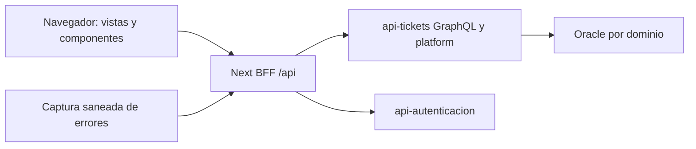

# Manual técnico — Sistema-tickets

Base documental: `926fe45d27922c595c63e8f79e1e82b1594470eb`; actualización de consulta de casos: `cd953b4ea8731336669948645a55032e5f5eabba`; actualización de vistas y diagnóstico judicial: `9d497b6ff471410ea5a96ba6df5e707ccebd8e43`; línea de integración revisada: `Dev + fix/vistas_presentacion_y_layout`. Describe la base y la actualización citadas; la configuración y las autorizaciones efectivas de un servidor se comprueban por separado. Esta edición se preparó sin conectarse a Oracle, SMTP ni servidores institucionales.

Los enlaces de código fijan esa revisión para que sigan siendo consultables cuando `main` excluya herramientas de desarrollo. Al modificar un comportamiento se deben actualizar su caso de uso, configuración y referencia de código.


## Índice

- [1. Propósito y límites](#orientacion)
- [2. Arquitectura y dependencias](#arquitectura)
- [3. Organización de carpetas](#organizacion)
- [4. Patrones, nomenclatura y estilo](#convenciones)
- [5. Preparación y configuración](#configuracion)
- [6. Datos y transacciones](#datos)
- [7. Autenticación, permisos y privacidad](#seguridad)
- [8. Operación, fallos y recuperación](#operacion)
- [9. Validación y mantenimiento](#validacion)
- [10. Ramas y documentos de producción](#promocion)
- [11. Índice de configuración](#variables)
- [12. Índice de persistencia](#objetos)

Casos funcionales y recorridos: [casos-de uso.md](casos-de%20uso.md).

<a id="orientacion"></a>

## 1. Propósito y límites

Panel web institucional para solicitar y atender tickets, consultar aplicaciones y administrar equipos, activos, red, sistemas, servidores, accesos y métricas. La interfaz administra capacidades del actor efectivo, no solo el nombre del perfil. No accede directamente a Oracle: las reglas y datos persistentes pertenecen a api-tickets y api-autenticacion.

<a id="arquitectura"></a>

## 2. Arquitectura y dependencias

`next 16.1.6`, `react 19.2.3`, `graphql ^16.13.1`.

Next App Router separa páginas/layouts de componentes cliente. Las vistas coordinan hooks y contratos de `src/api`; los manejadores `src/app/api` actúan como BFF del mismo origen, conservan autenticación y filtran rutas de destino. `src/platform` proporciona cliente, contexto, navegación, fechas y políticas de presentación. Los módulos corporativos heredados se integran mediante un puente con comprobación de acceso. Los componentes reutilizables y SCSS Modules comparten lenguaje visual, sin sustituir permisos del servidor.




<a id="organizacion"></a>

## 3. Organización de carpetas

| Ubicación | Responsabilidad |
| --- | --- |
| `src/app` | Páginas, layouts y BFF del mismo origen |
| `src/views` | Pantallas funcionales y espacios de plataforma |
| `src/components` | Componentes reutilizables cliente/servidor |
| `src/api` | Contratos, hooks, cliente y configuración |
| `src/platform` | Contexto, acceso, navegación y utilidades de plataforma |
| `src/config` | Registro y catálogo de aplicaciones/rutas |
| `src/auth` | Adaptadores de identidad y recuperación |
| `src/observability` | Registro saneado de incidencias de servidor |
| `scripts` | Actualización y laboratorio local |

<a id="convenciones"></a>

## 4. Patrones, nomenclatura y estilo

Componentes y vistas PascalCase con `.tsx`; hooks `useX`; tipos en archivos próximos al componente; estilos `.module.scss`. Respetar la separación `components/client` y `components/server`, y el uso de client components cuando existe interacción. Las carpetas de App Router determinan rutas; usar el catálogo y navegación central para enlaces en lugar de duplicar permisos por pantalla. Reutilizar cards, tabs, formularios y estados del Panel. Campos de solo lectura no deben parecer editables. Formularios conservan entradas ante errores y muestran permiso denegado antes de pedir una selección larga.

Para una modificación: localizar el caso en [casos-de uso.md](casos-de%20uso.md), seguir sus entradas hasta el servicio/adaptador, modificar contrato y validación juntos y mantener la nomenclatura de los archivos cercanos. Evitar trasladar reglas de autorización a controles visuales. Las reglas indicadas aquí describen las convenciones dominantes y las pautas que deben conservar los cambios nuevos; no presuponen uniformidad del código heredado.

<a id="configuracion"></a>

## 5. Preparación y configuración

Usar Node compatible con Next16 y Dockerfile; pnpm8.15.0 con su lockfile.

```bash
corepack pnpm install --frozen-lockfile
corepack pnpm typecheck
corepack pnpm build
```

Configurar endpoints privados de servidor (`GRAPHQL_ENDPOINT`, `TICKETS_API_URL` y configuración Auth) consultando `src/api/config/env.ts` y los BFF. El navegador usa `/api/graphql` y `/api/platform`, no el hostname interno de Docker. Los prefijos de publicación como `/web` pertenecen al proxy desplegado y no se agregan indiscriminadamente a los paths internos. Variables `NEXT_PUBLIC_*` se incorporan al bundle y deben ser públicas; cambiar solo el entorno al iniciar una imagen no recompila esos valores.

Para desarrollo con datos ficticios revisar `pnpm laboratorio`; el laboratorio no prueba Oracle ni sustituye permisos reales. La captura persistente de incidencias requiere su directorio/configuración de servidor y la integración autorizada con api-tickets. No incluir su clave en el cliente.

Los siguientes comandos son las entradas reales de `package.json`; el listado no es una secuencia que deba ejecutarse completa. Los comandos de semillas, migración, backfill, publicación y envío tienen efectos y se seleccionan según el entorno.

| Script | Comando declarado |
| --- | --- |
| `laboratorio` | `node scripts/laboratorio/iniciar.cjs` |
| `dev` | `next dev` |
| `build` | `next build` |
| `start` | `next start` |
| `typecheck` | `tsc --noEmit -p tsconfig.typecheck.json` |
| `lint` | `eslint` |
| `storybook` | `storybook dev` |
| `build-storybook` | `storybook build` |
| `test:integracion` | `node --test test/integracion/*.test.cjs` |

<a id="datos"></a>

## 6. Datos y transacciones

Sin DataSource ni SQL Oracle directo. api-tickets persiste tickets/plataforma en ADMEMETRAIT, accesos en ADMEMETRAIDENTIDAD y auditoría/métricas en ADMEMETRAAUDITORIA; Auth administra ADMAUTEMETRA. RRHH y nómina permanecen en ADMINSIAF. El estado React/Zustand/contextos es estado de cliente, no evidencia de commit. Los casos señalan fuentes remotas para localizar el cambio del backend correcto.

Cada caso detalla las tablas de su recorrido. El índice de persistencia distingue entidades mapeadas y referencias literales: una entidad de referencia no implica autorización de escritura. Conservar nombres entrecomillados y capitalización cuando el DDL los use. Usar binds para valores y listas validadas para identificadores; el esquema autenticado no sustituye al propietario de cada dominio.

<a id="seguridad"></a>

## 7. Autenticación, permisos y privacidad

El BFF valida sesión, ruta permitida y contrato; no es un proxy abierto a URLs aportadas por el navegador. `actor.admin`, `actor.mode` y capabilities del bootstrap gobiernan presentación, mientras el backend autoriza cada petición. Evitar persistir tokens en enlaces o exponer cabeceras. La captura de errores envía solo diagnóstico saneado; no subir archivos ni datos de nómina a servicios de previsualización externos. Un 200 GraphQL con `errors` es un fallo de operación que debe mostrarse correctamente.

La vista de presentación requiere `actor.admin=true` del bootstrap. `WorkspaceViewProvider` conserva una selección temporal para esa sesión y cuenta, y proyecta solo portada/navegación mediante `presentation.ts`. El bootstrap original, `getPlatformRuntime()`, cookies, token y permisos se conservan para autorizar peticiones y acciones. La interfaz avisa que los datos pertenecen a la cuenta actual; para verificar permisos de otra persona se usa una sesión de esa persona. El nombre USER_ADMIN por sí solo no habilita el selector.

<a id="operacion"></a>

## 8. Operación, fallos y recuperación

Actualizar con `scripts/actualizar-servicio-preservando.py`, comprobando primero el servicio y manteniendo montajes/redes. Tras reconstruir, comprobar proceso HTTP, bootstrap y una consulta autorizada cuando se reabran conexiones. El digest de Next indica una excepción de servidor y debe correlacionarse con logs saneados; no revela por sí solo la causa.

Las incidencias de navegador/BFF no deben bloquear la operación original ni exponerse como detalles internos al usuario. Los formularios de boletas separan revisión, autorización y envío; los archivos del ticket separan metadata, autorización y contenido. Las métricas de tickets pueden tener datos aunque la tabla de eventos de aplicaciones siga vacía. Las operaciones cuentan trabajo confirmado, no visitas de pantallas.

La consulta judicial acepta los primeros 3 o 6 caracteres o el código completo y resalta el prefijo coincidente. La recepción de papelería oculta los campos mientras no haya juzgados válidos y mantiene confirmación previa. El estado vacío de actuaciones reemplaza los encabezados sin filas; la tabla con datos se adapta a tarjetas móviles. Actualizar estado no descarta una solicitud cuyo resultado siga incierto.

El shell ocupa la ventana con posición fija y concentra el desplazamiento en `main`; evita que el documento exterior deje un área vacía al llegar al final de una bitácora larga. El bloqueo de scroll exterior solo se aplica cuando existe `data-workspace-shell`, sin afectar los formularios de autenticación. Los fallos judiciales con referencia UUID válida la muestran en el aviso para localizar la incidencia; no se copian errores SQL a la pantalla.

<a id="validacion"></a>

## 9. Validación y mantenimiento

Las comprobaciones se eligen por alcance: tipos y construcción para contratos; pruebas unitarias para políticas; integración controlada para transacciones, permisos y formatos. Antes de usar una prueba, revisar si instancia Oracle, consume servicios externos o envía mensajes. Los scripts declarados arriba identifican las herramientas disponibles; **este documento no certifica resultados de ejecución ni habilita conectividad institucional**.

Personal sin cuenta y unidades sin descripción siguen visibles como pendientes de vincular; no se completan por nombre. El catálogo de fuentes GitHub depende de credencial configurada en api-tickets. Las aplicaciones retiradas se muestran como desuso; no habilitar MOD13 o LPR por conservar vistas antiguas. Este manual no certifica la configuración de proxy, sesión ni permisos de eme02.

Al añadir una función: definir actor y permisos, enumerar datos y excepciones, implementar el recorrido de extremo a extremo, añadir una comprobación relevante y actualizar ambos documentos. Si cambia una tabla o un catálogo, incluir el DDL o carga revisable en Dev/QA; no habilitar sincronización automática de tablas compartidas para sustituir esa preparación.

<a id="promocion"></a>

## 10. Ramas y documentos de producción

Esta edición añade los dos documentos estables a la raíz para que acompañen al código al promoverlo a `main`. Los documentos de trabajo, SQL y pruebas se mantienen en las ramas de integración conforme a la política del repositorio. Este repositorio no incorpora en este cambio el exportador filtrado de VIVI: un merge normal de Git incluye todos los archivos de su origen. La presencia de estos dos documentos no demuestra que exista filtrado automático del resto del árbol. Revisar el diff de promoción antes de publicar.

<a id="variables"></a>

## 11. Índice de configuración

El índice se obtiene de las lecturas explícitas de configuración del código de referencia; no contiene valores privados. Algunas variables son opcionales o solo se usan en herramientas. Para precedencia, tipo y valor predeterminado, seguir el archivo. Las configuraciones cargadas mediante objetos, JSON o archivos requieren consultar también los adaptadores citados.

| Variable | Función / tratamiento | Fuente |
| --- | --- | --- |
| `AUTH_RECOVERY_BASE_URL` | Destino, escucha u origen permitido de una integración. | [src/auth/recovery.server.ts](https://github.com/EMETRA/Sistema-tickets/blob/926fe45d27922c595c63e8f79e1e82b1594470eb/src/auth/recovery.server.ts) |
| `GRAPHQL_ENDPOINT` | Destino, escucha u origen permitido de una integración. | [src/api/config/env.ts](https://github.com/EMETRA/Sistema-tickets/blob/926fe45d27922c595c63e8f79e1e82b1594470eb/src/api/config/env.ts) |
| `GRAPHQL_PROXY_TIMEOUT_MS` | Parámetro de comportamiento; el tipo, valor predeterminado y validación están en el archivo citado. | [src/app/api/graphql/route.ts](https://github.com/EMETRA/Sistema-tickets/blob/926fe45d27922c595c63e8f79e1e82b1594470eb/src/app/api/graphql/route.ts) |
| `NEXT_PUBLIC_AUTH_API_URL` | Configuración incorporada al cliente; solo valores públicos. | [src/api/config/env.ts](https://github.com/EMETRA/Sistema-tickets/blob/926fe45d27922c595c63e8f79e1e82b1594470eb/src/api/config/env.ts) |
| `NEXT_PUBLIC_AUTH_COOKIE_SECURE` | Configuración incorporada al cliente; solo valores públicos. | [src/auth/constants.ts](https://github.com/EMETRA/Sistema-tickets/blob/926fe45d27922c595c63e8f79e1e82b1594470eb/src/auth/constants.ts) |
| `NEXT_PUBLIC_AUTH_LOGIN_PATH` | Configuración incorporada al cliente; solo valores públicos. | [src/api/config/env.ts](https://github.com/EMETRA/Sistema-tickets/blob/926fe45d27922c595c63e8f79e1e82b1594470eb/src/api/config/env.ts) |
| `NEXT_PUBLIC_ENV` | Configuración incorporada al cliente; solo valores públicos. | [src/api/config/env.ts](https://github.com/EMETRA/Sistema-tickets/blob/926fe45d27922c595c63e8f79e1e82b1594470eb/src/api/config/env.ts) |
| `NEXT_PUBLIC_FETCH_TIMEOUT_MS` | Configuración incorporada al cliente; solo valores públicos. | [src/api/config/env.ts](https://github.com/EMETRA/Sistema-tickets/blob/926fe45d27922c595c63e8f79e1e82b1594470eb/src/api/config/env.ts) |
| `NEXT_PUBLIC_GRAPHQL_DEBUG` | Configuración incorporada al cliente; solo valores públicos. | [src/api/config/env.ts](https://github.com/EMETRA/Sistema-tickets/blob/926fe45d27922c595c63e8f79e1e82b1594470eb/src/api/config/env.ts) |
| `NEXT_PUBLIC_GRAPHQL_ENDPOINT` | Configuración incorporada al cliente; solo valores públicos. | [src/api/config/env.ts](https://github.com/EMETRA/Sistema-tickets/blob/926fe45d27922c595c63e8f79e1e82b1594470eb/src/api/config/env.ts) |
| `NEXT_PUBLIC_GRAPHQL_TIMEOUT_MS` | Configuración incorporada al cliente; solo valores públicos. | [src/api/config/env.ts](https://github.com/EMETRA/Sistema-tickets/blob/926fe45d27922c595c63e8f79e1e82b1594470eb/src/api/config/env.ts) |
| `NEXT_PUBLIC_TICKETS_API_URL` | Configuración incorporada al cliente; solo valores públicos. | [src/api/config/env.ts](https://github.com/EMETRA/Sistema-tickets/blob/926fe45d27922c595c63e8f79e1e82b1594470eb/src/api/config/env.ts) |
| `NEXT_PUBLIC_TURNSTILE_EMBED_ORIGIN` | Configuración incorporada al cliente; solo valores públicos. | [src/components/client/atoms/Turnstile/Turnstile.tsx](https://github.com/EMETRA/Sistema-tickets/blob/926fe45d27922c595c63e8f79e1e82b1594470eb/src/components/client/atoms/Turnstile/Turnstile.tsx) |
| `NEXT_PUBLIC_TURNSTILE_EMBED_URL` | Configuración incorporada al cliente; solo valores públicos. | [src/components/client/atoms/Turnstile/Turnstile.tsx](https://github.com/EMETRA/Sistema-tickets/blob/926fe45d27922c595c63e8f79e1e82b1594470eb/src/components/client/atoms/Turnstile/Turnstile.tsx) |
| `NEXT_RUNTIME` | Parámetro de comportamiento; el tipo, valor predeterminado y validación están en el archivo citado. | [src/instrumentation.ts](https://github.com/EMETRA/Sistema-tickets/blob/926fe45d27922c595c63e8f79e1e82b1594470eb/src/instrumentation.ts) |
| `NODE_ENV` | Parámetro de comportamiento; el tipo, valor predeterminado y validación están en el archivo citado. | [src/api/graphql/errors.ts](https://github.com/EMETRA/Sistema-tickets/blob/926fe45d27922c595c63e8f79e1e82b1594470eb/src/api/graphql/errors.ts) |
| `TICKETS_API_URL` | Destino, escucha u origen permitido de una integración. | [src/api/config/env.ts](https://github.com/EMETRA/Sistema-tickets/blob/926fe45d27922c595c63e8f79e1e82b1594470eb/src/api/config/env.ts) |
| `TICKETS_ERROR_QUEUE_DIR` | Ruta de almacenamiento, montaje o archivo de configuración. | [src/observability/server-incidents.ts](https://github.com/EMETRA/Sistema-tickets/blob/926fe45d27922c595c63e8f79e1e82b1594470eb/src/observability/server-incidents.ts) |
| `TICKETS_LOCAL_LAB` | Parámetro de comportamiento; el tipo, valor predeterminado y validación están en el archivo citado. | [next.config.ts](https://github.com/EMETRA/Sistema-tickets/blob/926fe45d27922c595c63e8f79e1e82b1594470eb/next.config.ts) |
| `TICKETS_PANEL_ERROR_TOKEN` | Credencial, material privado o referencia de autenticación; revisar el uso en origen. | [src/observability/server-incidents.ts](https://github.com/EMETRA/Sistema-tickets/blob/926fe45d27922c595c63e8f79e1e82b1594470eb/src/observability/server-incidents.ts) |
| `TICKETS_PLATFORM_ENABLED` | Parámetro de comportamiento; el tipo, valor predeterminado y validación están en el archivo citado. | [src/api/graphql/home/getAppsCatalog.ts](https://github.com/EMETRA/Sistema-tickets/blob/926fe45d27922c595c63e8f79e1e82b1594470eb/src/api/graphql/home/getAppsCatalog.ts) |

<a id="objetos"></a>

## 12. Índice de persistencia

Referencias literales del código (tablas, vistas y paquetes). Los nombres sin propietario pueden construirse con la configuración del módulo; **este índice no es un script de permisos ni acredita que el objeto exista en un entorno**. Las tablas dinámicas del contrato aparecen arriba y los objetos de cada recorrido en el catálogo.

| Referencia | Punto de lectura o uso |
| --- | --- |
| `TB_CATEGORIA` | [src/api/graphql/COM03/catalogos.dummy.ts](https://github.com/EMETRA/Sistema-tickets/blob/926fe45d27922c595c63e8f79e1e82b1594470eb/src/api/graphql/COM03/catalogos.dummy.ts) |
| `TB_ETIQUETA` | [src/api/graphql/COM03/catalogos.dummy.ts](https://github.com/EMETRA/Sistema-tickets/blob/926fe45d27922c595c63e8f79e1e82b1594470eb/src/api/graphql/COM03/catalogos.dummy.ts) |
| `TB_NOTICIA` | [src/api/graphql/COM03/types.ts](https://github.com/EMETRA/Sistema-tickets/blob/926fe45d27922c595c63e8f79e1e82b1594470eb/src/api/graphql/COM03/types.ts) |
| `TB_NOTICIA_CATEGORIA` | [src/api/graphql/COM03/types.ts](https://github.com/EMETRA/Sistema-tickets/blob/926fe45d27922c595c63e8f79e1e82b1594470eb/src/api/graphql/COM03/types.ts) |
| `TB_NOTICIA_ETIQUETA` | [src/api/graphql/COM03/types.ts](https://github.com/EMETRA/Sistema-tickets/blob/926fe45d27922c595c63e8f79e1e82b1594470eb/src/api/graphql/COM03/types.ts) |
| `TB_NOTICIA_RECURSO` | [src/api/graphql/COM03/types.ts](https://github.com/EMETRA/Sistema-tickets/blob/926fe45d27922c595c63e8f79e1e82b1594470eb/src/api/graphql/COM03/types.ts) |
| `TB_RECURSO` | [src/api/graphql/COM03/types.ts](https://github.com/EMETRA/Sistema-tickets/blob/926fe45d27922c595c63e8f79e1e82b1594470eb/src/api/graphql/COM03/types.ts) |
| `TB_SECCION_NOTICIA` | [src/api/graphql/COM03/types.ts](https://github.com/EMETRA/Sistema-tickets/blob/926fe45d27922c595c63e8f79e1e82b1594470eb/src/api/graphql/COM03/types.ts) |
