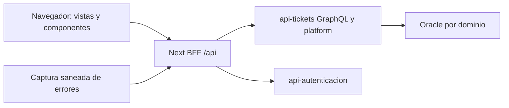

# Manual técnico — Sistema-tickets

Base documental: `926fe45d27922c595c63e8f79e1e82b1594470eb`; actualización de consulta de casos: `cd953b4ea8731336669948645a55032e5f5eabba`; actualización de vistas y diagnóstico judicial: `9d497b6ff471410ea5a96ba6df5e707ccebd8e43`; actualización documental: `b77da403cba653095c8156b0e2c13035a96b606b`; actualización de catálogo: `e3f8676f5121223c9f23aaa036833260efe236f9`; reportes VIVI: `b29ea52c21307f21bb49041ba2e8f76fb8080f44`; responsables de noticias: `55827f0694bf6f736264c3c5d41622b7cc59a88a`; inventario institucional: `9daff7769ccb684b8eb5497a8b8b82b902e050e0`; navegación de personal, activos y red: `db60d821fdbc9b5e2cee31f98cc7422626a4ff22`; perfil y campañas de RRHH: `b2e63af1d1e66bbc5bab985dc80893e3f05879ae`; línea de integración revisada: `Dev + feat/perfil_campanas_rrhh`. Describe la base y la actualización citadas; la configuración y las autorizaciones efectivas de un servidor se comprueban por separado. Esta edición se preparó sin conectarse a Oracle, SMTP ni servidores institucionales.

Los enlaces de código fijan esa revisión para que sigan siendo consultables cuando `main` excluya herramientas de desarrollo. Al modificar un comportamiento se deben actualizar su caso de uso, configuración y referencia de código.


## Índice

- [1. Propósito y límites](#orientacion)
- [2. Arquitectura y dependencias](#arquitectura)
- [3. Organización de carpetas](#organizacion)
- [4. Patrones, nomenclatura y estilo](#convenciones)
- [5. Preparación y configuración](#configuracion)
- [6. Datos y transacciones](#datos)
- [Inventario institucional en equipos y cableado](#inventario-institucional)
- [Perfil personal y campañas de RRHH](#rrhh-personal)
- [7. Autenticación, permisos y privacidad](#seguridad)
- [8. Operación, fallos y recuperación](#operacion)
- [9. Validación y mantenimiento](#validacion)
- [10. Ramas y documentos de producción](#promocion)
- [11. Índice de configuración](#variables)
- [12. Índice de persistencia](#objetos)

Casos funcionales y recorridos: [casos-de uso.md](casos-de%20uso.md).

<a id="orientacion"></a>

## 1. Propósito y límites

Panel web institucional para solicitar y atender tickets, consultar aplicaciones y administrar equipos, activos, red, sistemas, servidores, accesos y métricas. La interfaz administra capacidades del actor efectivo, no solo el nombre del perfil. No accede directamente a Oracle: las reglas y datos persistentes pertenecen a api-tickets y api-autenticacion.

<a id="arquitectura"></a>

## 2. Arquitectura y dependencias

`next 16.1.6`, `react 19.2.3`, `graphql ^16.13.1`.

Next App Router separa páginas/layouts de componentes cliente. Las vistas coordinan hooks y contratos de `src/api`; los manejadores `src/app/api` actúan como BFF del mismo origen, conservan autenticación y filtran rutas de destino. `src/platform` proporciona cliente, contexto, navegación, fechas y políticas de presentación. Los módulos corporativos heredados se integran mediante un puente con comprobación de acceso. Los componentes reutilizables y SCSS Modules comparten lenguaje visual, sin sustituir permisos del servidor.




<a id="organizacion"></a>

## 3. Organización de carpetas

| Ubicación | Responsabilidad |
| --- | --- |
| `src/app` | Páginas, layouts y BFF del mismo origen |
| `src/views` | Pantallas funcionales y espacios de plataforma |
| `src/components` | Componentes reutilizables cliente/servidor |
| `src/api` | Contratos, hooks, cliente y configuración |
| `src/platform` | Contexto, acceso, navegación y utilidades de plataforma |
| `src/config` | Registro y catálogo de aplicaciones/rutas |
| `src/auth` | Adaptadores de identidad y recuperación |
| `src/observability` | Registro saneado de incidencias de servidor |
| `scripts` | Actualización y laboratorio local |

<a id="convenciones"></a>

## 4. Patrones, nomenclatura y estilo

Componentes y vistas PascalCase con `.tsx`; hooks `useX`; tipos en archivos próximos al componente; estilos `.module.scss`. Respetar la separación `components/client` y `components/server`, y el uso de client components cuando existe interacción. Las carpetas de App Router determinan rutas; usar el catálogo y navegación central para enlaces en lugar de duplicar permisos por pantalla. Reutilizar cards, tabs, formularios y estados del Panel. Campos de solo lectura no deben parecer editables. Formularios conservan entradas ante errores y muestran permiso denegado antes de pedir una selección larga.

Para una modificación: localizar el caso en [casos-de uso.md](casos-de%20uso.md), seguir sus entradas hasta el servicio/adaptador, modificar contrato y validación juntos y mantener la nomenclatura de los archivos cercanos. Evitar trasladar reglas de autorización a controles visuales. Las reglas indicadas aquí describen las convenciones dominantes y las pautas que deben conservar los cambios nuevos; no presuponen uniformidad del código heredado.

Noticias mantiene separados el autor editorial y los responsables del registro. El BFF conserva `actividadEditorial` procedente de api-tickets; [src/api/cms/mappers.ts](https://github.com/EMETRA/Sistema-tickets/blob/55827f0694bf6f736264c3c5d41622b7cc59a88a/src/api/cms/mappers.ts) lo adapta al listado y al detalle. [src/components/client/organisms/NewsActivity/NewsActivity.tsx](https://github.com/EMETRA/Sistema-tickets/blob/55827f0694bf6f736264c3c5d41622b7cc59a88a/src/components/client/organisms/NewsActivity/NewsActivity.tsx) presenta creador, último actualizador y sus fechas en `America/Guatemala`: columna «Registro y edición» y ficha de solo lectura al editar. La fecha de publicación sigue siendo otro dato. La vista previa pública y los comandos de guardado no incorporan este bloque administrativo.

Ante metadatos históricos ausentes se muestra «Sin registro»; si solo existe el ID, «Usuario #ID». No se deduce el responsable a partir del autor editorial. Compatible con un API anterior mediante los campos `creado_por`, `actualizado_por`, `creado` y `actualizado`, sin inventar nombres. Publicar primero el cambio de api-tickets para disponer de identidades resueltas. No requiere SQL ni nuevas variables. Pruebas: [test/integracion/news-activity.test.cjs](https://github.com/EMETRA/Sistema-tickets/blob/55827f0694bf6f736264c3c5d41622b7cc59a88a/test/integracion/news-activity.test.cjs) y [test/integracion/cms-bff-browser.cjs](https://github.com/EMETRA/Sistema-tickets/blob/55827f0694bf6f736264c3c5d41622b7cc59a88a/test/integracion/cms-bff-browser.cjs).

<a id="configuracion"></a>

## 5. Preparación y configuración

Usar Node compatible con Next16 y Dockerfile; pnpm8.15.0 con su lockfile.

```bash
corepack pnpm install --frozen-lockfile
corepack pnpm typecheck
corepack pnpm build
```

Configurar endpoints privados de servidor (`GRAPHQL_ENDPOINT`, `TICKETS_API_URL` y configuración Auth) consultando `src/api/config/env.ts` y los BFF. El navegador usa `/api/graphql` y `/api/platform`, no el hostname interno de Docker. Los prefijos de publicación como `/web` pertenecen al proxy desplegado y no se agregan indiscriminadamente a los paths internos. Variables `NEXT_PUBLIC_*` se incorporan al bundle y deben ser públicas; cambiar solo el entorno al iniciar una imagen no recompila esos valores.

Para desarrollo con datos ficticios revisar `pnpm laboratorio`; el laboratorio no prueba Oracle ni sustituye permisos reales. La captura persistente de incidencias requiere su directorio/configuración de servidor y la integración autorizada con api-tickets. No incluir su clave en el cliente.

Los siguientes comandos son las entradas reales de `package.json`; el listado no es una secuencia que deba ejecutarse completa. Los comandos de semillas, migración, backfill, publicación y envío tienen efectos y se seleccionan según el entorno.

| Script | Comando declarado |
| --- | --- |
| `laboratorio` | `node scripts/laboratorio/iniciar.cjs` |
| `dev` | `next dev` |
| `build` | `next build` |
| `start` | `next start` |
| `typecheck` | `tsc --noEmit -p tsconfig.typecheck.json` |
| `lint` | `eslint` |
| `storybook` | `storybook dev` |
| `build-storybook` | `storybook build` |
| `test:integracion` | `node --test test/integracion/*.test.cjs` |

<a id="datos"></a>

## 6. Datos y transacciones

Sin DataSource ni SQL Oracle directo. api-tickets persiste tickets/plataforma en ADMEMETRAIT, accesos en ADMEMETRAIDENTIDAD y auditoría/métricas en ADMEMETRAAUDITORIA; Auth administra ADMAUTEMETRA. RRHH y nómina permanecen en ADMINSIAF. El estado React/Zustand/contextos es estado de cliente, no evidencia de commit. Los casos señalan fuentes remotas para localizar el cambio del backend correcto.

Cada caso detalla las tablas de su recorrido. El índice de persistencia distingue entidades mapeadas y referencias literales: una entidad de referencia no implica autorización de escritura. Conservar nombres entrecomillados y capitalización cuando el DDL los use. Usar binds para valores y listas validadas para identificadores; el esquema autenticado no sustituye al propietario de cada dominio.

<a id="inventario-institucional"></a>

### Personal, activos y red: navegación por tarea

| Entrada | Finalidad | Vistas |
| --- | --- | --- |
| Personal y equipos | Personas y organización del trabajo | Personal de RRHH (administración), equipos de trabajo, responsabilidades |
| Activos y mantenimiento | Bienes y su atención técnica | Inventario de bienes, fichas técnicas, mantenimientos/visitas, ubicaciones, movimientos |
| Red y cableado | Dispositivos y enlaces físicos/lógicos | Dispositivos, conexiones, mapa de red |

[WorkspaceNavigation](https://github.com/EMETRA/Sistema-tickets/blob/db60d821fdbc9b5e2cee31f98cc7422626a4ff22/src/views/Platform/WorkspaceNavigation.tsx) usa `?view=` y el historial del navegador, con selección válida según permisos. [AssetsWorkspace](https://github.com/EMETRA/Sistema-tickets/blob/db60d821fdbc9b5e2cee31f98cc7422626a4ff22/src/views/Platform/AssetsWorkspace.tsx), [OrganizationWorkspace](https://github.com/EMETRA/Sistema-tickets/blob/db60d821fdbc9b5e2cee31f98cc7422626a4ff22/src/views/Platform/OrganizationWorkspace.tsx) y [NetworkWorkspace](https://github.com/EMETRA/Sistema-tickets/blob/db60d821fdbc9b5e2cee31f98cc7422626a4ff22/src/views/Platform/NetworkWorkspace.tsx) definen las tareas de cada espacio. `PlatformRoute` los envuelve en Suspense por la lectura de parámetros de búsqueda.

El acceso antiguo `/equipo` redirige al espacio de organización cuando el usuario tiene ese módulo disponible; el menú elimina esa entrada duplicada. Si no dispone del módulo conserva su directorio heredado autorizado. Los perfiles individuales `/equipo/:id` mantienen su URL y ofrecen Perfil/Bienes asignados. [SystemLayout](https://github.com/EMETRA/Sistema-tickets/blob/db60d821fdbc9b5e2cee31f98cc7422626a4ff22/src/components/client/templates/SystemLayout/SystemLayout.tsx) conserva el runtime de permisos y las vistas de presentación existentes.

El personal administrativo carga desde `/organization/people`, sin preparar la sincronización. [OrganizationSync](https://github.com/EMETRA/Sistema-tickets/blob/db60d821fdbc9b5e2cee31f98cc7422626a4ff22/src/views/Platform/OrganizationSync.tsx) queda como acción desplegable dentro de Equipos de trabajo; conserva vista previa, conflictos y dos confirmaciones. El directorio no crea cuentas ni membresías. Los enlaces Ver bienes llevan al inventario canónico con `empleado`, `equipoId` o `usuarioId`; el API resuelve la relación institucional. No confundir ID del Panel con código de empleado ni deducir vínculos por nombre.

[ResourceWorkspace](https://github.com/EMETRA/Sistema-tickets/blob/db60d821fdbc9b5e2cee31f98cc7422626a4ff22/src/components/client/organisms/ResourceWorkspace/ResourceWorkspace.tsx) muestra registros técnicos con las columnas de [resources.ts](https://github.com/EMETRA/Sistema-tickets/blob/db60d821fdbc9b5e2cee31f98cc7422626a4ff22/src/platform/resources.ts), en lugar de repetir estado/equipo/fecha para todos los tipos. `labels` contiene los nombres autorizados resueltos por el API; los UUID no se presentan como descripciones. En estas tablas el nombre abre el detalle, sin otra acción duplicada. Las descripciones y encabezados de directorio aparecen una sola vez.

El inventario oficial es de solo lectura. Crear ficha técnica copia referencia, número, serie y modelo, y requiere completar los datos técnicos; no cambia tarjetas. Buscar un bien desde un formulario es una acción explícita, sin formularios anidados. Red utiliza [InventoryLinkDialog](https://github.com/EMETRA/Sistema-tickets/blob/db60d821fdbc9b5e2cee31f98cc7422626a4ff22/src/views/Platform/InventoryLinkDialog.tsx) para vincular un bien y completar ubicación/puertos; al guardar, cierra la búsqueda y recarga los dispositivos. El mapa usa los mismos dispositivos y conexiones. Las ubicaciones se mantienen únicamente en Activos y mantenimiento; Red ofrece un enlace a ese catálogo compartido.

Actualizar primero api-tickets y después Panel. El error inicial observado con `offset=0` se diagnosticó leyendo el compilado del contenedor: seguía instalada una versión del API que exigía empleado. [Guía de actualización y comprobación](https://github.com/EMETRA/api-tickets/blob/e077b221b4efdd01c60b7051331bea6b5392a13d/docs/guia-inventario-activos-fijos.md). No requiere migración ni variables nuevas.

Pruebas: [navegación y presentación de valores](https://github.com/EMETRA/Sistema-tickets/blob/db60d821fdbc9b5e2cee31f98cc7422626a4ff22/test/integracion/navegacion-inventario.test.cjs), [recorridos de navegador](https://github.com/EMETRA/Sistema-tickets/blob/db60d821fdbc9b5e2cee31f98cc7422626a4ff22/test/integracion/inventario-browser.cjs) y [sincronización RRHH](https://github.com/EMETRA/Sistema-tickets/blob/db60d821fdbc9b5e2cee31f98cc7422626a4ff22/test/integracion/equipos-rrhh-browser.cjs). Incluyen persona sin cuenta, filtros, historial, autorización, confirmaciones, conflictos, dispositivo nuevo, conexiones, mapa y móvil con datos ficticios.

<a id="rrhh-personal"></a>

## Perfil personal, notificaciones y campañas de RRHH

`/mi-perfil` es el destino del menú personal para todos los roles autenticados. Los enlaces antiguos al propio colaborador reutilizan la misma vista; los perfiles de terceros conservan la información básica permitida, sin la ficha privada de RRHH. [src/views/Platform/HrProfileWorkspace.tsx](https://github.com/EMETRA/Sistema-tickets/blob/b2e63af1d1e66bbc5bab985dc80893e3f05879ae/src/views/Platform/HrProfileWorkspace.tsx) presenta campos oficiales agrupados y buscables, el estado de vínculo, bienes asignados y convocatorias. El navegador no elige otro empleado: `GET /api/platform/hr/me` se resuelve por el actor en el API. Números, texto y fechas se presentan como datos; archivos/fotografía se representan como registro de archivo, sin mostrar rutas de descarga públicas.

`/notificaciones` y la campana superior integran los avisos de campañas y un enlace al seguimiento de tickets. [src/platform/hr-notifications.tsx](https://github.com/EMETRA/Sistema-tickets/blob/b2e63af1d1e66bbc5bab985dc80893e3f05879ae/src/platform/hr-notifications.tsx) muestra el aviso obligatorio mientras una campaña esté abierta y PENDIENTE/DEVUELTA. Consulta al entrar, volver al foco, finalizar un trámite y periódicamente con la pestaña visible. Ante fallo temporal conserva el último aviso conocido y reintenta con espera creciente de 30 segundos a 5 minutos; no repite automáticamente 401/403. Una campaña programada se anuncia con su apertura y una cerrada se identifica como tal. La convocatoria persiste en Oracle aunque el usuario esté desconectado; no se necesita permiso de notificaciones del navegador ni un worker adicional.

En `/mi-perfil?campana=...`, el formulario comprueba estado y vínculo antes de habilitar campos. Solo muestra los solicitados por RRHH; CONFIRMAR exige correcto o corrección con observación. El campo confirmado no se vuelve editable por manipular React: el API valida el contrato publicado. Enviar usa `platformCommand` sin la doble confirmación administrativa, aunque el usuario tenga administración, porque el actor/destinatario son propios. Conserva la entrada ante fallos y puede recargar los datos oficiales para revisar cambios concurrentes; los campos de confirmación se deben responder otra vez. AL_ENVIAR modifica los campos editables al enviar; CON_REVISION conserva la propuesta hasta aprobación. No guardar fichas ni respuestas personales en localStorage.

El módulo `rh-datos` se abre desde **Aplicaciones de Recursos Humanos → Formularios → Actualización de datos del personal**. ModuleAccessGate bloquea el formulario antes de pedir opciones/datos. [src/views/Platform/HrCampaignsWorkspace.tsx](https://github.com/EMETRA/Sistema-tickets/blob/b2e63af1d1e66bbc5bab985dc80893e3f05879ae/src/views/Platform/HrCampaignsWorkspace.tsx) usa las acciones LEER/INSERTAR/EDITAR para consultar, gestionar y revisar, además de la validación del API en cada petición. La vista permite programar o activar, definir cierre exacto/plazos habituales, seleccionar hasta 50 campos con edición/confirmación y elegir modo de aplicación. La lista de campos tiene búsqueda y scroll propio para evitar crecer indefinidamente.

[src/platform/hr.ts](https://github.com/EMETRA/Sistema-tickets/blob/b2e63af1d1e66bbc5bab985dc80893e3f05879ae/src/platform/hr.ts) centraliza contratos y fechas: controles en hora de Guatemala, instantes ISO con zona, presets de días y un mes calendario con ajuste al último día válido, incluso cuando la fecha UTC ya cambió de mes. No deducir el plazo desde la zona del navegador ni sustituir el mes por 30 días.

El reporte distingue porcentaje enviado, datos aplicados/confirmados, contacto y revisión humana. Su 100% es el grupo convocado al publicar y no cambia al filtrar filas. Cada entrega muestra anterior/propuesta, observaciones y contacto. [src/views/Platform/HrDeliveryHistory.tsx](https://github.com/EMETRA/Sistema-tickets/blob/b2e63af1d1e66bbc5bab985dc80893e3f05879ae/src/views/Platform/HrDeliveryHistory.tsx) carga/pagina versiones anteriores de forma separada, sin volver a aplicarlas. Las decisiones permiten aprobar, devolver dentro de plazo, solicitar contacto sin aplicar y finalizar atención. La observación del revisor es obligatoria y visible al usuario. Las acciones administrativas conservan la revisión/confirmación de Tickets.

El BFF de plataforma solo incorpora el prefijo `hr`: Bearer, cabeceras privadas, conservación de HTTP/referencia y `cache: no-store`. No hay SQL, secretos ni lógica de aplicación oficial en Next. El API requiere `TICKETS_HR_SELF_SERVICE_ENABLED=true` para campañas, con valor predeterminado false; el perfil propio sigue siendo lectura. No se añade una variable pública de cliente. Instalar/verificar según [sql/rrhh/README.md](https://github.com/EMETRA/api-tickets/blob/27b17f87b19c9140668a295aa7c4a46436745731/sql/rrhh/README.md), actualizar API y luego Panel y asignar los permisos funcionales de RRHH. Las tablas corporativas permanecen en ADMINSIAF y la identidad en ADMAUTEMETRA; las tres tablas del trámite pertenecen a ADMEMETRAIT.

Validación: [test/integracion/rrhh-datos.test.cjs](https://github.com/EMETRA/Sistema-tickets/blob/b2e63af1d1e66bbc5bab985dc80893e3f05879ae/test/integracion/rrhh-datos.test.cjs) comprueba fechas de Guatemala/mes, rutas de todos los roles y el BFF privado. [test/integracion/rrhh-datos-browser.cjs](https://github.com/EMETRA/Sistema-tickets/blob/b2e63af1d1e66bbc5bab985dc80893e3f05879ae/test/integracion/rrhh-datos-browser.cjs) usa backend/sesión ficticios y recorre perfil, aviso, confirmación con observación, reintento idempotente, programación, ambos modos declarados, aprobación, contacto, cierre, permisos previos, recuperación de bandeja y anchos 1440/1024/390. La escritura real se valida en las pruebas del API; la instalación y datos reales quedan pendientes de QA. Ver [CU-RH-01](casos-de%20uso.md#cu-rh-01).

<a id="seguridad"></a>

## 7. Autenticación, permisos y privacidad

El BFF valida sesión, ruta permitida y contrato; no es un proxy abierto a URLs aportadas por el navegador. `actor.admin`, `actor.mode` y capabilities del bootstrap gobiernan presentación, mientras el backend autoriza cada petición. Evitar persistir tokens en enlaces o exponer cabeceras. La captura de errores envía solo diagnóstico saneado; no subir archivos ni datos de nómina a servicios de previsualización externos. Un 200 GraphQL con `errors` es un fallo de operación que debe mostrarse correctamente.

La vista de presentación requiere `actor.admin=true` del bootstrap. `WorkspaceViewProvider` conserva una selección temporal para esa sesión y cuenta, y proyecta solo portada/navegación mediante `presentation.ts`. El bootstrap original, `getPlatformRuntime()`, cookies, token y permisos se conservan para autorizar peticiones y acciones. La interfaz avisa que los datos pertenecen a la cuenta actual; para verificar permisos de otra persona se usa una sesión de esa persona. El nombre USER_ADMIN por sí solo no habilita el selector.

El catálogo vigente sitúa **Consultar caso** en **Aplicaciones Juzgado → Consultas** (`/home/juzgado/consultas/juz01`), conservando `VIVI_JUZGADO_*`. **Notificar documento** permanece en Jurídico. Los tres reportes semanales (`mod01`, `exportmod01`, `save-mod01`) están deshabilitados; los dos dashboards de Informática se retiran del catálogo y su acceso queda en **Métricas** (`/espacio/metricas`). Se conservan tablas y registros históricos.

[`publicAppsCatalog`](https://github.com/EMETRA/Sistema-tickets/blob/e3f8676f5121223c9f23aaa036833260efe236f9/src/config/apps-catalog.ts) normaliza catálogos anteriores sin inventar acceso a Juzgado. El respaldo usa la misma ubicación. Los marcadores judiciales antiguos conservan `caseNumber`; los reportes llevan a desuso y los dashboards a Métricas. El destino exige sesión y permisos, y la retirada se aplica también en el API. No requiere SQL.

Los **Reportes de VIVI** se ubican en Aplicaciones de Informática → Reportes (`/home/informatica/reportes/vivi-reportes`). Ofrecen usuarios inscritos, ficha de los datos declarados y actividad del usuario con avisos vehiculares y reportes de incidentes, además de cuentas activas/inactivas y sin actividad. Los filtros de inscripción afectan al universo de usuarios; sus contadores de actividad son históricos completos. En actividad se filtra la fecha de registro, no el hecho ni su evidencia. Los días son inclusivos de Guatemala y se convierten a UTC.

El formulario se monta solo después de comprobar `vivi-reportes` con ModuleAccessGate. El BFF conserva Bearer, origen fijo y respuesta privada sin caché. La pantalla muestra nulos, vacíos y errores como estados distintos, mantiene los últimos resultados confirmados y permite reintentar. La paginación usa los filtros aplicados y el CSV exporta solo la página confirmada (hasta 50 filas), con protección frente a fórmulas; no incluye la ficha privada completa. Las peticiones anteriores se abortan al cambiar de consulta para impedir cruces de resultados.

La entrada requiere registrar el catálogo en api-tickets con `sql/vivi/04_reportes_informatica.sql`; tener solo la vista local no habilita las fuentes. Acceso efectivo: `TICKETS_ADMINISTRAR` o `TICKETS_VIVI_REPORTES_LEER`. La implementación está en [src/views/Platform/ViviReportsWorkspace.tsx](https://github.com/EMETRA/Sistema-tickets/blob/b29ea52c21307f21bb49041ba2e8f76fb8080f44/src/views/Platform/ViviReportsWorkspace.tsx) y [src/platform/vivi-reports.ts](https://github.com/EMETRA/Sistema-tickets/blob/b29ea52c21307f21bb49041ba2e8f76fb8080f44/src/platform/vivi-reports.ts).

<a id="operacion"></a>

## 8. Operación, fallos y recuperación

Actualizar con `scripts/actualizar-servicio-preservando.py`, comprobando primero el servicio y manteniendo montajes/redes. Tras reconstruir, comprobar proceso HTTP, bootstrap y una consulta autorizada cuando se reabran conexiones. El digest de Next indica una excepción de servidor y debe correlacionarse con logs saneados; no revela por sí solo la causa.

Las incidencias de navegador/BFF no deben bloquear la operación original ni exponerse como detalles internos al usuario. Los formularios de boletas separan revisión, autorización y envío; los archivos del ticket separan metadata, autorización y contenido. Las métricas de tickets pueden tener datos aunque la tabla de eventos de aplicaciones siga vacía. Las operaciones cuentan trabajo confirmado, no visitas de pantallas.

La consulta judicial acepta los primeros 3 o 6 caracteres o el código completo y resalta el prefijo coincidente. La recepción de papelería oculta los campos mientras no haya juzgados válidos y mantiene confirmación previa. El estado vacío de actuaciones reemplaza los encabezados sin filas; la tabla con datos se adapta a tarjetas móviles. Actualizar estado no descarta una solicitud cuyo resultado siga incierto.

El shell ocupa la ventana con posición fija y concentra el desplazamiento en `main`; evita que el documento exterior deje un área vacía al llegar al final de una bitácora larga. El bloqueo de scroll exterior solo se aplica cuando existe `data-workspace-shell`, sin afectar los formularios de autenticación. Los fallos judiciales con referencia UUID válida la muestran en el aviso para localizar la incidencia; no se copian errores SQL a la pantalla.

El proxy JUZ01 conserva la referencia UUID del API y su HTTP. Los fallos técnicos sin referencia del API se encolan como incidencias del Panel; sesión, permiso y conflicto no se convierten en bugs. La generación de PDF exige JSON y la descarga valida el tipo del archivo. El reintento documental obtiene un comando revisado nuevo por clic para no quedar bloqueado por un intento anterior incierto; usa el mismo ID de resolución y la idempotencia documental del API. Esta excepción no altera la identidad de las decisiones judiciales ni de otras mutaciones. El aviso indica que la resolución ya está registrada y que se debe reintentar únicamente el PDF.

<a id="validacion"></a>

## 9. Validación y mantenimiento

Las comprobaciones se eligen por alcance: tipos y construcción para contratos; pruebas unitarias para políticas; integración controlada para transacciones, permisos y formatos. Antes de usar una prueba, revisar si instancia Oracle, consume servicios externos o envía mensajes. Los scripts declarados arriba identifican las herramientas disponibles; **este documento no certifica resultados de ejecución ni habilita conectividad institucional**.

Personal sin cuenta y unidades sin descripción siguen visibles como pendientes de vincular; no se completan por nombre. El catálogo de fuentes GitHub depende de credencial configurada en api-tickets. Las aplicaciones retiradas se muestran como desuso; no habilitar MOD13 o LPR por conservar vistas antiguas. Este manual no certifica la configuración de proxy, sesión ni permisos de eme02.

Al añadir una función: definir actor y permisos, enumerar datos y excepciones, implementar el recorrido de extremo a extremo, añadir una comprobación relevante y actualizar ambos documentos. Si cambia una tabla o un catálogo, incluir el DDL o carga revisable en Dev/QA; no habilitar sincronización automática de tablas compartidas para sustituir esa preparación.

<a id="promocion"></a>

## 10. Ramas y documentos de producción

Esta edición añade los dos documentos estables a la raíz para que acompañen al código al promoverlo a `main`. Los documentos de trabajo, SQL y pruebas se mantienen en las ramas de integración conforme a la política del repositorio. Este repositorio no incorpora en este cambio el exportador filtrado de VIVI: un merge normal de Git incluye todos los archivos de su origen. La presencia de estos dos documentos no demuestra que exista filtrado automático del resto del árbol. Revisar el diff de promoción antes de publicar.

<a id="variables"></a>

## 11. Índice de configuración

El índice se obtiene de las lecturas explícitas de configuración del código de referencia; no contiene valores privados. Algunas variables son opcionales o solo se usan en herramientas. Para precedencia, tipo y valor predeterminado, seguir el archivo. Las configuraciones cargadas mediante objetos, JSON o archivos requieren consultar también los adaptadores citados.

| Variable | Función / tratamiento | Fuente |
| --- | --- | --- |
| `AUTH_RECOVERY_BASE_URL` | Destino, escucha u origen permitido de una integración. | [src/auth/recovery.server.ts](https://github.com/EMETRA/Sistema-tickets/blob/926fe45d27922c595c63e8f79e1e82b1594470eb/src/auth/recovery.server.ts) |
| `GRAPHQL_ENDPOINT` | Destino, escucha u origen permitido de una integración. | [src/api/config/env.ts](https://github.com/EMETRA/Sistema-tickets/blob/926fe45d27922c595c63e8f79e1e82b1594470eb/src/api/config/env.ts) |
| `GRAPHQL_PROXY_TIMEOUT_MS` | Parámetro de comportamiento; el tipo, valor predeterminado y validación están en el archivo citado. | [src/app/api/graphql/route.ts](https://github.com/EMETRA/Sistema-tickets/blob/926fe45d27922c595c63e8f79e1e82b1594470eb/src/app/api/graphql/route.ts) |
| `NEXT_PUBLIC_AUTH_API_URL` | Configuración incorporada al cliente; solo valores públicos. | [src/api/config/env.ts](https://github.com/EMETRA/Sistema-tickets/blob/926fe45d27922c595c63e8f79e1e82b1594470eb/src/api/config/env.ts) |
| `NEXT_PUBLIC_AUTH_COOKIE_SECURE` | Configuración incorporada al cliente; solo valores públicos. | [src/auth/constants.ts](https://github.com/EMETRA/Sistema-tickets/blob/926fe45d27922c595c63e8f79e1e82b1594470eb/src/auth/constants.ts) |
| `NEXT_PUBLIC_AUTH_LOGIN_PATH` | Configuración incorporada al cliente; solo valores públicos. | [src/api/config/env.ts](https://github.com/EMETRA/Sistema-tickets/blob/926fe45d27922c595c63e8f79e1e82b1594470eb/src/api/config/env.ts) |
| `NEXT_PUBLIC_ENV` | Configuración incorporada al cliente; solo valores públicos. | [src/api/config/env.ts](https://github.com/EMETRA/Sistema-tickets/blob/926fe45d27922c595c63e8f79e1e82b1594470eb/src/api/config/env.ts) |
| `NEXT_PUBLIC_FETCH_TIMEOUT_MS` | Configuración incorporada al cliente; solo valores públicos. | [src/api/config/env.ts](https://github.com/EMETRA/Sistema-tickets/blob/926fe45d27922c595c63e8f79e1e82b1594470eb/src/api/config/env.ts) |
| `NEXT_PUBLIC_GRAPHQL_DEBUG` | Configuración incorporada al cliente; solo valores públicos. | [src/api/config/env.ts](https://github.com/EMETRA/Sistema-tickets/blob/926fe45d27922c595c63e8f79e1e82b1594470eb/src/api/config/env.ts) |
| `NEXT_PUBLIC_GRAPHQL_ENDPOINT` | Configuración incorporada al cliente; solo valores públicos. | [src/api/config/env.ts](https://github.com/EMETRA/Sistema-tickets/blob/926fe45d27922c595c63e8f79e1e82b1594470eb/src/api/config/env.ts) |
| `NEXT_PUBLIC_GRAPHQL_TIMEOUT_MS` | Configuración incorporada al cliente; solo valores públicos. | [src/api/config/env.ts](https://github.com/EMETRA/Sistema-tickets/blob/926fe45d27922c595c63e8f79e1e82b1594470eb/src/api/config/env.ts) |
| `NEXT_PUBLIC_TICKETS_API_URL` | Configuración incorporada al cliente; solo valores públicos. | [src/api/config/env.ts](https://github.com/EMETRA/Sistema-tickets/blob/926fe45d27922c595c63e8f79e1e82b1594470eb/src/api/config/env.ts) |
| `NEXT_PUBLIC_TURNSTILE_EMBED_ORIGIN` | Configuración incorporada al cliente; solo valores públicos. | [src/components/client/atoms/Turnstile/Turnstile.tsx](https://github.com/EMETRA/Sistema-tickets/blob/926fe45d27922c595c63e8f79e1e82b1594470eb/src/components/client/atoms/Turnstile/Turnstile.tsx) |
| `NEXT_PUBLIC_TURNSTILE_EMBED_URL` | Configuración incorporada al cliente; solo valores públicos. | [src/components/client/atoms/Turnstile/Turnstile.tsx](https://github.com/EMETRA/Sistema-tickets/blob/926fe45d27922c595c63e8f79e1e82b1594470eb/src/components/client/atoms/Turnstile/Turnstile.tsx) |
| `NEXT_RUNTIME` | Parámetro de comportamiento; el tipo, valor predeterminado y validación están en el archivo citado. | [src/instrumentation.ts](https://github.com/EMETRA/Sistema-tickets/blob/926fe45d27922c595c63e8f79e1e82b1594470eb/src/instrumentation.ts) |
| `NODE_ENV` | Parámetro de comportamiento; el tipo, valor predeterminado y validación están en el archivo citado. | [src/api/graphql/errors.ts](https://github.com/EMETRA/Sistema-tickets/blob/926fe45d27922c595c63e8f79e1e82b1594470eb/src/api/graphql/errors.ts) |
| `TICKETS_API_URL` | Destino, escucha u origen permitido de una integración. | [src/api/config/env.ts](https://github.com/EMETRA/Sistema-tickets/blob/926fe45d27922c595c63e8f79e1e82b1594470eb/src/api/config/env.ts) |
| `TICKETS_ERROR_QUEUE_DIR` | Ruta de almacenamiento, montaje o archivo de configuración. | [src/observability/server-incidents.ts](https://github.com/EMETRA/Sistema-tickets/blob/926fe45d27922c595c63e8f79e1e82b1594470eb/src/observability/server-incidents.ts) |
| `TICKETS_LOCAL_LAB` | Parámetro de comportamiento; el tipo, valor predeterminado y validación están en el archivo citado. | [next.config.ts](https://github.com/EMETRA/Sistema-tickets/blob/926fe45d27922c595c63e8f79e1e82b1594470eb/next.config.ts) |
| `TICKETS_PANEL_ERROR_TOKEN` | Credencial, material privado o referencia de autenticación; revisar el uso en origen. | [src/observability/server-incidents.ts](https://github.com/EMETRA/Sistema-tickets/blob/926fe45d27922c595c63e8f79e1e82b1594470eb/src/observability/server-incidents.ts) |
| `TICKETS_PLATFORM_ENABLED` | Parámetro de comportamiento; el tipo, valor predeterminado y validación están en el archivo citado. | [src/api/graphql/home/getAppsCatalog.ts](https://github.com/EMETRA/Sistema-tickets/blob/926fe45d27922c595c63e8f79e1e82b1594470eb/src/api/graphql/home/getAppsCatalog.ts) |

<a id="objetos"></a>

## 12. Índice de persistencia

Referencias literales del código (tablas, vistas y paquetes). Los nombres sin propietario pueden construirse con la configuración del módulo; **este índice no es un script de permisos ni acredita que el objeto exista en un entorno**. Las tablas dinámicas del contrato aparecen arriba y los objetos de cada recorrido en el catálogo.

| Referencia | Punto de lectura o uso |
| --- | --- |
| `TB_CATEGORIA` | [src/api/graphql/COM03/catalogos.dummy.ts](https://github.com/EMETRA/Sistema-tickets/blob/926fe45d27922c595c63e8f79e1e82b1594470eb/src/api/graphql/COM03/catalogos.dummy.ts) |
| `TB_ETIQUETA` | [src/api/graphql/COM03/catalogos.dummy.ts](https://github.com/EMETRA/Sistema-tickets/blob/926fe45d27922c595c63e8f79e1e82b1594470eb/src/api/graphql/COM03/catalogos.dummy.ts) |
| `TB_NOTICIA` | [src/api/graphql/COM03/types.ts](https://github.com/EMETRA/Sistema-tickets/blob/926fe45d27922c595c63e8f79e1e82b1594470eb/src/api/graphql/COM03/types.ts) |
| `TB_NOTICIA_CATEGORIA` | [src/api/graphql/COM03/types.ts](https://github.com/EMETRA/Sistema-tickets/blob/926fe45d27922c595c63e8f79e1e82b1594470eb/src/api/graphql/COM03/types.ts) |
| `TB_NOTICIA_ETIQUETA` | [src/api/graphql/COM03/types.ts](https://github.com/EMETRA/Sistema-tickets/blob/926fe45d27922c595c63e8f79e1e82b1594470eb/src/api/graphql/COM03/types.ts) |
| `TB_NOTICIA_RECURSO` | [src/api/graphql/COM03/types.ts](https://github.com/EMETRA/Sistema-tickets/blob/926fe45d27922c595c63e8f79e1e82b1594470eb/src/api/graphql/COM03/types.ts) |
| `TB_RECURSO` | [src/api/graphql/COM03/types.ts](https://github.com/EMETRA/Sistema-tickets/blob/926fe45d27922c595c63e8f79e1e82b1594470eb/src/api/graphql/COM03/types.ts) |
| `TB_SECCION_NOTICIA` | [src/api/graphql/COM03/types.ts](https://github.com/EMETRA/Sistema-tickets/blob/926fe45d27922c595c63e8f79e1e82b1594470eb/src/api/graphql/COM03/types.ts) |
